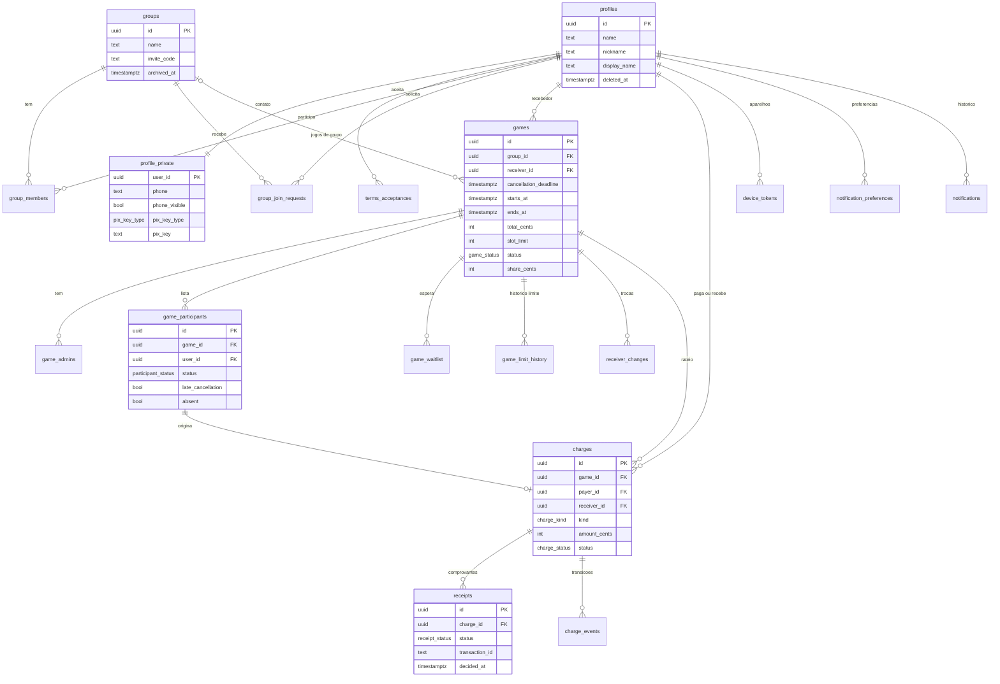

# Modelo de Dados
 
> Base: `requisitos.md`, `regras-negocio.md` e `stacks.md`, já com as decisões de 06/11/2026 (exclusão de grupo, status Isento, retenção após a decisão, cobrança por usuário etc.). As poucas escolhas puramente técnicas estão na seção 9.
 
## 1. Convenções
 
- **Banco:** Postgres do Supabase, schema `public`. Nomes de tabelas, colunas e enums em inglês e `snake_case`, seguindo os nomes já usados no `stacks.md` (`device_tokens`, `notifications` etc.).
- **Chaves:** `uuid` com `gen_random_uuid()`. Tabelas de junção usam chave composta.
- **Tempo:** todo instante é `timestamptz`, gravado em UTC e exibido em `America/Fortaleza` (RN01). Instantes de regra (entrada, cancelamento, conclusão) vêm de `now()` no servidor, nunca do aparelho (RN02).
- **Dinheiro:** `integer` em centavos, colunas com sufixo `_cents`. Nenhum cálculo em ponto flutuante (RN04).
- **Auditoria mínima:** `created_at` (padrão `now()`) nas tabelas que a seção 4 lista com essa coluna; `updated_at` mantido por *trigger* onde há edição. As tabelas cujo instante de criação já tem nome próprio (`joined_at`, `added_at`, `accepted_at`, `effective_from`, `sent_at`) não repetem `created_at`, e a `notification_preferences` não guarda instante (ADR 0016).
- **Sem exclusão física de histórico:** jogos, presenças, valores e comprovantes mudam de status; contas são anonimizadas (RF13) e grupos são arquivados (RF103).
- **Escrita controlada:** tabelas com regra de negócio (grupos, jogos, listas, valores, comprovantes) **não aceitam escrita direta do app**. As mudanças passam por funções `security definer` ou Edge Functions (seção 6). O app escreve direto apenas em perfil, preferências, tokens e na leitura de notificações.
- **RLS ativado em todas as tabelas** (seção 8).
## 2. Diagrama (ERD)
 

 
## 3. Enums
 
| Enum | Valores | Rótulo no app | Origem |
|------|---------|---------------|--------|
| `pix_key_type` | `cpf`, `cnpj`, `email`, `phone`, `random` | CPF, CNPJ, E-mail, Telefone, Aleatória | RF11 |
| `legal_document` | `terms_of_use`, `privacy_policy` | Termos de Uso, Política de Privacidade | RF105 |
| `group_role` | `admin`, `member` | Admin, Membro | RN10 |
| `join_request_status` | `pending`, `approved`, `rejected`, `cancelled` | Pendente, Aprovada, Recusada, Cancelada | RN12, RN17, RN104 |
| `game_status` | `open`, `confirmed`, `cancelled`, `completed` | Aberto, Confirmado, Cancelado, Concluído | RF37 |
| `game_completion_mode` | `manual`, `automatic` | Manual, Automática | RN44, RN45 |
| `participant_status` | `active`, `left_after_start`, `cancelled`, `removed` | Na lista, Saiu após o início, Cancelou, Removido | RN57, RN58 |
| `removal_reason` | `by_admin`, `left_group`, `account_deleted` | — | RN14, RN58, RN104 |
| `absence_source` | `left_after_start`, `marked_by_admin` | — | RN63 |
| `charge_kind` | `share`, `absence_penalty`, `late_cancellation_penalty` | Parte do jogo, Multa por falta, Multa por cancelamento | RN72 |
| `charge_status` | `pending`, `under_review`, `paid`, `waived` | Pendente, Em análise, Pago, Isento | RF72 |
| `charge_waive_reason` | `manual_waiver`, `receiver_change` | Isentado pelo admin, Anulado na troca de recebedor | RN93, RN94 |
| `payment_method` | `receipt`, `manual` | Comprovante, Marcado pelo recebedor | RN80, RN84 |
| `receipt_status` | `under_review`, `approved`, `rejected` | Em análise, Aprovado, Recusado | RN90 |
| `receipt_rejection_reason` | `duplicate_transaction`, `receiver_rejected` | ID de transação já usado, Recusado pelo recebedor | RN83, RN89 |
| `device_platform` | `android`, `ios` | — | stacks 5 |
| `notification_type` | ver abaixo | — | RF89 a RF97, RF104 |
 
**`notification_type`:**
 
| Valor | Evento | RF |
|-------|--------|----|
| `group_join_requested` | Nova solicitação de entrada (para admins do grupo) | RF89 |
| `group_join_decided` | Solicitação aprovada ou recusada | RF89 |
| `removed_from_group` | Membro removido ou grupo excluído | RF104 |
| `waitlist_slot_opened` | Vaga liberada ou limite aumentado | RF90 |
| `game_confirmed`, `game_cancelled`, `game_completed`, `game_updated` | Mudanças do jogo | RF91 |
| `removed_from_game` | Participante removido pelo admin | RF104 |
| `reminder_cancellation_deadline`, `reminder_game_start` | Lembretes de 2 horas | RF92, RF93 |
| `reminder_complete_game` | Aviso aos admins no horário de fim | RF94 |
| `charge_created` | Novo valor a pagar, inclusive multa | RF95 |
| `penalty_waived` | Multa isentada, automática ou manualmente | RF104 |
| `charge_reminder` | Cobrança das 9h e 20h (uma por usuário) | RF96 |
| `receipt_needs_review` | Comprovante enviado para análise (para o recebedor) | RF97 |
| `payment_received` | Valor Pago por comprovante aprovado automaticamente (para o recebedor) | RF104 |
| `charge_paid`, `charge_back_to_pending` | Mudança do valor a pagar (para o pagador) | RF97 |
| `receiver_changed` | Troca de recebedor | RF97 |
 
## 4. Tabelas
 
### 4.1 Conta
 
#### `profiles`
Dados exibidos a quem compartilha contexto (RN107). Criado por *trigger* em `auth.users` **quando o e-mail fica confirmado**, junto com a linha de `profile_private`: na confirmação do código (cadastro por e-mail, ADR 0017) ou no próprio cadastro (Google, que já chega confirmado). Um cadastro nunca confirmado não deixa perfil. Assim, quando o Supabase vincula o Google a um cadastro pendente com o mesmo e-mail (RF108), o perfil já nasce com os dados do Google, e não com o nome de quem digitou o e-mail errado.
O `name` vem dos metadados: `name` e, sem ele, `full_name`, sem espaço nas pontas e cortado em 80 caracteres. Sem nenhum dos dois, vem do início do e-mail (antes do `@`), e a pessoa corrige no perfil. Decisões de 09/11/2026, cenários B15 a B23 do `testes-referencia.md`.
 
| Coluna | Tipo | Regras |
|--------|------|--------|
| `id` | uuid | PK, FK `auth.users(id)` **on delete restrict** (a conta é anonimizada, não apagada) |
| `name` | text | not null, 1 a 80 caracteres após `trim` |
| `nickname` | text | null, 1 a 30 caracteres |
| `display_name` | text | gerada: `coalesce(nickname, name)` (RN100) |
| `photo_path` | text | null, caminho no bucket `avatars` |
| `deleted_at` | timestamptz | null; preenchida na anonimização (RN104) |
| `created_at`, `updated_at` | timestamptz | |
 
#### `profile_private`
Dados com visibilidade própria (RN101, RN102). Ficam fora de `profiles` porque o RLS filtra linhas, não colunas. Só o dono lê a tabela; os demais acessam pela função `get_profile_contact` (seção 6).
 
| Coluna | Tipo | Regras |
|--------|------|--------|
| `user_id` | uuid | PK, FK `profiles(id)` |
| `phone` | text | null, formato E.164 (`^\+[1-9][0-9]{7,14}$`). O app só aceita números do Brasil: mostra `+55` fixo e a pessoa digita DDD e número, com 10 ou 11 dígitos (decisão de 12/11/2026) |
| `phone_visible` | boolean | not null, padrão `false` (RN101) |
| `pix_key_type` | pix_key_type | null |
| `pix_key` | text | null, normalizada (CPF só dígitos, CNPJ sem pontuação e em maiúsculas, e-mail minúsculo, telefone E.164, aleatória em minúsculas) |
| `updated_at` | timestamptz | |
 
Constraints: `(pix_key_type is null) = (pix_key is null)`; formato de `pix_key` validado por `pix_key_type`. **CPF e CNPJ também têm os dígitos verificadores conferidos** (decisão de 12/11/2026), pelas funções `private.is_valid_cpf(text)` e `private.is_valid_cnpj(text)`, `immutable`, usadas na constraint e repetidas no app para o aviso no campo. Sequências de um dígito só (`00000000000`, `11111111111`...) são recusadas, embora passem na conta. **O CNPJ segue o formato alfanumérico da Receita Federal** (decisão de 13/11/2026): 14 caracteres, os 12 primeiros letras maiúsculas (`A` a `Z`) ou números e os 2 últimos dígitos verificadores numéricos, calculados em módulo 11 com cada caractere valendo o código ASCII menos 48 (os números valem eles mesmos, `A` vale 17 e `Z` vale 42). O CNPJ só com números é o caso particular da mesma conta e continua válido. A chave de telefone segue a mesma regra do campo `phone` no app (só Brasil).
*Trigger* da RN105: rejeita `pix_key = null` se o usuário for `receiver_id` de um jogo `open`/`confirmed` ou de um `charge` `pending`/`under_review`. A troca de chave é livre.
 
#### `terms_acceptances`
 
| Coluna | Tipo | Regras |
|--------|------|--------|
| `id` | uuid | PK |
| `user_id` | uuid | FK `profiles(id)` |
| `document` | legal_document | not null |
| `version` | text | not null |
| `accepted_at` | timestamptz | not null, padrão `now()` |
 
Único: `(user_id, document, version)`. A **versão vigente** de cada documento vem da função `public.current_terms_versions()` (seção 6), trocada por migração quando um texto muda (decisão de 12/11/2026). O app compara o aceite com ela para pedir novo aceite (RF105), e a política de inserção só aceita a versão vigente (`rls-matriz.md`, fatia 2). O `accepted_at` vem sempre do padrão `now()`: o app não tem privilégio na coluna.
 
### 4.2 Grupos
 
#### `groups`
 
| Coluna | Tipo | Regras |
|--------|------|--------|
| `id` | uuid | PK |
| `name` | text | not null, 1 a 60 caracteres |
| `photo_path` | text | null |
| `invite_code` | text | null (invalidado ou grupo arquivado), único; 12 caracteres base62 aleatórios (RN11) |
| `invite_code_updated_at` | timestamptz | null |
| `created_by` | uuid | FK `profiles(id)` |
| `archived_at` | timestamptz | null; preenchida na exclusão do grupo (RN17) |
| `archived_by` | uuid | null, FK `profiles(id)` |
| `created_at`, `updated_at` | timestamptz | |
 
Constraint: `archived_at is not null` ⇒ `invite_code is null`.
Índice: `(archived_at)` parcial `where archived_at is null` para a lista de grupos ativos.
 
#### `group_members`
 
| Coluna | Tipo | Regras |
|--------|------|--------|
| `group_id` | uuid | FK `groups(id)` |
| `user_id` | uuid | FK `profiles(id)` |
| `role` | group_role | not null, padrão `member` |
| `joined_at` | timestamptz | not null |
 
PK `(group_id, user_id)`. Índice `(user_id)`.
Invariante RN13 (ao menos um admin enquanto o grupo não estiver arquivado): *constraint trigger* adiável que rejeita a transação se um grupo ativo ficar sem `admin`.
 
#### `group_join_requests`
 
| Coluna | Tipo | Regras |
|--------|------|--------|
| `id` | uuid | PK |
| `group_id` | uuid | FK `groups(id)` |
| `user_id` | uuid | FK `profiles(id)` |
| `status` | join_request_status | not null, padrão `pending` |
| `created_at` | timestamptz | |
| `decided_at` | timestamptz | null |
| `decided_by` | uuid | null, FK `profiles(id)` (null em cancelamento automático) |
 
Constraint: `(status = 'pending') = (decided_at is null)`.
Índices: único `(group_id, user_id) where status = 'pending'` (RN12); `(group_id) where status = 'pending'` para a tela do admin (RF17).
 
### 4.3 Jogos
 
#### `games`
 
| Coluna | Tipo | Regras |
|--------|------|--------|
| `id` | uuid | PK |
| `group_id` | uuid | null = jogo avulso; FK `groups(id)` |
| `created_by` | uuid | FK `profiles(id)` |
| `location_name` | text | not null, 1 a 120 caracteres (RF28) |
| `maps_url` | text | null, deve começar com `https://` |
| `cancellation_deadline` | timestamptz | not null |
| `starts_at` | timestamptz | not null |
| `ends_at` | timestamptz | not null |
| `total_cents` | integer | not null, `> 0` (RN05) |
| `slot_limit` | integer | not null, `>= 1` (RN06); congelado a partir do início (RN34) |
| `status` | game_status | not null, padrão `open` |
| `receiver_id` | uuid | not null, FK `profiles(id)` (RN28) |
| `invite_code` | text | not null, único (RN55) |
| `share_cents` | integer | null; parte por vaga, gravada na conclusão (RN71) |
| `completed_at` | timestamptz | null |
| `completion_mode` | game_completion_mode | null |
| `completed_by` | uuid | null (conclusão automática) |
| `cancelled_at` | timestamptz | null |
| `cancelled_by` | uuid | null |
| `created_at`, `updated_at` | timestamptz | |
 
Constraints:
- `cancellation_deadline <= starts_at and starts_at < ends_at` (RN23). "Início no futuro" é validado na função de criação, pois depende de `now()`.
- `(status = 'completed') = (completed_at is not null and share_cents is not null and completion_mode is not null)`.
- `(status = 'cancelled') = (cancelled_at is not null)`.
Índices:
- `(group_id, starts_at)`: jogos do grupo (RF44).
- `(ends_at) where status in ('open','confirmed')`: conclusão automática e aviso aos admins (RF42, RF94).
- `(cancellation_deadline) where status in ('open','confirmed')` e `(starts_at) where status in ('open','confirmed')`: lembretes (RF92, RF93).
- `(receiver_id)`.
#### `game_limit_history`
Registra cada valor do limite de vagas, para calcular o `L` da RN62 (menor limite vigente entre o prazo e o início). Preenchida por *trigger* em `insert` e em `update of slot_limit` de `games`.
 
| Coluna | Tipo | Regras |
|--------|------|--------|
| `id` | uuid | PK |
| `game_id` | uuid | FK `games(id)` |
| `slot_limit` | integer | not null, `>= 1` |
| `effective_from` | timestamptz | not null, padrão `now()` |
 
Índice `(game_id, effective_from)`.
 
#### `game_admins`
 
| Coluna | Tipo | Regras |
|--------|------|--------|
| `game_id` | uuid | FK `games(id)` |
| `user_id` | uuid | FK `profiles(id)` |
| `added_by` | uuid | null (criador) |
| `added_at` | timestamptz | |
 
PK `(game_id, user_id)`. Índice `(user_id)`.
Invariantes: ao menos um admin por jogo (RN25, *constraint trigger*); quem é adicionado precisa estar na lista com `status = 'active'` (RN27). Sair da lista depois não remove o papel (RN26); sair do grupo remove (RN14).
 
#### `game_participants`
Cada linha é **uma passagem** do usuário pela lista de presença. Quem cancela e volta ganha uma linha nova (RN56), e a linha antiga fica com o cancelamento anulado.
 
| Coluna | Tipo | Regras |
|--------|------|--------|
| `id` | uuid | PK |
| `game_id` | uuid | FK `games(id)` |
| `user_id` | uuid | FK `profiles(id)` |
| `joined_at` | timestamptz | not null, `now()` do servidor; define a ordem (RN52) |
| `status` | participant_status | not null, padrão `active` |
| `left_at` | timestamptz | null; instante do cancelamento, saída ou remoção |
| `removal_reason` | removal_reason | null |
| `late_cancellation` | boolean | null; fixado no cancelamento: `left_at > cancellation_deadline` (RN35, RN61) |
| `cancellation_voided_at` | timestamptz | null; preenchido quando a pessoa volta antes do início (RN56) |
| `late_cancellation_exempt` | boolean | null; resultado da isenção automática, gravado na conclusão (RN62) |
| `absent` | boolean | not null, padrão `false` |
| `absence_source` | absence_source | null |
 
Constraints:
- `(status = 'active') = (left_at is null)`.
- `(status = 'cancelled') = (late_cancellation is not null)`.
- `(status = 'removed') = (removal_reason is not null)`.
- `absent = (absence_source is not null)`.
- `cancellation_voided_at` só com `status = 'cancelled'`.
**Vaga ocupada** = linha com `status in ('active','left_after_start')` (a saída após o início não libera a vaga, RN57).
 
Índices:
- Único `(game_id, user_id) where status in ('active','left_after_start')`: uma vaga por pessoa.
- `(game_id, joined_at)`: lista ordenada e texto do WhatsApp (RF100).
- `(user_id, game_id)`: "meus jogos" (RF44) e visibilidade de perfil (RN107).
- `(game_id, left_at) where status = 'cancelled' and late_cancellation and cancellation_voided_at is null`: candidatos a multa (RN62).
#### `game_waitlist`
 
| Coluna | Tipo | Regras |
|--------|------|--------|
| `game_id` | uuid | FK `games(id)` |
| `user_id` | uuid | FK `profiles(id)` |
| `joined_at` | timestamptz | not null |
| `left_at` | timestamptz | null; saída da espera ou entrada na lista |
 
PK `(game_id, user_id)`. Índice `(user_id)`.
A linha é mantida com `left_at` preenchido (em vez de apagada) porque passar pela lista de espera também conta como "compartilhar contexto" (RN107). Voltar à espera limpa `left_at`. O encerramento no início é derivado (`now() >= starts_at`): ninguém entra e ninguém é notificado.
 
#### `receiver_changes`
Histórico das trocas de recebedor (RN30, RN31, RN115).
 
| Coluna | Tipo | Regras |
|--------|------|--------|
| `id` | uuid | PK |
| `game_id` | uuid | FK `games(id)` |
| `old_receiver_id` | uuid | FK `profiles(id)` |
| `new_receiver_id` | uuid | FK `profiles(id)`, diferente do antigo |
| `changed_by` | uuid | FK `profiles(id)` |
| `after_completion` | boolean | not null |
| `changed_at` | timestamptz | |
 
Índice `(game_id, changed_at)`.
 
### 4.4 Rateio e pagamentos
 
#### `charges` (valor a pagar)
 
| Coluna | Tipo | Regras |
|--------|------|--------|
| `id` | uuid | PK |
| `game_id` | uuid | FK `games(id)` |
| `participant_id` | uuid | FK `game_participants(id)`; a passagem que originou o valor |
| `payer_id` | uuid | FK `profiles(id)` |
| `receiver_id` | uuid | FK `profiles(id)`; recebedor a quem o valor é devido (RN32) |
| `kind` | charge_kind | not null |
| `amount_cents` | integer | not null, `> 0` |
| `status` | charge_status | not null, padrão `pending` |
| `auto_reads_used` | smallint | not null, padrão 0, entre 0 e 3 (RN86) |
| `paid_at` | timestamptz | null |
| `paid_via` | payment_method | null |
| `waived_at` | timestamptz | null |
| `waive_reason` | charge_waive_reason | null |
| `waived_by` | uuid | null |
| `created_at`, `updated_at` | timestamptz | |
 
Constraints:
- `payer_id <> receiver_id` (RF71).
- `(status = 'paid') = (paid_at is not null and paid_via is not null)`.
- `(status = 'waived') = (waived_at is not null and waive_reason is not null)`.
- `not (kind = 'share' and waive_reason = 'manual_waiver')`: só multa pode ser isentada pelo admin (RN66).
Índices:
- Único `(game_id, payer_id) where status <> 'waived'`: no máximo um valor ativo por pessoa por jogo.
- `(payer_id, status)`: total que devo e cobrança diária (RF75, RF96).
- `(receiver_id, status)`: total a receber (RF76) e bloqueio da RN105.
- `(game_id)`: rateio do jogo (RF73, RF74).
#### `charge_events`
Toda transição de status de um valor a pagar, com autor e momento (exigido pelas RN85 e RN93, e útil para suporte).
 
| Coluna | Tipo | Regras |
|--------|------|--------|
| `id` | uuid | PK |
| `charge_id` | uuid | FK `charges(id)` |
| `from_status` | charge_status | null (criação) |
| `to_status` | charge_status | not null |
| `actor_id` | uuid | null = sistema |
| `receipt_id` | uuid | null, FK `receipts(id)` |
| `note` | text | null |
| `created_at` | timestamptz | |
 
Índice `(charge_id, created_at)`.
 
#### `receipts` (comprovantes)
A linha é criada pela Edge Function `process-receipt` ao fim da leitura, já com o status final da etapa automática. Durante a leitura, o bloqueio de novo envio é feito pelo app (RN86); no servidor, a função bloqueia a linha do `charge` (`for update`) e confere que ele continua `pending` antes de gravar.
 
| Coluna | Tipo | Regras |
|--------|------|--------|
| `id` | uuid | PK |
| `charge_id` | uuid | FK `charges(id)` |
| `payer_id` | uuid | FK `profiles(id)` |
| `receiver_id` | uuid | FK `profiles(id)`; recebedor do valor no envio, define quem vê o arquivo (RN87) |
| `storage_path` | text | null após a exclusão do arquivo |
| `mime_type` | text | `image/jpeg`, `image/png`, `image/webp`, `image/heic` ou `application/pdf` (RN87) |
| `size_bytes` | integer | entre 1 e 10.485.760 (10 MB, RN87) |
| `status` | receipt_status | not null |
| `auto_read` | boolean | not null; `true` se contou como leitura automática (RN86) |
| `extracted_amount_cents` | integer | null |
| `extracted_paid_at` | timestamptz | null; minuto lido no comprovante, interpretado em `America/Sao_Paulo` (RN88c) |
| `extracted_recipient_name` | text | null |
| `extracted_recipient_key` | text | null |
| `transaction_id` | text | null, normalizado (`trim`, maiúsculas) |
| `extraction` | jsonb | null; resposta bruta do modelo |
| `validation` | jsonb | null; resultado de cada condição da RN88 |
| `rejection_reason` | receipt_rejection_reason | null |
| `receiver_note` | text | null |
| `decided_by` | uuid | null (decisão automática) |
| `decided_at` | timestamptz | null; início do prazo de retenção (RN91) |
| `file_deleted_at` | timestamptz | null |
| `created_at` | timestamptz | |
 
Constraints:
- `(status = 'under_review') = (decided_at is null)`: aprovado e recusado sempre têm decisão.
- `(status = 'rejected') = (rejection_reason is not null)`.
- `rejection_reason = 'receiver_rejected'` ⇒ `receiver_note` não vazio (RN83).
- `file_deleted_at is not null` ⇒ `storage_path is null`.
Índices:
- Único `(transaction_id) where status in ('under_review','approved') and transaction_id is not null`: ID repetido (RN89).
- Único `(charge_id) where status = 'under_review'`: um comprovante em análise por valor.
- `(charge_id, created_at)`: histórico do participante (RF86).
- `(receiver_id, status)`: fila de análise do recebedor (RF83).
- `(decided_at) where storage_path is not null`: *job* de retenção, que apaga quando `decided_at < now() - interval '30 days'` (RN91, RN92).
### 4.5 Notificações
 
#### `device_tokens`
 
| Coluna | Tipo | Regras |
|--------|------|--------|
| `id` | uuid | PK |
| `user_id` | uuid | FK `profiles(id)` |
| `token` | text | not null, único |
| `platform` | device_platform | not null |
| `created_at`, `updated_at` | timestamptz | |
 
Índice `(user_id)`. Apagado no logout (RF07) e quando o FCM invalida o token.
 
#### `notification_preferences`
 
| Coluna | Tipo | Regras |
|--------|------|--------|
| `user_id` | uuid | FK `profiles(id)` |
| `type` | notification_type | |
| `enabled` | boolean | not null |
 
PK `(user_id, type)`. Sem linha = ativado (RF98).
 
#### `notifications` (sino)
 
| Coluna | Tipo | Regras |
|--------|------|--------|
| `id` | uuid | PK |
| `user_id` | uuid | FK `profiles(id)` |
| `type` | notification_type | not null |
| `title` | text | not null |
| `body` | text | not null |
| `data` | jsonb | not null, padrão `{}`; IDs e rota de abertura |
| `read_at` | timestamptz | null |
| `push_sent_at` | timestamptz | null (preferência desativada ou falha) |
| `created_at` | timestamptz | |
 
Índices: `(user_id, created_at desc)`; `(user_id) where read_at is null` (contador do sino).
 
#### `scheduled_notifications_log`
Torna as tarefas agendadas idempotentes (RN111).
 
| Coluna | Tipo | Regras |
|--------|------|--------|
| `id` | uuid | PK |
| `type` | notification_type | not null |
| `user_id` | uuid | FK `profiles(id)` |
| `game_id` | uuid | null (cobrança diária não é por jogo) |
| `scheduled_for` | timestamptz | not null; horário de referência: prazo, início ou fim do jogo, ou o horário de 9h/20h da cobrança |
| `sent_at` | timestamptz | |
 
Único `nulls not distinct (type, user_id, game_id, scheduled_for)`. Como o horário de referência faz parte da chave, um jogo remarcado gera um lembrete novo (RN111), e a cobrança diária sai uma vez por usuário e horário (RN113).
 
### 4.6 Auditoria
 
#### `audit_log`
 
| Coluna | Tipo | Regras |
|--------|------|--------|
| `id` | bigint | PK, *identity* |
| `event` | text | not null (`account_deleted`, `group_archived`, `game_completed`, `receiver_changed` etc.) |
| `actor_id` | uuid | null = sistema |
| `entity_type` | text | not null |
| `entity_id` | uuid | not null |
| `data` | jsonb | sem dados pessoais (stacks 13.2) |
| `created_at` | timestamptz | |
 
Índice `(entity_type, entity_id)`.
 
## 5. Valores derivados
 
| Valor | Cálculo |
|-------|---------|
| Vagas ocupadas | `count(*)` em `game_participants` com `status in ('active','left_after_start')` |
| Jogo em andamento | `starts_at <= now()` e `status in ('open','confirmed')` |
| Lista travada | `now() >= ends_at` e status não final: ninguém sai (RN57) |
| Estimativa por pessoa | `ceil(total_cents / slot_limit)`, só exibição (RN24) |
| Parte por vaga | `(total_cents + slot_limit - 1) / slot_limit`, em inteiros (RN71) |
| `L` da RN62 | menor `slot_limit` entre o vigente em `cancellation_deadline` e as linhas de `game_limit_history` com `effective_from` entre o prazo e o início |
| Vagas cobertas | ocupadas no início + multas de cancelamento mantidas |
| Valor por conta do recebedor | `total_cents - sum(amount_cents)` dos valores não `waived` (RN74) |
| Compartilhar contexto (A, B) | A e B membros do mesmo grupo não arquivado, ou ambos com linha (qualquer status) em `game_participants` ou `game_waitlist` do mesmo jogo (RN107) |
 
## 6. Funções do servidor
 
Toda escrita com regra passa por uma função do servidor (SQL `security definer` ou Edge Function). Cada uma valida o papel de quem chama, usa `now()` do servidor e roda em uma transação. A lista completa, com assinaturas e erros, está em `contratos-api.md`, que prevalece sobre esta tabela.
 
| Função | O que faz | Regras |
|--------|-----------|--------|
| `create_game` | Valida datas e chave Pix, cria o jogo, o admin, a primeira passagem na lista e o histórico de limite; status `confirmed` se o limite for 1 | RN20 a RN23, RN40 |
| `join_game` | `select ... for update` no jogo, valida acesso, status e `now() < starts_at`, conta as vagas, insere, fecha a passagem na espera, anula cancelamento anterior e recalcula o status | RN03, RN50 a RN54, RN56 |
| `leave_game` | Antes do início: `cancelled` com `late_cancellation`. Entre o início e o fim: `left_after_start` com falta. Após o fim: recusa. Bloqueia o recebedor | RN29, RN57, RN60, RN61 |
| `remove_participant` | Só até o início, sem multa, libera a vaga e notifica | RN58, RF104 |
| `set_slot_limit` | Aumento ou redução antes do início, nunca abaixo das vagas ocupadas; recalcula status e avisa a espera | RN41, RN42, RN53, RN59 |
| `join_waitlist` / `leave_waitlist` | Entrada só com jogo `confirmed` e antes do início | RN51, RN54 |
| `cancel_game` | Até a conclusão; notifica lista e espera | RN43, RN114 |
| `complete_game` | Conclusão manual e automática (abaixo) | RN44 a RN49, RN62, RN70 a RN75 |
| `change_receiver` | Antes ou depois da conclusão, com as regras da RN31 | RN28 a RN31, RN94, RN115 |
| `waive_penalty` | Isenção manual de multa `pending` (`waived`, `manual_waiver`); notifica | RN66, RN93 |
| `mark_charge_paid` / `revert_charge` | Pagamento manual e reversão só do que foi manual | RN84, RN85 |
| `review_receipt` | Aprova (valor `paid`) ou recusa com observação (valor `pending`); grava `decided_at` | RN82, RN83, RN91 |
| `leave_group` / `remove_group_member` | Valida a RN16, retira das listas e da espera dos jogos do grupo não iniciados (sem multa), remove o papel de admin dos jogos do grupo `open`/`confirmed` e notifica o removido | RN14, RN16, RF104 |
| `archive_group` | Valida que não há jogo `open`/`confirmed`, remove membros, cancela solicitações pendentes, invalida o convite, grava `archived_at` e notifica os membros | RN17, RF103 |
| `delete_account` | Valida bloqueios, sai das listas futuras, cancela solicitações e anonimiza | RN103, RN104 |
| `get_profile_contact(user_id)` | Devolve telefone e chave Pix só quando a RN101, a RN102 e a RN107 permitem | RN101, RN102, RN107 |
| `current_terms_versions()` | Devolve a versão vigente dos Termos de Uso e da Política de Privacidade | RF105 |
 
**`complete_game(game_id, total_cents?, absent_user_ids?)`**
 
1. Bloqueia o jogo e valida: status não final; manual a partir de `ends_at`, por admin; automática a partir de `ends_at + 1h`.
2. `P` = passagens com vaga ocupada. Na manual, aplica as faltas informadas (o recebedor nunca é marcado, RF63) e permite desmarcar as faltas de saída após o início (RN47). Na automática, não muda as faltas (RN49).
3. Isenção automática: `ociosas = max(0, L - |P|)`, `mantidas = min(cancelamentos fora do prazo não anulados, ociosas)`. Mantém as multas dos últimos a cancelar (`left_at` mais recente), grava `late_cancellation_exempt` nos demais e cria a notificação `penalty_waived` para eles.
4. Na manual, aceita o novo valor total. O limite não muda (RN34, RN48).
5. Calcula a parte por vaga e cria os `charges` (`pending`, `receiver_id` = recebedor atual): `share` para cada presente, `absence_penalty` para cada faltoso e `late_cancellation_penalty` para cada multa mantida, sempre exceto o recebedor.
6. Grava `completed`, `share_cents`, `completed_at` e `completion_mode`, cria os `charge_events`, as notificações e o registro de auditoria.
## 7. Storage
 
| Bucket | Caminho | Limites | Acesso |
|--------|---------|---------|--------|
| `avatars` (privado) | `profiles/{user_id}/{uuid}.{ext}`, `groups/{group_id}/{uuid}.{ext}` | JPEG, PNG ou WebP; até 2 MB (RN106) | Escrita pelo dono do perfil ou admin do grupo; leitura por URL assinada para quem pode ver o perfil (RN107) ou é membro do grupo |
| `receipts` (privado) | `{charge_id}/{uuid}.{ext}` | Imagem ou PDF; até 10 MB (RN87) | Escrita pelo pagador, apenas para valor `pending`; leitura pelo pagador e pelo `receiver_id` do comprovante, por URL assinada de curta duração |
 
Arquivos de foto substituídos, de grupos arquivados e de contas anonimizadas são apagados do bucket. Arquivos enviados ao bucket `receipts` sem linha correspondente em `receipts` após 24 horas são apagados pelo *job* diário de retenção.
 
## 8. Resumo do RLS
 
| Tabela | Leitura | Escrita direta pelo app |
|--------|---------|-------------------------|
| `profiles` | O próprio e quem compartilha contexto com o dono (RN107) | Própria linha (`name`, `nickname`, `photo_path`) |
| `profile_private` | Apenas o dono (outros via `get_profile_contact`) | Própria linha, com a *trigger* da RN105 |
| `terms_acceptances` | Apenas o dono | Inserção da própria linha |
| `groups`, `group_members` | Membros do grupo | Não (funções) |
| `group_join_requests` | O solicitante e os admins do grupo | Não (funções) |
| `games`, `game_admins`, `game_participants`, `game_waitlist` | Membros do grupo do jogo, quem tem ou teve passagem na lista ou na espera, e admins do jogo; jogo avulso só os três últimos | Não (funções) |
| `game_limit_history`, `receiver_changes` | Admins do jogo | Não |
| `charges`, `charge_events` | O pagador vê os seus; o recebedor e os admins do jogo veem todos do jogo | Não (funções) |
| `receipts` | Pagador e `receiver_id` | Não (Edge Function `process-receipt` e funções) |
| `device_tokens`, `notification_preferences` | Próprio usuário | Próprio usuário |
| `notifications` | Próprio usuário | Só `read_at` |
| `scheduled_notifications_log`, `audit_log` | Ninguém pelo app | Não |
 
Funções auxiliares para as políticas: `is_group_member`, `is_group_admin`, `is_game_admin`, `can_view_game`, `shares_context(a, b)`. As políticas detalhadas, os privilégios e a fatia em que cada tabela é liberada estão em `rls-matriz.md`.
 
## 9. Escolhas técnicas deste modelo
 
Não alteram regra de negócio; podem ser revistas na implementação.
 
1. **Telefone e chave Pix em `profile_private`**, expostos a terceiros só pela função `get_profile_contact`, porque o RLS não esconde colunas.
2. **`auth.users` não é apagado** na exclusão de conta: é anonimizado e bloqueado, para preservar a chave estrangeira de `profiles`.
3. **Código de convite com 12 caracteres base62**, cerca de 71 bits de aleatoriedade.
4. **Lista de espera com `left_at`** em vez de exclusão da linha, para que a passagem pela espera conte como contexto compartilhado (RN107).
5. **Proteção contra envios simultâneos de comprovante no servidor** por bloqueio da linha do valor a pagar, sem criar um status de comprovante a mais (a regra de negócio só bloqueia no app, RN86).
