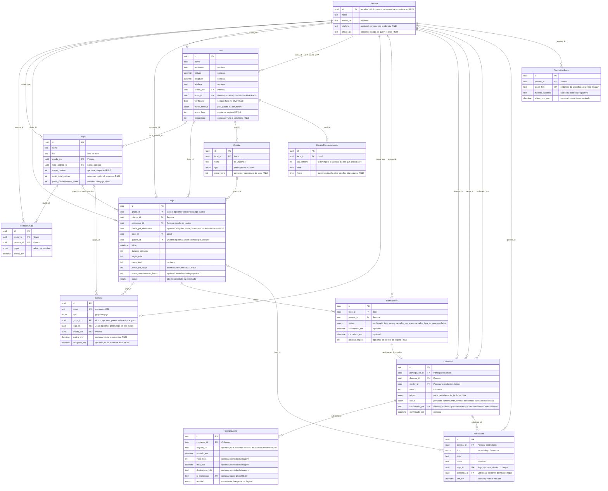

# Modelo de dados — VoleiIn

Representação completa das treze entidades do MVP, seus campos e seus relacionamentos. Este documento é descritivo: a referência normativa é o [PRD](prd.md), e as RNxx citadas apontam para a seção de regras de negócio de lá. Quando houver divergência, o PRD vence.

Convenções que valem para todas as entidades:

- Todo identificador é UUID.
- `Pessoa.id` espelha o id do usuário no serviço de autenticação, que é onde vive a credencial (RN21).
- Valores monetários são inteiros em centavos.
- `criado_em` e `atualizado_em` existem em todas as tabelas e estão omitidos do diagrama para não poluí-lo.
- Datas e horas são gravadas em UTC; a conversão para horário de Brasília acontece na borda (RNF08).
- Campo descrito como opcional aceita vazio; os demais são obrigatórios.

## Diagrama

## Chaves estrangeiras

Cada linha é uma referência real no banco. "Obrigatória" indica se a coluna aceita vazio.

| Origem | Coluna | Destino | Obrigatória | Observação |
| --- | --- | --- | --- | --- |
| Grupo | `criado_por` | Pessoa | sim | Quem criou é quem promove admins (RN13) |
| Grupo | `local_padrao_id` | Local | não | Apenas sugestão no formulário (RN12) |
| MembroGrupo | `grupo_id` | Grupo | sim | — |
| MembroGrupo | `pessoa_id` | Pessoa | sim | — |
| Convite | `grupo_id` | Grupo | não | Preenchido quando `tipo` é `grupo` |
| Convite | `jogo_id` | Jogo | não | Preenchido quando `tipo` é `jogo` |
| Convite | `criado_por` | Pessoa | sim | Revogação registrada em `revogado_em` (RF32, RN22) |
| Local | `criado_por` | Pessoa | sim | No MVP, sempre um admin de plataforma (RN18) |
| Local | `dono_id` | Pessoa | não | Sem uso no MVP; reservado ao perfil de dono |
| HorarioFuncionamento | `local_id` | Local | sim | — |
| Quadra | `local_id` | Local | sim | — |
| Jogo | `grupo_id` | Grupo | não | Vazio indica jogo avulso |
| Jogo | `criador_id` | Pessoa | sim | — |
| Jogo | `recebedor_id` | Pessoa | sim | Padrão é o criador (RN24) |
| Jogo | `local_id` | Local | sim | — |
| Jogo | `quadra_id` | Quadra | não | Obrigatória no modo `por_quadra` (RN15) |
| Participacao | `jogo_id` | Jogo | sim | — |
| Participacao | `pessoa_id` | Pessoa | sim | — |
| Cobranca | `participacao_id` | Participacao | sim | Único: no máximo uma cobrança por participação |
| Cobranca | `devedor_id` | Pessoa | sim | Igual ao `pessoa_id` da participação |
| Cobranca | `credor_id` | Pessoa | sim | Igual ao `recebedor_id` do jogo; migra junto (RN20) |
| Cobranca | `confirmado_por` | Pessoa | não | Preenchido na baixa e na isenção manual (RN07) |
| Comprovante | `cobranca_id` | Cobranca | sim | Uma cobrança aceita vários comprovantes |
| Notificacao | `pessoa_id` | Pessoa | sim | Destinatário |
| Notificacao | `jogo_id` | Jogo | não | Destino do toque |
| Notificacao | `cobranca_id` | Cobranca | não | Destino do toque |
| DispositivoPush | `pessoa_id` | Pessoa | sim | Um registro por aparelho |

## Restrições de unicidade

| Entidade | Chave | Por quê |
| --- | --- | --- |
| MembroGrupo | `grupo_id` + `pessoa_id` | Ninguém entra duas vezes no mesmo grupo |
| Participacao | `jogo_id` + `pessoa_id` | Ninguém ocupa duas vagas no mesmo jogo |
| Cobranca | `participacao_id` | Impede cobrar a mesma vaga duas vezes (RN01, RN25) |
| Convite | `token` | Compõe a URL do link |
| Comprovante | `id_transacao` | Único em toda a plataforma; bloqueia reenvio (RN10) |
| DispositivoPush | `token_fcm` | Um registro por aparelho |

As de Participacao e Cobranca sustentam a integridade do rateio: uma pessoa tem no máximo uma Participacao por jogo, e uma Participacao tem no máximo uma Cobranca. Juntas, garantem que uma vaga gera no máximo um débito.

A unicidade de `id_transacao` só vale quando o campo está preenchido: comprovante ilegível entra sem identificador e não participa da checagem (RN10).

## Catálogo de enums

| Entidade.campo | Valores |
| --- | --- |
| `MembroGrupo.papel` | `admin`, `membro` |
| `Convite.tipo` | `grupo`, `jogo` |
| `Local.modo_reserva` | `por_quadra`, `por_horario` |
| `Quadra.tipo` | `areia`, `ginasio`, `outro` |
| `Jogo.status` | `aberto`, `cancelado`, `encerrado` |
| `Participacao.status` | `confirmado`, `lista_espera`, `cancelou_no_prazo`, `cancelou_fora_do_prazo`, `faltou` |
| `Cobranca.origem` | `parte`, `cancelamento_tardio`, `falta` |
| `Cobranca.status` | `pendente`, `comprovante_enviado`, `confirmado`, `isenta`, `cancelada` |
| `Comprovante.resultado` | `consistente`, `divergente`, `ilegivel` |
| `Notificacao.tipo` | `vaga_liberada`, `jogo_editado`, `jogo_cancelado`, `regra_grupo_alterada`, `valor_recalculado`, `pagamento_liberado`, `cobranca_vencida`, `comprovante_recebido`, `comprovante_recusado`, `cobranca_confirmada`, `cobranca_isenta`, `falta_marcada`, `removido_do_grupo`, `promovido_a_admin` |

Cada valor de `Notificacao.tipo` tem uma regra de origem: `vaga_liberada` vem da RN08, `jogo_editado` e `valor_recalculado` da RN20 e RN01, `jogo_cancelado` da RN23, `regra_grupo_alterada` da RN11, `pagamento_liberado` e `cobranca_vencida` da RN07, `comprovante_recebido` da RN09, `comprovante_recusado` da RN10, `cobranca_confirmada` e `cobranca_isenta` dos RF22 e RF23, `falta_marcada` da RN04, `removido_do_grupo` da RN30 e `promovido_a_admin` da RN13.

## Invariantes que o diagrama não expressa

Regras de integridade que dependem de mais de uma tabela ou de condição entre campos. São o que uma chave estrangeira sozinha não garante.

| Invariante | Origem |
| --- | --- |
| `Cobranca.devedor_id` é igual ao `pessoa_id` da participação referenciada | Modelo |
| `Cobranca.credor_id` é igual ao `recebedor_id` do jogo e migra quando o recebedor é trocado | RN20 |
| `Jogo.preco_por_vaga` é `custo_total / vagas_total` arredondado para cima no centavo | RN01, RN16 |
| `Jogo.vagas_total` nunca desce abaixo do número de participações `confirmado`, e só é editável até o início do jogo | RN06, RN20 |
| `Jogo.custo_total` e `Jogo.recebedor_id` são editáveis até o encerramento, nunca depois | RN20 |
| `Jogo.quadra_id` é obrigatória quando o local é `por_quadra` e vazia quando é `por_horario` | RN15 |
| Dois jogos não ocupam a mesma quadra em horários sobrepostos | RN15 |
| No modo `por_horario`, jogos simultâneos no local não passam de `capacidade`; vazia significa sem limite | RN15 |
| `Jogo.inicio` mais `duracao_minutos` cabem inteiros dentro de uma faixa de HorarioFuncionamento do local | RN15 |
| Faixa de HorarioFuncionamento com `fecha` menor ou igual a `abre` atravessa a meia-noite e termina no dia seguinte | RN15 |
| `Jogo.prazo_cancelamento_horas` é obrigatório quando `grupo_id` é vazio | RN12 |
| `Jogo.chave_pix_recebedor` nunca nasce vazio; vem do perfil do recebedor ou é digitado na criação, e só esvazia na anonimização dele | RN24, RN27 |
| Convite preenche exatamente um entre `grupo_id` e `jogo_id`, conforme o `tipo` | RN22 |
| Convite com `revogado_em` preenchido não aplica mais o convite, mesmo dentro do prazo | RF32, RN22 |
| A exclusão de conta apaga o usuário no serviço de autenticação e preserva a linha de Pessoa, anonimizada; nenhuma coluna do perfil guarda credencial | RN21, RN27 |
| A troca de e-mail e a exclusão de conta apagam todos os DispositivoPush do titular, não os de um aparelho | RNF07, RN27 |
| `DispositivoPush.token_fcm` pertence a quem o registrou por último: registrar um token que já existe transfere a linha, em vez de criar outra | RN29 |
| `Participacao.posicao_espera` só é preenchido enquanto o status for `lista_espera` | RN08 |
| `Cobranca` só sai de `pendente` por ato de pessoa depois do jogo encerrado | RN07 |
| `Cobranca.confirmado_por` e `confirmado_em` são preenchidos juntos ou ficam ambos vazios: a baixa e a isenção manual registram o par, e a transição automática o deixa vazio | RN07 |
| `Comprovante` só é aceito depois do encerramento do jogo | RN07 |
| `Comprovante.resultado` é derivado no servidor a partir dos campos lidos e dos dados da cobrança, nunca informado pelo app | RN09 |
| O descarte do comprovante esvazia `arquivo_url` mas preserva a linha, porque `id_transacao` segue bloqueando reenvio | RN10, RN19 |
| `Participacao` passa a `faltou` junto com a mudança da cobrança para origem `falta` | RN04 |
| A cobrança vence e a janela de falta fecha 24 horas após o encerramento previsto, `inicio + duracao_minutos + 1h`, mesmo quando o jogo foi encerrado antes à mão | RN04, RN07, RN17 |
| `Local.verificado` é sempre falso no MVP | RN18 |
| Local, Quadra e HorarioFuncionamento são somente leitura para todo cliente autenticado; só a chave de serviço escreve | RN18 |
| Só o devedor e o credor da cobrança leem o `arquivo_url` do comprovante | RN19, RNF02 |

## Notas de leitura

O prazo de cancelamento sem multa não é armazenado em lugar nenhum: resulta de `Jogo.inicio` menos `prazo_cancelamento_horas` — do jogo quando preenchido, do grupo quando vazio. As regras do grupo são consultadas no grupo, não copiadas no jogo, o que faz uma alteração valer de imediato nos jogos abertos (RN11).

`Jogo.chave_pix_recebedor` é a exceção deliberada a esse princípio: ela é copiada, não consultada. O motivo é que o devedor precisa ver a mesma chave que existia quando confirmou, mesmo que o recebedor edite o perfil depois, e porque o criador pode informar a chave de um recebedor que ainda não a tem cadastrada (RN24). A cópia tem um preço: ela é dado bancário duplicado, e por isso a anonimização da RN27 precisa alcançá-la explicitamente. A duplicação de jogo (RN28) relê a chave do perfil em vez de copiar a do jogo antigo, pelo mesmo motivo.

A faixa de funcionamento que atravessa a meia-noite é a única convenção implícita do modelo. Ela existe porque jogo noturno é o caso comum do vôlei: cadastrar 20h às 2h como duas faixas bloquearia um jogo das 23h à 1h, que não caberia inteiro em nenhuma delas.

Os campos lidos do Comprovante — `valor_lido`, `data_lida`, `destinatario_lido` e `id_transacao` — chegam do reconhecimento de texto feito no próprio aparelho, antes do upload. Já `resultado` é calculado no servidor a partir deles: o app informa o que leu, nunca o veredito. É o que impede que um devedor declare o próprio comprovante consistente.

Notificacao e DispositivoPush pendem apenas de Pessoa e não participam do rateio. O aviso é sempre gravado, mesmo sem push autorizado ou com falha no envio: o sino é a fonte de verdade e o push é entrega oportunista (RN29).

`Local.dono_id` e `Local.verificado` existem sem uso, à espera do perfil de dono de local, que está fora do MVP (RN18).
