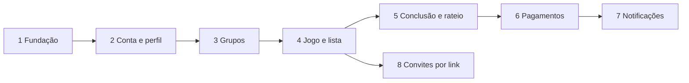

# Plano de Implementação em Fatias

> Decisões de 06/11/2026. Base: `requisitos.md`, `regras-negocio.md`, `modelo-dados.md`, `stacks.md` e `requisitos-nao-funcionais.md`.
> Este documento define a ordem e o escopo. As regras continuam nos documentos de origem: em caso de dúvida, eles prevalecem.

## 1. Como ler

- Cada fatia entrega algo que funciona de ponta a ponta, do banco à tela.
- Cada RF e cada RN pertence a **exatamente uma fatia**: aquela em que seu critério de pronto é cobrado. Uma fatia anterior pode preparar parte do caminho, e isso aparece em "Prepara" ou em "Fora de escopo".
- Antes de cada fatia, siga a lista da seção 8.4 do `plan-docs.md`.

| Fatia | Nome | RFs | RNs |
|-------|------|-----|-----|
| 1 | Fundação | 0 | 3 |
| 2 | Conta e perfil | 16 | 3 |
| 3 | Grupos | 12 | 6 |
| 4 | Jogo e lista de presença | 27 | 34 |
| 5 | Conclusão, multas e rateio | 25 | 27 |
| 6 | Pagamentos, comprovantes e exclusão de conta | 12 | 15 |
| 7 | Notificações e tarefas agendadas | 14 | 6 |
| 8 | Convites por link | 2 | 1 |
| | **Total** | **108** | **95** |

A fatia 8 só depende da 4. Ela está por último porque os fluxos principais funcionam sem ela, mas pode ser antecipada. Os jogos avulsos só recebem outros participantes depois dela.

## 2. Decisões do plano

Estas decisões organizam o trabalho e não mudam o comportamento do app.

1. **O banco inteiro nasce na fatia 1.** Todas as tabelas, enums e constraints do `modelo-dados.md` são criadas de uma vez, com RLS ativado e sem políticas, o que bloqueia o acesso por padrão. Cada fatia libera o acesso às suas tabelas e cria suas funções. Assim, regras que cruzam fatias, como a RN105 e a `shares_context`, já têm as tabelas de que precisam, e os testes podem inserir dados direto nelas.
2. **Toda função já registra suas notificações.** A fatia 1 cria uma função interna, `emit_notification`, que grava a linha em `notifications` com texto provisório. As fatias 3 a 6 a chamam em cada evento. A fatia 7 entrega o que o usuário percebe: textos finais, push, sino e preferências. Isso evita reabrir funções já testadas.
3. **O Spec Kit roda uma vez por fatia.** As fatias grandes podem virar mais de uma especificação, seguindo as etapas indicadas nelas. Cada `spec.md` cita os RFs e RNs em vez de copiar o texto.

**Mudanças em relação ao rascunho do `plan-docs.md`**, feitas para respeitar a coluna de dependências do `requisitos.md`:

| RF | Saiu de | Foi para | Motivo |
|----|---------|----------|--------|
| RF13 (excluir conta) | 2 | 6 | Os bloqueios da RN103 dependem de jogos e de valores a pagar |
| RF22, RF102 (saída do grupo com jogos) | 3 | 4 | Dependem da lista de presença, do recebedor e dos admins do jogo |
| RF101 (telefone visível) | 2 | 4 | Depende de RF19 e de RF46 |
| RF33 (trocar recebedor) | 4 | 5 | A troca após a conclusão (RN31) depende dos valores a pagar. Reunir toda a troca em uma fatia evita fazê-la duas vezes |
| RF40 a RF42 (conclusão) | 4 | 5 | O RF41 depende do RF58, e a conclusão gera o rateio |
| RF15, RF16 (convite de grupo) | 3 e 8 | 3 | O RF16 aceita "link ou código", e o código já permite que o grupo funcione |
| RF43, RF48 (convite de jogo) | 4 e 8 | 8 | Exigem o link |

**Exceções às dependências:** o RF44 e o RF50 citam o RF48, da fatia 8, e ficam na fatia 4. O RF48 é só mais um caminho de entrada: quem entrou pelo link aparece nos jogos (RF44) e sai da lista (RF50) da mesma forma, sem mudança de código.

## 3. Fatias

### Fatia 1. Fundação

**Objetivo:** ter o projeto rodando em todos os ambientes, com o banco completo e protegido.

- **RFs:** nenhum.
- **RNs:** RN01, RN02, RN04.
- **Banco:** todas as tabelas, enums, constraints e índices da seção 4 do `modelo-dados.md`; *triggers* de `profiles`, `updated_at`, `game_limit_history` e das invariantes de admin (RN13, RN25); `emit_notification`; buckets `avatars` e `receipts`.
- **Funções e serviços:** nenhuma função de regra. Repositório Git, CI (`stacks.md`, seção 10.2), Supabase local, limpeza e adaptação do projeto de produção (o `VoleiIn` do v0, `setup.md`, seção 9.3), Spec Kit.
- **Telas:** navegação base, tema inicial e um login técnico com usuário de teste.
- **Depende de:** nada.
- **Pronto quando:**
  - o CI roda `dart analyze`, `flutter test` e `supabase test db` em todo PR;
  - um teste falha se alguma tabela estiver sem RLS;
  - o app abre em emuladores com API 29 e com a versão alvo e faz login no Supabase local;
  - as migrações aplicam em um banco limpo e na produção, já limpa do v0;
  - o ensaio de migração com cópia da produção (`setup.md`, seção 9.2) roda de ponta a ponta, ainda com dados de teste.
- **Verificar também:** o que conta como "uso" para a pausa do plano grátis (`requisitos-nao-funcionais.md`, seção 8) e o teste do Spec Kit em um repositório descartável.
- **Fora de escopo:** cadastro real, telas de produto e políticas de acesso além do mínimo para o login técnico.

### Fatia 2. Conta e perfil

**Objetivo:** a pessoa cria a conta, entra, aceita os termos e cuida do próprio perfil.

- **RFs:** RF01 a RF12, RF105 a RF108.
- **RNs:** RN100, RN105, RN106.
- **Banco:** políticas de `profiles` (própria linha), `profile_private` e `terms_acceptances`; Storage `avatars` (própria foto); *trigger* da RN105; `current_terms_versions()`; dígitos verificadores de CPF e CNPJ na chave Pix (`rls-matriz.md` e `modelo-dados.md`, decisões de 12/11/2026).
- **Funções e serviços:** Supabase Auth com código de 6 dígitos por e-mail (ADR 0017), login com Google e Resend como SMTP.
- **Telas:** cadastro, login, recuperação de senha, aceite dos termos, perfil, troca de e-mail e de senha, chave Pix.
- **Depende de:** fatia 1.
- **Pronto quando:**
  - cadastro por e-mail com confirmação por código, login com Google e vinculação das duas formas de acesso (RF108) funcionam no Supabase local e na produção (ainda sem usuários reais);
  - o e-mail chega pelo Resend;
  - um novo aceite é pedido quando a versão dos termos muda;
  - o teste da RN105 recusa a remoção da chave Pix com jogo ou valor em aberto;
  - fotos fora do formato ou acima de 2 MB são recusadas no servidor (RN106).
- **Fora de escopo:** excluir conta (RF13, fatia 6), telefone visível para outros (RF101, fatia 4) e remoção do token de push no logout (fatia 7).

### Fatia 3. Grupos

**Objetivo:** a pessoa cria um grupo, convida por código e administra os membros.

- **RFs:** RF14 a RF21, RF23 a RF25, RF103.
- **RNs:** RN10, RN11, RN12, RN13, RN17, RN107.
- **Banco:** políticas de `groups`, `group_members`, `group_join_requests` e leitura de `profiles` por contexto; Storage de foto do grupo; `is_group_member`, `is_group_admin`, `shares_context`.
- **Funções:** `create_group`, `update_group`, `regenerate_group_invite`, `invalidate_group_invite`, `request_group_join`, `decide_join_request`, `set_group_role`, `leave_group`, `remove_group_member`, `archive_group` e a Edge Function `preview-invite` (grupos).
- **Telas:** meus grupos, criar e editar grupo, entrada por código, solicitações pendentes, integrantes.
- **Prepara:** eventos `group_join_requested`, `group_join_decided` e `removed_from_group`.
- **Depende de:** fatia 2.
- **Pronto quando:**
  - uma pessoa cria o grupo, outra solicita a entrada pelo código e um admin aprova;
  - o último admin não consegue sair nem ser rebaixado (RN13);
  - o código regenerado invalida o anterior (RN11);
  - um usuário sem contexto não vê perfil de outro (RN107, teste negativo);
  - a exclusão é recusada com jogo Aberto ou Confirmado, testada com dados inseridos direto (RN17).
- **Fora de escopo:** abrir o convite por link (fatia 8) e efeitos da saída sobre jogos (RF22, RF102, fatia 4).

### Fatia 4. Jogo e lista de presença

**Objetivo:** um membro cria um jogo, as pessoas entram e saem da lista e a disputa por vagas é justa.

- **RFs:** RF22, RF26 a RF32, RF34 a RF39, RF44 a RF47, RF49 a RF55, RF101, RF102.
- **RNs:** RN03, RN05, RN06, RN14, RN15, RN16, RN20 a RN29, RN33, RN34, RN35, RN40 a RN43, RN50 a RN54, RN56 a RN59, RN101, RN102.
- **Banco:** políticas de `games`, `game_admins`, `game_participants`, `game_waitlist` e `game_limit_history`; `is_game_admin`, `can_view_game`.
- **Funções:** `create_game`, `join_game` (membros do grupo), `leave_game`, `remove_participant`, `set_slot_limit`, `join_waitlist`, `leave_waitlist`, `cancel_game`, `update_game`, `add_game_admin`, `remove_game_admin`, `get_profile_contact` e a extensão de `leave_group` e `remove_group_member`.
- **Telas:** criar e editar jogo, meus jogos, detalhe do jogo, lista e espera, com atualização ao vivo (Realtime).
- **Etapas sugeridas:**
  - **A.** Criar, ver e editar o jogo, com entrada na lista.
  - **B.** Saídas, vagas, lista de espera e concorrência.
  - **C.** Admins, cancelamento do jogo, saída do grupo e telefone visível.
- **Prepara:** a saída grava `late_cancellation` (RN60, RN61, cobradas na fatia 5). Eventos de jogo e de lista.
- **Depende de:** fatia 3.
- **Pronto quando:**
  - dois usuários disputam a última vaga e só um fica com ela (RN53, teste de concorrência);
  - os limites de tempo funcionam no instante exato do início (RN03);
  - o status passa entre Aberto e Confirmado nas entradas, saídas e mudanças de limite;
  - cancelar e voltar anula o cancelamento (RN56);
  - quem sai do grupo é retirado dos jogos não iniciados, e a saída é bloqueada para recebedor ou único admin (RN14, RN16);
  - os participantes veem a chave Pix do recebedor desde a criação do jogo, e quem não está na lista não a vê (RN102, teste negativo);
  - a lista carrega em até 2 s (RNF04).
- **Fora de escopo:** conclusão, multas e rateio (fatia 5), troca de recebedor (RF33, fatia 5) e entrada pelo link (RF43, RF48, fatia 8). O recebedor fica impedido de sair, sem como indicar outro, até a fatia 5.

### Fatia 5. Conclusão, multas e rateio

**Objetivo:** o jogo é concluído e cada pessoa fica com o valor certo. É a fatia de maior risco.

- **RFs:** RF33, RF40 a RF42, RF56 a RF76.
- **RNs:** RN30, RN31, RN32, RN36, RN44 a RN49, RN60 a RN67, RN70 a RN76, RN93, RN94.
- **Banco:** políticas de `charges`, `charge_events` e `receiver_changes`; leitura de `audit_log` fica bloqueada ao app.
- **Funções:** `preview_complete_game`, `complete_game` (funções SQL), `change_receiver`, `waive_penalty`; `auto_complete_due_games`, agendada a cada 5 minutos.
- **Telas:** conclusão com faltas, aviso do valor por conta do recebedor, rateio, valores por jogo, total a pagar, total a receber, troca de recebedor, isenção de multa.
- **Etapas sugeridas:**
  - **A.** Conclusão manual e automática, rateio.
  - **B.** Faltas, multas e isenções.
  - **C.** Troca de recebedor e totais.
- **Prepara:** eventos `game_completed`, `charge_created`, `penalty_waived` e `receiver_changed`.
- **Depende de:** fatia 4.
- **Pronto quando:**
  - os exemplos das seções 7 e 8 do `regras-negocio.md` dão exatamente os valores escritos (RN62 e R$ 229,24);
  - os testes de referência de rateio, isenção automática e troca de recebedor passam, inclusive limite alterado entre o prazo e o início;
  - a conclusão manual e a automática usam a mesma função (RN46);
  - o recebedor nunca recebe multa nem valor a pagar;
  - cada pessoa vê só o próprio valor, e o recebedor e os admins veem o rateio completo (RN76).
- **Fora de escopo:** pagar e enviar comprovante (fatia 6) e avisos aos usuários (fatia 7).

### Fatia 6. Pagamentos, comprovantes e exclusão de conta

**Objetivo:** quem deve paga e comprova, quem recebe confere, e a conta pode ser excluída com segurança.

- **RFs:** RF13, RF77 a RF87.
- **RNs:** RN80 a RN92, RN103, RN104.
- **Banco:** políticas de `receipts`; Storage `receipts`.
- **Funções:** Edge Function `process-receipt`, `review_receipt`, `mark_charge_paid`, `revert_charge`, `delete_account`; Edge Function `storage-cleanup`, agendada uma vez por dia.
- **Telas:** pagar e copiar a chave Pix, enviar comprovante, meus comprovantes, análise do recebedor, excluir conta.
- **Antes de começar:** escrever `docs/comprovantes-ia.md` (`plan-docs.md`, seção 4.4), com o modelo da Claude API e o custo medido. Definir o mecanismo do alerta de gasto em US$ 4 (RNF10).
- **Prepara:** eventos `receipt_needs_review`, `payment_received`, `charge_paid` e `charge_back_to_pending`.
- **Depende de:** fatia 5.
- **Pronto quando:**
  - o conjunto fixo de comprovantes dá o resultado esperado em cada exemplo;
  - o mesmo ID de transação é recusado, inclusive em envios simultâneos, e volta a ficar livre após a recusa do outro comprovante (RN89);
  - a partir da 4ª tentativa, o envio vai para Em análise sem chamar a API (RN86);
  - o arquivo é apagado 30 dias após a decisão, e o registro continua guardado (RN91);
  - a leitura termina em até 30 s (RNF04);
  - a exclusão é recusada em cada caso da RN103, e a conta excluída fica anonimizada com o histórico mantido (RN104).
- **Fora de escopo:** push dos eventos de pagamento (fatia 7).

### Fatia 7. Notificações e tarefas agendadas

**Objetivo:** cada pessoa é avisada na hora certa e controla o que recebe.

- **RFs:** RF88 a RF100, RF104.
- **RNs:** RN110 a RN115.
- **Banco:** políticas de `notifications`, `device_tokens` e `notification_preferences`; `scheduled_notifications_log`.
- **Funções:** Edge Function `send-push`, versão final de `emit_notification`, `send_game_reminders` e `send_charge_reminders` agendadas (`stacks.md`, seção 7).
- **Telas:** sino, preferências, abertura da rota certa ao tocar na notificação, compartilhamento da lista em texto (RF100).
- **Antes de começar:** escrever os textos de todos os tipos de notificação (`plan-docs.md`, seção 4.3).
- **Depende de:** fatias 3 a 6.
- **Pronto quando:**
  - cada `notification_type` tem um teste, com texto e rota finais;
  - cada evento grava no histórico antes do push e respeita as preferências (RN110);
  - um lembrete não sai duas vezes, e um jogo remarcado gera um novo (RN111);
  - a cobrança das 9h e 20h de `America/Fortaleza` é uma por usuário e só soma valores Pendentes (RN113);
  - o token é apagado no logout e quando o FCM o invalida;
  - a lista compartilhada segue o formato do RF100.
- **Fora de escopo:** novos tipos de notificação.

### Fatia 8. Convites por link

**Objetivo:** um link enviado no WhatsApp abre o app no grupo ou no jogo certo.

- **RFs:** RF43, RF48.
- **RNs:** RN55.
- **Banco:** nenhuma tabela nova.
- **Funções e serviços:** `regenerate_game_invite`, extensão de `join_game` e `join_waitlist` para aceitar o código, `preview-invite` (jogos), página no Cloudflare Pages, `assetlinks.json`, `app_links`, rotas `/g/<codigo>` e `/j/<codigo>`.
- **Telas:** prévia e entrada por convite, retomada depois do login e página de fallback.
- **Complementa:** o link passa a ser um caminho para o RF15 e o RF16, já entregues por código na fatia 3.
- **Depende de:** fatia 4.
- **Pronto quando:**
  - o link abre o app direto, com o domínio verificado, num build instalado no emulador;
  - sem o app instalado, a página mostra o botão da Play e o código, e o aviso de Android apenas em outros aparelhos;
  - sem login, o app guarda o convite, conduz o login e retoma o fluxo;
  - um jogo avulso recebe participantes pelo link e chega até a conclusão;
  - o código regenerado invalida o anterior (RN55).
- **Fora de escopo:** preservar o convite durante a instalação (*deferred deep link*, `stacks.md`, seção 8).

## 4. Funções do servidor

As assinaturas, os erros e as permissões de todas as funções estão em `contratos-api.md`, que também inclui as funções que faltavam na seção 6 do `modelo-dados.md`.

## 5. Outros pontos para os próximos documentos

- **Ambientes:** desenvolvimento e homologação rodam no Supabase local, com o app no emulador. A produção é o único projeto remoto (ADR 0011, `setup.md`).
- **Tamanho das fatias:** o critério "cabe em poucas sessões" só pode ser confirmado na prática. Se a fatia 4 ou a 5 passar disso, cada etapa vira sua própria especificação no Spec Kit.
