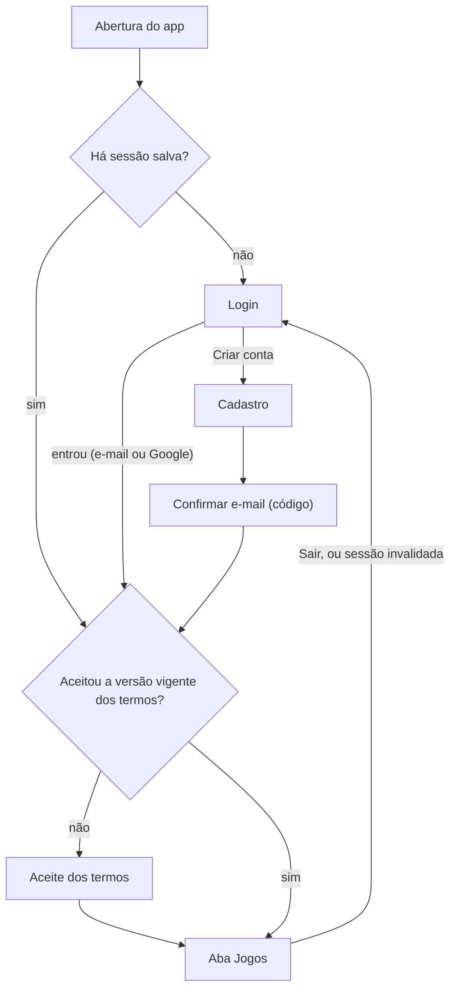

# Telas e Navegação

> Decisões de 09/11/2026. Base: `requisitos.md`, `plano-implementacao.md`, `arquitetura-app.md` (seção 9) e `design-system.md`.
> Este documento decide **quais telas existem, como se ligam e o que cada uma faz**. A aparência vem do `design-system.md` e os textos, do `docs/copy.md`.
> O mapa (seção 2) cobre o app inteiro. O detalhe de cada tela (seção 4 em diante) é escrito na fatia que a usa, para não envelhecer antes de ser lido (`plan-docs.md`, seção 8.2).

## 1. Como ler

- **Rota** é o caminho do `go_router`, em inglês. No código, a navegação usa o nome da rota (`arquitetura-app.md`, seção 9). O nome é o caminho em `camelCase`, sem os parâmetros (`/games/:gameId/edit` → `gameEdit`).
- **Onde fica:** a aba da barra inferior em que a tela abre, "fora das abas" (tela cheia, sem a barra) ou "sheet" (folha sobre a tela de origem).
- Uma tela marcada com duas fatias nasce na primeira e é completada na segunda.
- Telas novas ou renomeadas entram aqui antes de entrar no código.
- **Referência visual:** cada tela tem um PNG desenhado pelo responsável em `docs/ui/referencias/` antes de ser implementada. Este documento decide o conteúdo e o comportamento, e o PNG decide a aparência e a disposição (`docs/ui/referencias/README.md`).

## 2. Mapa de telas

### 2.1 Barra inferior

Quatro abas. Em todas, o sino fica na barra superior (`design-system.md`, 7.7) a partir da fatia 7.

| Ordem | Aba | Ícone | Rota | Conteúdo final |
|-------|-----|-------|------|----------------|
| 1 | **Jogos** | `sports_volleyball` | `/games` | Meus jogos, próximos e concluídos (RF44) |
| 2 | **Grupos** | `groups` | `/groups` | Meus grupos (RF25) |
| 3 | **Cobranças** | `payments` | `/charges` | Total a pagar e total a receber (RF75, RF76). Leva o contador vermelho quando há valor a pagar |
| 4 | **Perfil** | `person` | `/profile` | Dados da conta e configurações |

Depois do login, o app abre na aba Jogos.

### 2.2 Todas as telas

| Tela | Rota | Onde fica | Fatia | RFs |
|------|------|-----------|-------|-----|
| **Acesso** | | | | |
| Login | `/login` | Fora das abas | 1 e 2 | RF04 |
| Cadastro | `/signup` | Fora das abas | 2 | RF01, RF03, RF105 |
| Confirmar e-mail (código) | `/confirm-email` | Fora das abas | 2 | RF02 |
| Recuperar senha | `/forgot-password` | Fora das abas | 2 | RF06 |
| Aceite dos termos | `/terms` | Fora das abas | 2 | RF105 |
| Texto de um documento | `/terms/:document` | Fora das abas | 2 | RF105 |
| **Jogos** | | | | |
| Meus jogos | `/games` | Aba Jogos | 1 e 4 | RF44 |
| Criar jogo | `/games/new` | Fora das abas | 4 | RF26 a RF32 |
| Detalhe do jogo, com lista e espera | `/games/:gameId` | Aba Jogos | 4 | RF37, RF45 a RF55, RF65, RF101 |
| Editar jogo | `/games/:gameId/edit` | Fora das abas | 4 | RF36, RF52, RF53 |
| Admins do jogo | `/games/:gameId/admins` | Aba Jogos | 4 | RF34, RF35 |
| Concluir jogo (faltas, total, aviso do valor por conta do recebedor) | `/games/:gameId/complete` | Fora das abas | 5 | RF40, RF41, RF60 |
| Rateio do jogo | `/games/:gameId/split` | Aba Jogos | 5 | RF64, RF73, RF74 |
| Trocar recebedor | — | Sheet sobre o detalhe | 5 | RF33 |
| Convite do jogo (gerar e compartilhar o link) | — | Sheet sobre o detalhe | 8 | RF43 |
| Compartilhar a lista em texto | — | Ação do detalhe | 7 | RF100 |
| **Grupos** | | | | |
| Meus grupos | `/groups` | Aba Grupos | 1 e 3 | RF25 |
| Criar grupo | `/groups/new` | Fora das abas | 3 | RF14 |
| Entrar por código (com a prévia do grupo) | `/groups/join` | Fora das abas | 3 | RF16 |
| Detalhe do grupo, com os jogos do grupo | `/groups/:groupId` | Aba Grupos | 3 e 4 | RF44, RF103 |
| Editar grupo | `/groups/:groupId/edit` | Fora das abas | 3 | RF18 |
| Convite do grupo (código) | — | Sheet sobre o detalhe | 3 | RF15 |
| Integrantes | `/groups/:groupId/members` | Aba Grupos | 3 | RF19 a RF21, RF23, RF24, RF102 |
| Solicitações pendentes | `/groups/:groupId/requests` | Aba Grupos | 3 | RF17 |
| Perfil de outra pessoa | `/people/:userId` | Na aba de origem | 3 e 4 | RF19, RF101 |
| **Cobranças** | | | | |
| Totais a pagar e a receber | `/charges` | Aba Cobranças | 1, 5 e 6 | RF75, RF76 |
| Valor a pagar (chave Pix, copiar, comprovantes enviados) | `/charges/:chargeId` | Aba Cobranças | 6 | RF65, RF77, RF78, RF86 |
| Enviar comprovante | — | Sheet sobre o valor a pagar | 6 | RF78 a RF83 |
| Análise de comprovante | `/receipts/:receiptId` | Aba Cobranças | 6 | RF83 |
| Marcar como pago e reverter | — | Ações na lista do recebedor | 6 | RF84, RF85 |
| **Perfil** | | | | |
| Meu perfil | `/profile` | Aba Perfil | 1 e 2 | RF07, RF08 a RF12 |
| Editar perfil (nome, apelido, foto, telefone) | `/profile/edit` | Fora das abas | 2 | RF08 a RF10, RF12 |
| Chave Pix | `/profile/pix` | Fora das abas | 2 | RF11, RF12 |
| Trocar e-mail | `/profile/email` | Fora das abas | 2 | RF106 |
| Trocar senha | `/profile/password` | Fora das abas | 2 | RF107 |
| Preferências de notificação | `/profile/notifications` | Aba Perfil | 7 | RF98 |
| Excluir conta | `/profile/delete` | Fora das abas | 6 | RF13 |
| **Notificações e convites** | | | | |
| Sino (histórico) | `/notifications` | Fora das abas | 7 | RF99, RF104 |
| Convite de grupo por link | `/g/:code` | Fora das abas | 8 | RF16 |
| Convite de jogo por link | `/j/:code` | Fora das abas | 8 | RF48 |

**Sem tela própria:** RF05 (sessão mantida), RF22 (efeito da saída do grupo), RF38, RF42, RF56 a RF63, RF66 a RF72 e RF79 a RF82 são regras do servidor que aparecem nas telas acima. RF88 a RF97 são notificações (fatia 7). RF108 acontece dentro do login com Google (fatia 2).

## 3. Navegação

### 3.1 Abertura e redirecionamentos

- **Sem sessão** → `/login`, salvo nas rotas de acesso: `/signup`, `/confirm-email` e `/forgot-password`. Com sessão, quem abre uma rota de acesso vai para `/games`.
- **E-mail não confirmado não tem sessão.** Com o código (ADR 0017), o Supabase Auth só cria a sessão depois do `verifyOTP`. Por isso a `/confirm-email` não é um redirecionamento: o app chega a ela pelo cadastro ou pelo erro `email_not_confirmed` do login (seção 5.1), com o e-mail guardado em memória. Sem esse e-mail, a rota volta ao login.
- **Termos** (fatia 2): com sessão, se falta o aceite da versão vigente de algum documento (`current_terms_versions()`, `contratos-api.md`, seção 9) → `/terms`, salvo em `/terms/:document`. A conferência roda ao abrir o app com sessão e logo depois de cada login, e o resultado fica em memória até a sessão acabar ou o aceite ser gravado. Enquanto ela carrega, aparece o estado carregando. Se falhar, aparecem os estados de erro ou sem conexão, com "Tentar de novo".
- **Sessão invalidada** (o *refresh* do token falha, ou a conta foi bloqueada): o `authStateProvider` recebe a saída e o roteador volta ao login. Falta de conexão não invalida a sessão (RNF07).
- **Tela de abertura nativa** do Android com a cor `background` (`#0F1833`), sem logo, enquanto o `main` inicia o Supabase. Assim não aparece tela branca, e a abertura cabe nos 3 s da RNF04.

### 3.2 Pilha e voltar

- A barra inferior troca de aba sem empilhar e guarda a posição de cada aba (`StatefulShellRoute.indexedStack`).
- Uma tela "na aba" empilha dentro da aba, com a barra visível. Uma tela "fora das abas" cobre a barra.
- O voltar do Android numa raiz de aba que não é Jogos vai para Jogos. Em Jogos, fecha o app.
- Parâmetro de rota é sempre um ID ou um código. A tela relê os dados do servidor ao abrir (`arquitetura-app.md`, seção 9).

## 4. Fatia 1

Na fatia 1 o app tem o login, a barra inferior e as quatro abas ainda vazias. Nenhuma tela lê dados de tabela, porque o banco ainda não libera acesso a nenhuma (`docs/rls-matriz.md`, seção 3).

### 4.1 Login (`/login`)

**Objetivo:** entrar com e-mail e senha. Na fatia 1, com os usuários do seed (`setup.md`, seção 8). É o começo da tela real: a fatia 2 só acrescenta itens, sem refazer o que já existe.

**Conteúdo, de cima para baixo** (margem lateral 24, `design-system.md`, seção 6):

1. Espaço reservado do logo: o texto `VoleiIn` em `title.xl` (`design-system.md`, 7.17).
2. Subtítulo em `body.lg`, `onSurfaceVariant`.
3. Campo **E-mail**: teclado de e-mail, sem correção automática, *autofill* de e-mail, ação "próximo".
4. Campo **Senha**: texto oculto, botão de ícone para mostrar ou ocultar (área de 48 × 48, rótulo para o TalkBack), *autofill* de senha, ação "entrar", que equivale ao botão.
5. Botão principal **Entrar**.

**Comportamento:**

| Situação | O que acontece |
|----------|----------------|
| Campo vazio ao tocar em Entrar | Erro no campo (`design-system.md`, 7.2). O app não chama o servidor |
| Enviando | O botão entra no estado carregando e bloqueia novo toque. Os campos ficam desabilitados |
| Sucesso | O roteador leva à aba Jogos. A tela de login sai da pilha |
| Erro do servidor | `SnackBar` com o texto do código (`docs/copy.md`, seção 5.3). Os campos mantêm o que foi digitado |
| Sem conexão | `SnackBar` de sem conexão. Os campos mantêm o que foi digitado |

- O app não valida o formato do e-mail nem o tamanho da senha: quem decide se o login vale é o Supabase Auth.
- A tela rola quando o teclado abre ou a fonte está em 150%.
- **A fatia 2 acrescenta:** "Entrar com Google", "Criar conta" e "Esqueci minha senha".

**RFs:** RF04, completado na fatia 2.

### 4.2 Barra inferior e abas

A barra segue a seção 2.1 e o `design-system.md` (7.6). Na fatia 1:

- **Jogos, Grupos e Cobranças:** barra superior de raiz com o título da aba, sem o sino, que só entra na fatia 7. No corpo, o estado vazio (`design-system.md`, 7.16) com o ícone da aba e o texto provisório de "em construção" (`docs/copy.md`, seção 5.2). Sem botão de ação.
- **Perfil:** igual às outras, mais um botão de contorno **Sair** abaixo do estado vazio. Ele encerra a sessão (`signOut`) e o roteador volta ao login. Sem confirmação. Serve para trocar de usuário nos testes. O Sair definitivo, com a remoção do token de push, vem nas fatias 2 e 7 (RF07).
- O contador vermelho de Cobranças não aparece: ainda não há valores a pagar.
- Cada aba vazia é substituída pela tela real na fatia indicada no mapa (seção 2.2), e o texto provisório sai do `app_pt.arb` junto.

### 4.3 Testes da fatia 1

Os cenários estão em `testes-referencia.md`, seção 9.4: login, barra inferior, sessão mantida e Sair (L01 a L07).

## 5. Fatia 2

Decisões de 12/11/2026. A fatia 2 completa o acesso (cadastro, Google, código por e-mail, recuperação de senha, aceite dos termos) e troca a aba Perfil vazia pela tela real. As abas Jogos, Grupos e Cobranças continuam com o estado provisório da seção 4.2. Os textos estão no `docs/copy.md`, seção 6, e as regras de quem lê e grava o quê, na `rls-matriz.md` (fatia 2).

**Regras comuns às telas de acesso** (5.1 a 5.4):

- Os campos de e-mail e senha seguem os da seção 4.1: teclado, *autofill*, mostrar e ocultar a senha.
- O app confere só o que dá para conferir sem o servidor: campo vazio, nome com até 80 caracteres e senha com pelo menos 8 caracteres (decisão de 12/11/2026, igual ao `minimum_password_length` do Supabase Auth, `setup.md`, seção 6.1). O formato do e-mail fica com o Supabase Auth.
- **Campo de código:** 6 dígitos, teclado numérico, *autofill* de código de uso único (`AutofillHints.oneTimeCode`). Confirma sozinho ao completar o sexto dígito, sem precisar tocar no botão.
- **Reenviar código:** botão de texto, desabilitado por 60 s depois de cada envio, com a contagem no próprio rótulo. A espera é só da tela: quem limita os envios de verdade é o Supabase Auth, e o erro dele vira `SnackBar`.
- O e-mail do código pendente fica num provider em memória, nunca no aparelho nem na rota (`arquitetura-app.md`, seção 9).
- Envio, erro e sem conexão seguem a tabela de comportamento do login (seção 4.1): botão carregando, campos desabilitados, `SnackBar` e campos preservados.

### 5.1 Login (`/login`), completado

Mantém tudo da seção 4.1 e acrescenta:

1. Abaixo do campo Senha, à direita, o botão de texto **Esqueci minha senha**, que abre a `/forgot-password` com o e-mail digitado, se houver.
2. Abaixo de **Entrar**, um divisor com "ou" e o botão de contorno **Continuar com Google**. Ele entra na conta e também cria a conta de quem ainda não tem (RF03), e vincula ao cadastro por e-mail quando o e-mail Google já é de uma conta (RF108, feito pelo Supabase Auth).
3. No pé da tela, a frase "Não tem conta?" com o botão de texto **Criar conta**, que abre a `/signup`.

| Situação | O que acontece |
|----------|----------------|
| Toca em Continuar com Google | Abre o seletor de contas do Google. Os dois botões ficam bloqueados até o fim |
| A pessoa fecha o seletor sem escolher | Nada acontece, sem mensagem |
| Google conclui | `signInWithIdToken` no Supabase Auth. Depois, a conferência dos termos (seção 3.1) |
| Erro do Google ou do Supabase Auth | `SnackBar` com o texto do código (`docs/copy.md`, 6.8) |
| Entrar com e-mail ainda não confirmado (`email_not_confirmed`) | `SnackBar` com o texto do erro e a ação **Confirmar**. A ação guarda o e-mail, pede um código novo (`resend`, tipo `signup`) e abre a `/confirm-email` |

### 5.2 Cadastro (`/signup`)

**Objetivo:** criar a conta com nome, e-mail e senha (RF01). Barra superior interna com voltar.

**Conteúdo:** título e frase de apoio; campos **Nome** (*autofill* de nome, até 80 caracteres), **E-mail** e **Senha** (*autofill* de senha nova, com a dica "Pelo menos 8 caracteres" abaixo); botão principal **Criar conta**; no pé, "Já tem conta?" com o botão de texto **Entrar**, que volta ao login.

| Situação | O que acontece |
|----------|----------------|
| Nome vazio, e-mail vazio ou senha com menos de 8 caracteres | Erro no campo. O app não chama o servidor |
| Sucesso | `signUp` com o nome nos metadados (`name`). O app guarda o e-mail e troca a tela pela `/confirm-email`, que sai da pilha do cadastro |
| E-mail que já tem conta | O Supabase Auth responde como se desse certo e não envia código, para não revelar quem tem conta. O app segue para a `/confirm-email`, que avisa o que fazer nesse caso |
| Erro | `SnackBar` com o texto do código |

- **Não há caixa de aceite no cadastro.** O aceite é feito por todos na `/terms`, logo depois do primeiro acesso, inclusive por quem entra pelo Google (decisão de 12/11/2026).

### 5.3 Confirmar e-mail (`/confirm-email`)

**Objetivo:** digitar o código enviado ao e-mail do cadastro (RF02, ADR 0017).

**Conteúdo:** título; a frase com o e-mail ("Enviamos um código de 6 dígitos para {email}."); o campo de código; o botão principal **Confirmar**; o botão de texto **Reenviar código**; uma frase em `body.md` `onSurfaceVariant` para quem já tem conta ou digitou o e-mail errado; o botão de texto **Usar outro e-mail**, que volta ao cadastro com os campos preenchidos.

| Situação | O que acontece |
|----------|----------------|
| Código completo | `verifyOTP`, tipo `email`. O Supabase Auth confirma o e-mail e cria a sessão, e o perfil nasce pela *trigger* (`modelo-dados.md`, 4.1). Depois, a conferência dos termos leva à `/terms` |
| Código errado ou vencido (`otp_expired`) | Erro no campo, que é limpo. A pessoa pode digitar de novo ou pedir outro |
| Reenviar código | `resend`, tipo `signup`. `SnackBar` "Enviamos um novo código" |
| Rota aberta sem e-mail em memória (app reaberto) | Volta ao login. Entrar com o e-mail não confirmado traz de volta a esta tela (5.1) |

### 5.4 Recuperar senha (`/forgot-password`)

**Objetivo:** trocar a senha esquecida com um código enviado ao e-mail (RF06, ADR 0017). Barra superior interna com voltar. A tela tem duas etapas, sem trocar de rota.

**Etapa 1:** frase de apoio, campo **E-mail** (preenchido se veio do login) e botão principal **Enviar código**. Chama `resetPasswordForEmail`. O Supabase Auth responde igual para e-mail com e sem conta, e o app sempre avança.

**Etapa 2:** a frase com o e-mail, o campo de código, o campo **Nova senha** (pelo menos 8 caracteres), o botão principal **Salvar nova senha** e o **Reenviar código**.

| Situação | O que acontece |
|----------|----------------|
| Salvar nova senha | `verifyOTP`, tipo `recovery`, que cria a sessão, e em seguida `updateUser` com a senha nova. `SnackBar` "Senha alterada" e conferência dos termos |
| Código errado ou vencido | Erro no campo de código. Nada muda |
| O código vale, mas a senha nova é recusada (`same_password`, `weak_password`) | A sessão já existe. A tela fica na etapa 2 só com o campo de senha, mostra o erro nele, e o novo toque chama só o `updateUser`. Se a pessoa sair daqui, continua logada com a senha antiga |
| Voltar na etapa 2 | Volta à etapa 1 |

### 5.5 Aceite dos termos (`/terms`)

**Objetivo:** aceitar os Termos de Uso e a Política de Privacidade na versão vigente (RF105). Sem barra inferior e sem voltar na barra superior: o voltar do Android fecha o app.

**Conteúdo, de cima para baixo:**

1. Título e frase de apoio. A frase muda quando a pessoa já tinha aceitado uma versão anterior de algum documento.
2. Uma linha por documento, com o rótulo do enum `legal_document` (`modelo-dados.md`, seção 3), a versão vigente como subtítulo ("Versão 1.0") e a seta. Toca para abrir a `/terms/:document`.
3. A caixa de seleção **Li e aceito os Termos de Uso e a Política de Privacidade**, desmarcada.
4. Botão principal **Aceitar e continuar**, desabilitado até a caixa ser marcada.
5. Botão de texto **Sair**, que encerra a sessão (5.6) e volta ao login.

| Situação | O que acontece |
|----------|----------------|
| Aceitar e continuar | Insere em `terms_acceptances` uma linha por documento que falta, com a versão vigente. O instante vem do servidor. Atualiza a conferência em memória e vai para a aba Jogos |
| A versão mudou no servidor entre abrir a tela e aceitar | O RLS recusa o aceite (`rls-matriz.md`, fatia 2). O app relê as versões e mostra a tela de novo, com a caixa desmarcada |
| Erro ou sem conexão ao aceitar | `SnackBar`. A caixa continua marcada |
| Fecha o app sem aceitar | Na próxima abertura, volta a esta tela |

### 5.6 Texto de um documento (`/terms/:document`)

Barra superior interna com voltar e o rótulo do documento como título. O corpo rola. **Provisório até os textos jurídicos** (`plan-docs.md`, seção 6.1): o corpo tem uma frase do ARB dizendo que o texto definitivo chega antes do lançamento. Quando os textos existirem, eles entram como arquivos do app, e esta seção é atualizada. `:document` é o valor do enum (`terms_of_use` ou `privacy_policy`). Outro valor mostra o estado "não encontrado".

### 5.7 Meu perfil (`/profile`)

**Objetivo:** ver os próprios dados e chegar às edições (RF07 a RF12, RF106, RF107). Substitui a aba Perfil vazia da seção 4.2. Barra superior de raiz com o título da aba.

**Conteúdo, de cima para baixo:**

1. Cabeçalho: avatar de 72 (foto ou iniciais, `design-system.md`, 3.4), o `display_name` em `title.md` (RN100) e, abaixo, o e-mail da conta em `body.md` `onSurfaceVariant`.
2. Lista de linhas com seta (`design-system.md`, 7.13):
   - **Editar perfil**, com o subtítulo "Nome, apelido, foto e telefone";
   - **Chave Pix**, com o subtítulo do tipo e da chave formatada ("CPF · 123.456.789-09") ou "Não cadastrada";
   - **Trocar e-mail** e **Trocar senha**, só para quem tem acesso por e-mail e senha.
3. Botão de contorno **Sair**.

- **Quem tem acesso por e-mail e senha:** a conta tem a identidade `email` no Supabase Auth. Quem entrou só pelo Google não a tem e não vê as duas linhas, nem pela rota (decisão de 12/11/2026). Quem tem as duas formas de acesso (RF108) vê as duas linhas.
- **Sair** (RF07): sem confirmação. Encerra a sessão do Supabase Auth e a do Google, para o seletor de contas aparecer na próxima entrada, e volta ao login. A remoção do token de push entra na fatia 7.
- A tela lê a própria linha de `profiles` e de `profile_private`, com os estados carregando, erro e sem conexão (`design-system.md`, 7.16), e relê ao voltar de uma edição.

### 5.8 Editar perfil (`/profile/edit`)

**Objetivo:** editar nome, apelido, foto, telefone e a visibilidade do telefone (RF08 a RF10, RF12). Barra superior interna com voltar. Tudo é gravado junto, no botão **Salvar**.

**Conteúdo:**

1. **Foto:** avatar de 96 com o botão de texto **Trocar foto**, que abre uma sheet com **Escolher da galeria**, **Tirar foto** e, se houver foto, **Remover foto**. A foto escolhida aparece no avatar antes de salvar.
2. **Nome**, obrigatório, até 80 caracteres.
3. **Apelido**, opcional, até 30 caracteres, com a dica "Aparece no lugar do nome nas listas" (RN100).
4. **Telefone**, opcional: prefixo fixo `+55` e máscara `(86) 99999-1234`, com 10 ou 11 dígitos (decisão de 12/11/2026). Gravado em E.164 (`+5586999991234`).
5. Interruptor **Mostrar meu telefone**, desligado por padrão (RN101), com a dica "Quem estiver nos seus grupos e jogos poderá ver". Fica desabilitado com o telefone vazio. Apagar o telefone desliga o interruptor.
6. Botão principal **Salvar**.

| Situação | O que acontece |
|----------|----------------|
| Foto escolhida | O `image_picker` devolve a foto com no máximo 1024 px no maior lado (RN106). Tipo fora de JPEG, PNG ou WebP: `SnackBar`, e a foto não é aceita |
| Salvar | Nesta ordem: envia a foto nova para `profiles/{uid}/{uuid}.{ext}`, se houver; grava `name`, `nickname` e `photo_path` em `profiles`; grava `phone` e `phone_visible` em `profile_private`; apaga do bucket a foto antiga, se ela foi trocada ou removida. Depois, `SnackBar` "Perfil salvo" e volta ao perfil |
| Apelido apagado | Grava `nickname` nulo, e o `display_name` volta a ser o nome |
| Foto acima de 2 MB ou fora do tipo, mesmo depois do redimensionamento | O Storage recusa (`rls-matriz.md`, seção 3). `SnackBar` com o texto do erro, e nada é gravado |
| Erro depois de enviar a foto | `SnackBar`. A tela continua como estava, e um novo Salvar repete tudo. A foto enviada sem uso fica no bucket até a limpeza da fatia 6 (`modelo-dados.md`, seção 7) |
| Falha ao apagar a foto antiga | Ignorada: o perfil já está salvo. O arquivo fica para a limpeza da fatia 6 |

- Voltar com alterações não salvas descarta as alterações, sem confirmação.

### 5.9 Chave Pix (`/profile/pix`)

**Objetivo:** cadastrar, trocar e remover a chave Pix (RF11, RF12, RN105). Barra superior interna com voltar.

**Conteúdo:**

1. **Tipo da chave:** chips de filtro (`design-system.md`, 7.5) com os cinco rótulos de `pix_key_type`: CPF, CNPJ, E-mail, Telefone e Aleatória. Trocar o tipo limpa o campo.
2. **Chave**, com teclado e máscara do tipo:

   | Tipo | Teclado e máscara | O app confere | Grava |
   |------|-------------------|---------------|-------|
   | CPF | Numérico, `000.000.000-00` | 11 dígitos e dígitos verificadores | Só os dígitos |
   | CNPJ | Numérico, `00.000.000/0000-00` | 14 dígitos e dígitos verificadores | Só os dígitos |
   | E-mail | E-mail | Um `@` e um ponto depois dele | Em minúsculas |
   | Telefone | Numérico, `+55` fixo e `(86) 99999-1234` | 10 ou 11 dígitos | E.164 |
   | Aleatória | Texto, sem correção automática | Formato de UUID | Em minúsculas, com hífens |

   As mesmas regras estão nas constraints do banco (`modelo-dados.md`, 4.1), que decidem de verdade.
3. Botão principal **Salvar**.
4. Se já houver chave, o botão destrutivo de contorno **Remover chave**.

| Situação | O que acontece |
|----------|----------------|
| Chave inválida para o tipo | Erro no campo. O app não chama o servidor |
| Salvar | Grava `pix_key_type` e `pix_key` em `profile_private`. `SnackBar` "Chave Pix salva" e volta ao perfil. Trocar a chave é sempre permitido (RN105) |
| Remover chave | Abre a confirmação destrutiva (`design-system.md`, 7.15), que diz que sem chave a pessoa não pode ser recebedora. Ao confirmar, grava os dois campos nulos |
| Remoção recusada (`PIX_KEY_IN_USE`) | `SnackBar` com o texto do código. A chave continua |

### 5.10 Trocar e-mail (`/profile/email`)

**Objetivo:** trocar o e-mail de acesso, com código enviado ao novo endereço (RF106, ADR 0017). Só para quem tem acesso por e-mail e senha (5.7): sem ele, a rota volta ao perfil. Barra superior interna com voltar. Duas etapas, sem trocar de rota.

**Etapa 1:** o e-mail atual como texto, o campo **Novo e-mail**, a frase "Até você digitar o código, o e-mail atual continua valendo" e o botão principal **Enviar código**. Chama `updateUser` com o novo e-mail. O Supabase Auth envia o código só ao endereço novo (`double_confirm_changes = false`, `setup.md`, seção 6.1).

**Etapa 2:** a frase com o novo e-mail, o campo de código, o botão principal **Confirmar** e o **Reenviar código**.

| Situação | O que acontece |
|----------|----------------|
| Novo e-mail igual ao atual | Erro no campo. O app não chama o servidor |
| E-mail que já é de outra conta (`email_exists`) | Erro no campo |
| Código completo | `verifyOTP`, tipo `email_change`, com o novo e-mail. `SnackBar` "E-mail alterado" e volta ao perfil, que mostra o novo e-mail |
| Código errado ou vencido | Erro no campo. O e-mail atual continua valendo |

### 5.11 Trocar senha (`/profile/password`)

**Objetivo:** trocar a senha informando a atual (RF107). Só para quem tem acesso por e-mail e senha (5.7). Barra superior interna com voltar.

**Conteúdo:** campos **Senha atual** e **Nova senha** (pelo menos 8 caracteres), com mostrar e ocultar, e o botão principal **Salvar**.

| Situação | O que acontece |
|----------|----------------|
| Salvar | Confere a senha atual com `signInWithPassword` no e-mail da conta e, se ela vale, chama `updateUser` com a nova. `SnackBar` "Senha alterada" e volta ao perfil |
| Senha atual errada (`invalid_credentials`) | Erro no campo **Senha atual**, com texto próprio (`docs/copy.md`, 6.7) |
| Nova senha igual à atual (`same_password`) | Erro no campo **Nova senha** |

### 5.12 Testes da fatia 2

Os cenários estão em `testes-referencia.md`, seção 10.
