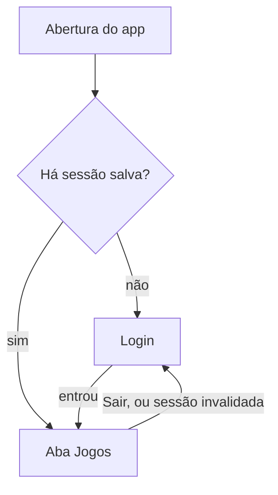

# Telas e Navegação

> Decisões de 09/11/2026. Base: `requisitos.md`, `plano-implementacao.md`, `arquitetura-app.md` (seção 9) e `design-system.md`.
> Este documento decide **quais telas existem, como se ligam e o que cada uma faz**. A aparência vem do `design-system.md` e os textos, do `docs/copy.md`.
> O mapa (seção 2) cobre o app inteiro. O detalhe de cada tela (seção 4 em diante) é escrito na fatia que a usa, para não envelhecer antes de ser lido (`plan-docs.md`, seção 8.2).

## 1. Como ler

- **Rota** é o caminho do `go_router`, em inglês. No código, a navegação usa o nome da rota (`arquitetura-app.md`, seção 9). O nome é o caminho em `camelCase`, sem os parâmetros (`/games/:gameId/edit` → `gameEdit`).
- **Onde fica:** a aba da barra inferior em que a tela abre, "fora das abas" (tela cheia, sem a barra) ou "sheet" (folha sobre a tela de origem).
- Uma tela marcada com duas fatias nasce na primeira e é completada na segunda.
- Telas novas ou renomeadas entram aqui antes de entrar no código.

## 2. Mapa de telas

### 2.1 Barra inferior

Quatro abas. Em todas, o sino fica na barra superior (`design-system.md`, 7.7) a partir da fatia 7.

| Ordem | Aba | Ícone | Rota | Conteúdo final |
|-------|-----|-------|------|----------------|
| 1 | **Jogos** | `sports_volleyball` | `/games` | Meus jogos, próximos e concluídos (RF44) |
| 2 | **Grupos** | `groups` | `/groups` | Meus grupos (RF25) |
| 3 | **Cobranças** | `payments` | `/charges` | Total a pagar e total a receber (RF75, RF76). Leva o contador vermelho quando há valor a pagar |
| 4 | **Perfil** | `person` | `/profile` | Dados da conta e configurações |

Depois do login, o app abre na aba Jogos.

### 2.2 Todas as telas

| Tela | Rota | Onde fica | Fatia | RFs |
|------|------|-----------|-------|-----|
| **Acesso** | | | | |
| Login | `/login` | Fora das abas | 1 e 2 | RF04 |
| Cadastro | `/signup` | Fora das abas | 2 | RF01, RF03, RF105 |
| Aviso de confirmação do e-mail | `/confirm-email` | Fora das abas | 2 | RF02 |
| Recuperar senha | `/forgot-password` | Fora das abas | 2 | RF06 |
| Aceite dos termos | `/terms` | Fora das abas | 2 | RF105 |
| **Jogos** | | | | |
| Meus jogos | `/games` | Aba Jogos | 1 e 4 | RF44 |
| Criar jogo | `/games/new` | Fora das abas | 4 | RF26 a RF32 |
| Detalhe do jogo, com lista e espera | `/games/:gameId` | Aba Jogos | 4 | RF37, RF45 a RF55, RF65, RF101 |
| Editar jogo | `/games/:gameId/edit` | Fora das abas | 4 | RF36, RF52, RF53 |
| Admins do jogo | `/games/:gameId/admins` | Aba Jogos | 4 | RF34, RF35 |
| Concluir jogo (faltas, total, aviso do valor por conta do recebedor) | `/games/:gameId/complete` | Fora das abas | 5 | RF40, RF41, RF60 |
| Rateio do jogo | `/games/:gameId/split` | Aba Jogos | 5 | RF64, RF73, RF74 |
| Trocar recebedor | — | Sheet sobre o detalhe | 5 | RF33 |
| Convite do jogo (gerar e compartilhar o link) | — | Sheet sobre o detalhe | 8 | RF43 |
| Compartilhar a lista em texto | — | Ação do detalhe | 7 | RF100 |
| **Grupos** | | | | |
| Meus grupos | `/groups` | Aba Grupos | 1 e 3 | RF25 |
| Criar grupo | `/groups/new` | Fora das abas | 3 | RF14 |
| Entrar por código (com a prévia do grupo) | `/groups/join` | Fora das abas | 3 | RF16 |
| Detalhe do grupo, com os jogos do grupo | `/groups/:groupId` | Aba Grupos | 3 e 4 | RF44, RF103 |
| Editar grupo | `/groups/:groupId/edit` | Fora das abas | 3 | RF18 |
| Convite do grupo (código) | — | Sheet sobre o detalhe | 3 | RF15 |
| Integrantes | `/groups/:groupId/members` | Aba Grupos | 3 | RF19 a RF21, RF23, RF24, RF102 |
| Solicitações pendentes | `/groups/:groupId/requests` | Aba Grupos | 3 | RF17 |
| Perfil de outra pessoa | `/people/:userId` | Na aba de origem | 3 e 4 | RF19, RF101 |
| **Cobranças** | | | | |
| Totais a pagar e a receber | `/charges` | Aba Cobranças | 1, 5 e 6 | RF75, RF76 |
| Valor a pagar (chave Pix, copiar, comprovantes enviados) | `/charges/:chargeId` | Aba Cobranças | 6 | RF65, RF77, RF78, RF86 |
| Enviar comprovante | — | Sheet sobre o valor a pagar | 6 | RF78 a RF83 |
| Análise de comprovante | `/receipts/:receiptId` | Aba Cobranças | 6 | RF83 |
| Marcar como pago e reverter | — | Ações na lista do recebedor | 6 | RF84, RF85 |
| **Perfil** | | | | |
| Meu perfil | `/profile` | Aba Perfil | 1 e 2 | RF07, RF08 a RF12 |
| Editar perfil (nome, apelido, foto, telefone) | `/profile/edit` | Fora das abas | 2 | RF08 a RF10, RF12 |
| Chave Pix | `/profile/pix` | Fora das abas | 2 | RF11, RF12 |
| Trocar e-mail | `/profile/email` | Fora das abas | 2 | RF106 |
| Trocar senha | `/profile/password` | Fora das abas | 2 | RF107 |
| Preferências de notificação | `/profile/notifications` | Aba Perfil | 7 | RF98 |
| Excluir conta | `/profile/delete` | Fora das abas | 6 | RF13 |
| **Notificações e convites** | | | | |
| Sino (histórico) | `/notifications` | Fora das abas | 7 | RF99, RF104 |
| Convite de grupo por link | `/g/:code` | Fora das abas | 8 | RF16 |
| Convite de jogo por link | `/j/:code` | Fora das abas | 8 | RF48 |

**Sem tela própria:** RF05 (sessão mantida), RF22 (efeito da saída do grupo), RF38, RF42, RF56 a RF63, RF66 a RF72 e RF79 a RF82 são regras do servidor que aparecem nas telas acima. RF88 a RF97 são notificações (fatia 7). RF108 acontece dentro do login com Google (fatia 2).

## 3. Navegação

### 3.1 Abertura e redirecionamentos

- **Na fatia 1** só existe o primeiro redirecionamento: sem sessão → `/login`. Com sessão, quem abre `/login` vai para `/games`.
- **A fatia 2** acrescenta, nesta ordem, os outros dois da `arquitetura-app.md` (seção 9): e-mail não confirmado → `/confirm-email`; termos não aceitos na versão vigente → `/terms`.
- **Sessão invalidada** (o *refresh* do token falha, ou a conta foi bloqueada): o `authStateProvider` recebe a saída e o roteador volta ao login. Falta de conexão não invalida a sessão (RNF07).
- **Tela de abertura nativa** do Android com a cor `background` (`#0F1833`), sem logo, enquanto o `main` inicia o Supabase. Assim não aparece tela branca, e a abertura cabe nos 3 s da RNF04.

### 3.2 Pilha e voltar

- A barra inferior troca de aba sem empilhar e guarda a posição de cada aba (`StatefulShellRoute.indexedStack`).
- Uma tela "na aba" empilha dentro da aba, com a barra visível. Uma tela "fora das abas" cobre a barra.
- O voltar do Android numa raiz de aba que não é Jogos vai para Jogos. Em Jogos, fecha o app.
- Parâmetro de rota é sempre um ID ou um código. A tela relê os dados do servidor ao abrir (`arquitetura-app.md`, seção 9).

## 4. Fatia 1

Na fatia 1 o app tem o login, a barra inferior e as quatro abas ainda vazias. Nenhuma tela lê dados de tabela, porque o banco ainda não libera acesso a nenhuma (`docs/rls-matriz.md`, seção 3).

### 4.1 Login (`/login`)

**Objetivo:** entrar com e-mail e senha. Na fatia 1, com os usuários do seed (`setup.md`, seção 8). É o começo da tela real: a fatia 2 só acrescenta itens, sem refazer o que já existe.

**Conteúdo, de cima para baixo** (margem lateral 24, `design-system.md`, seção 6):

1. Espaço reservado do logo: o texto `VoleiIn` em `title.xl` (`design-system.md`, 7.17).
2. Subtítulo em `body.lg`, `onSurfaceVariant`.
3. Campo **E-mail**: teclado de e-mail, sem correção automática, *autofill* de e-mail, ação "próximo".
4. Campo **Senha**: texto oculto, botão de ícone para mostrar ou ocultar (área de 48 × 48, rótulo para o TalkBack), *autofill* de senha, ação "entrar", que equivale ao botão.
5. Botão principal **Entrar**.

**Comportamento:**

| Situação | O que acontece |
|----------|----------------|
| Campo vazio ao tocar em Entrar | Erro no campo (`design-system.md`, 7.2). O app não chama o servidor |
| Enviando | O botão entra no estado carregando e bloqueia novo toque. Os campos ficam desabilitados |
| Sucesso | O roteador leva à aba Jogos. A tela de login sai da pilha |
| Erro do servidor | `SnackBar` com o texto do código (`docs/copy.md`, seção 5.3). Os campos mantêm o que foi digitado |
| Sem conexão | `SnackBar` de sem conexão. Os campos mantêm o que foi digitado |

- O app não valida o formato do e-mail nem o tamanho da senha: quem decide se o login vale é o Supabase Auth.
- A tela rola quando o teclado abre ou a fonte está em 150%.
- **A fatia 2 acrescenta:** "Entrar com Google", "Criar conta" e "Esqueci minha senha".

**RFs:** RF04, completado na fatia 2.

### 4.2 Barra inferior e abas

A barra segue a seção 2.1 e o `design-system.md` (7.6). Na fatia 1:

- **Jogos, Grupos e Cobranças:** barra superior de raiz com o título da aba, sem o sino, que só entra na fatia 7. No corpo, o estado vazio (`design-system.md`, 7.16) com o ícone da aba e o texto provisório de "em construção" (`docs/copy.md`, seção 5.2). Sem botão de ação.
- **Perfil:** igual às outras, mais um botão de contorno **Sair** abaixo do estado vazio. Ele encerra a sessão (`signOut`) e o roteador volta ao login. Sem confirmação. Serve para trocar de usuário nos testes. O Sair definitivo, com a remoção do token de push, vem nas fatias 2 e 7 (RF07).
- O contador vermelho de Cobranças não aparece: ainda não há valores a pagar.
- Cada aba vazia é substituída pela tela real na fatia indicada no mapa (seção 2.2), e o texto provisório sai do `app_pt.arb` junto.

### 4.3 Testes da fatia 1

Os cenários estão em `testes-referencia.md`, seção 9.4: login, barra inferior, sessão mantida e Sair (L01 a L07).
