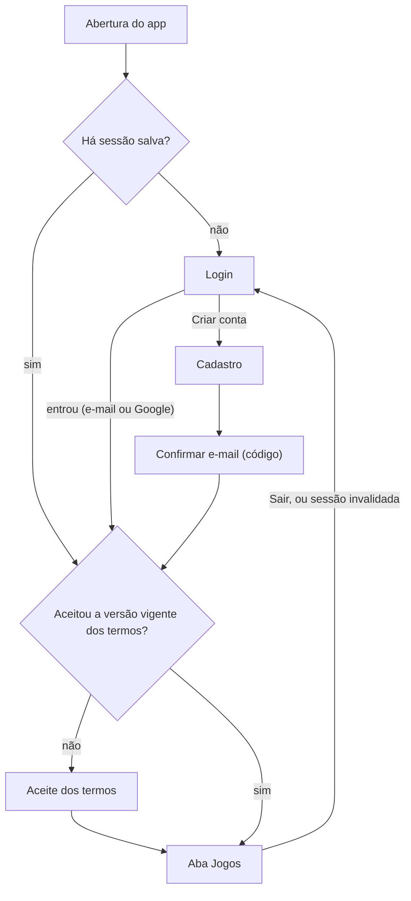

# Telas e Navegação

> Decisões de 09/11/2026. Base: `requisitos.md`, `plano-implementacao.md`, `arquitetura-app.md` (seção 9) e `design-system.md`.
> Este documento decide **quais telas existem, como se ligam e o que cada uma faz**. A aparência vem do `design-system.md` e os textos, do `docs/copy.md`.
> O mapa (seção 2) cobre o app inteiro. O detalhe de cada tela (seção 4 em diante) é escrito na fatia que a usa, para não envelhecer antes de ser lido (`plan-docs.md`, seção 8.2).

## 1. Como ler

- **Rota** é o caminho do `go_router`, em inglês. No código, a navegação usa o nome da rota (`arquitetura-app.md`, seção 9). O nome é o caminho em `camelCase`, sem os parâmetros (`/games/:gameId/edit` → `gameEdit`).
- **Onde fica:** a aba da barra inferior em que a tela abre, "fora das abas" (tela cheia, sem a barra) ou "sheet" (folha sobre a tela de origem).
- Uma tela marcada com duas fatias nasce na primeira e é completada na segunda.
- Telas novas ou renomeadas entram aqui antes de entrar no código.
- **Referência visual:** cada tela tem um PNG desenhado pelo responsável em `docs/ui/referencias/` antes de ser implementada. Este documento decide o conteúdo e o comportamento, e o PNG decide a aparência e a disposição (`docs/ui/referencias/README.md`).

## 2. Mapa de telas

### 2.1 Barra inferior

Quatro abas. Em todas, o sino fica na barra superior (`design-system.md`, 7.7) a partir da fatia 7.

| Ordem | Aba | Ícone | Rota | Conteúdo final |
|-------|-----|-------|------|----------------|
| 1 | **Jogos** | `sports_volleyball` | `/games` | Meus jogos, próximos e concluídos (RF44) |
| 2 | **Grupos** | `groups` | `/groups` | Meus grupos (RF25) |
| 3 | **Cobranças** | `payments` | `/charges` | Total a pagar e total a receber (RF75, RF76). Leva o contador vermelho quando há valor a pagar |
| 4 | **Perfil** | `person` | `/profile` | Dados da conta e configurações |

Depois do login, o app abre na aba Jogos.

### 2.2 Todas as telas

| Tela | Rota | Onde fica | Fatia | RFs |
|------|------|-----------|-------|-----|
| **Acesso** | | | | |
| Login | `/login` | Fora das abas | 1 e 2 | RF04 |
| Cadastro | `/signup` | Fora das abas | 2 | RF01, RF03, RF105 |
| Confirmar e-mail (código) | `/confirm-email` | Fora das abas | 2 | RF02 |
| Recuperar senha | `/forgot-password` | Fora das abas | 2 | RF06 |
| Aceite dos termos | `/terms` | Fora das abas | 2 | RF105 |
| Texto de um documento | `/terms/:document` | Fora das abas | 2 | RF105 |
| **Jogos** | | | | |
| Meus jogos | `/games` | Aba Jogos | 1 e 4 | RF44 |
| Criar jogo | `/games/new` | Fora das abas | 4 | RF26 a RF32 |
| Detalhe do jogo, com lista e espera | `/games/:gameId` | Aba Jogos | 4 e 5 | RF37, RF39, RF45 a RF55, RF65 |
| Editar jogo | `/games/:gameId/edit` | Fora das abas | 4 | RF36, RF52, RF53 |
| Admins do jogo | `/games/:gameId/admins` | Aba Jogos | 4 | RF34, RF35 |
| Concluir jogo (faltas, total, aviso do valor por conta do recebedor) | `/games/:gameId/complete` | Fora das abas | 5 | RF40, RF41, RF60 |
| Rateio do jogo | `/games/:gameId/split` | Aba Jogos | 5 | RF64, RF73, RF74 |
| Trocar recebedor | — | Sheet sobre o detalhe | 5 | RF33 |
| Convite do jogo (gerar e compartilhar o link) | — | Sheet sobre o detalhe | 8 | RF43 |
| Compartilhar a lista em texto | — | Ação do detalhe | 7 | RF100 |
| **Grupos** | | | | |
| Meus grupos | `/groups` | Aba Grupos | 1 e 3 | RF25 |
| Criar grupo | `/groups/new` | Fora das abas | 3 | RF14 |
| Entrar por código (com a prévia do grupo) | `/groups/join` | Fora das abas | 3 | RF16 |
| Detalhe do grupo, com os jogos do grupo | `/groups/:groupId` | Aba Grupos | 3 e 4 | RF21, RF22, RF26, RF44, RF102 |
| Editar grupo, com a exclusão | `/groups/:groupId/edit` | Fora das abas | 3 | RF18, RF103 |
| Convite do grupo (código) | — | Sheet sobre o detalhe | 3 | RF15 |
| Integrantes | `/groups/:groupId/members` | Aba Grupos | 3 e 4 | RF19, RF20, RF22, RF23, RF24, RF102 |
| Solicitações pendentes | `/groups/:groupId/requests` | Aba Grupos | 3 | RF17 |
| Perfil de outra pessoa | `/people/:userId` | Na aba de origem | 3 e 4 | RF19, RF101 |
| Sheet de bloqueio da saída do grupo | — | Sheet sobre o detalhe do grupo ou Integrantes | 4 | RF102 |
| **Cobranças** | | | | |
| Totais a pagar e a receber | `/charges` | Aba Cobranças | 1, 5 e 6 | RF75, RF76 |
| Valor a pagar (chave Pix, copiar, comprovantes enviados) | `/charges/:chargeId` | Aba Cobranças | 6 | RF65, RF77, RF78, RF86 |
| Enviar comprovante | — | Sheet sobre o valor a pagar | 6 | RF78 a RF83 |
| Análise de comprovante | `/receipts/:receiptId` | Aba Cobranças | 6 | RF83 |
| Marcar como pago e reverter | — | Ações na lista do recebedor | 6 | RF84, RF85 |
| **Perfil** | | | | |
| Meu perfil | `/profile` | Aba Perfil | 1 e 2 | RF07, RF08 a RF12 |
| Editar perfil (nome, apelido, foto, telefone) | `/profile/edit` | Fora das abas | 2 | RF08 a RF10, RF12 |
| Chave Pix | `/profile/pix` | Fora das abas | 2 | RF11, RF12 |
| Trocar e-mail | `/profile/email` | Fora das abas | 2 | RF106 |
| Trocar senha | `/profile/password` | Fora das abas | 2 | RF107 |
| Preferências de notificação | `/profile/notifications` | Aba Perfil | 7 | RF98 |
| Excluir conta | `/profile/delete` | Fora das abas | 6 | RF13 |
| **Notificações e convites** | | | | |
| Sino (histórico) | `/notifications` | Fora das abas | 7 | RF99, RF104 |
| Convite de grupo por link | `/g/:code` | Fora das abas | 8 | RF16 |
| Convite de jogo por link | `/j/:code` | Fora das abas | 8 | RF48 |

**Sem tela própria:** RF05 (sessão mantida), RF22 (efeito da saída do grupo), RF38, RF42, RF56 a RF63, RF66 a RF72 e RF79 a RF82 são regras do servidor que aparecem nas telas acima. RF88 a RF97 são notificações (fatia 7). RF108 acontece dentro do login com Google (fatia 2).

## 3. Navegação

### 3.1 Abertura e redirecionamentos

- **Sem sessão** → `/login`, salvo nas rotas de acesso: `/signup`, `/confirm-email` e `/forgot-password`. Com sessão, quem abre uma rota de acesso vai para `/games`.
- **E-mail não confirmado não tem sessão.** Com o código (ADR 0017), o Supabase Auth só cria a sessão depois do `verifyOTP`. Por isso a `/confirm-email` não é um redirecionamento: o app chega a ela pelo cadastro ou pelo erro `email_not_confirmed` do login (seção 5.1), com o e-mail guardado em memória. Sem esse e-mail, a rota volta ao login.
- **Termos** (fatia 2): com sessão, se falta o aceite da versão vigente de algum documento (`current_terms_versions()`, `contratos-api.md`, seção 9) → `/terms`, salvo em `/terms/:document`. A conferência roda ao abrir o app com sessão e logo depois de cada login, e o resultado fica em memória até a sessão acabar ou o aceite ser gravado. Enquanto ela carrega, aparece o estado carregando. Se falhar, aparecem os estados de erro ou sem conexão, com "Tentar de novo".
- **Sessão invalidada** (o *refresh* do token falha, ou a conta foi bloqueada): o `authStateProvider` recebe a saída e o roteador volta ao login. Falta de conexão não invalida a sessão (RNF07).
- **Tela de abertura nativa** do Android com a cor `background` (`#0F1833`), sem logo, enquanto o `main` inicia o Supabase. Assim não aparece tela branca, e a abertura cabe nos 3 s da RNF04.

### 3.2 Pilha e voltar

- A barra inferior troca de aba sem empilhar e guarda a posição de cada aba (`StatefulShellRoute.indexedStack`).
- Uma tela "na aba" empilha dentro da aba, com a barra visível. Uma tela "fora das abas" cobre a barra.
- O voltar do Android numa raiz de aba que não é Jogos vai para Jogos. Em Jogos, fecha o app.
- Parâmetro de rota é sempre um ID ou um código. A tela relê os dados do servidor ao abrir (`arquitetura-app.md`, seção 9).

## 4. Fatia 1

Na fatia 1 o app tem o login, a barra inferior e as quatro abas ainda vazias. Nenhuma tela lê dados de tabela, porque o banco ainda não libera acesso a nenhuma (`docs/rls-matriz.md`, seção 3).

### 4.1 Login (`/login`)

**Objetivo:** entrar com e-mail e senha. Na fatia 1, com os usuários do seed (`setup.md`, seção 8). É o começo da tela real: a fatia 2 só acrescenta itens, sem refazer o que já existe.

**Conteúdo, de cima para baixo** (margem lateral 24, `design-system.md`, seção 6):

1. Espaço reservado do logo: o texto `VoleiIn` em `title.xl` (`design-system.md`, 7.17).
2. Subtítulo em `body.lg`, `onSurfaceVariant`.
3. Campo **E-mail**: teclado de e-mail, sem correção automática, *autofill* de e-mail, ação "próximo".
4. Campo **Senha**: texto oculto, botão de ícone para mostrar ou ocultar (área de 48 × 48, rótulo para o TalkBack), *autofill* de senha, ação "entrar", que equivale ao botão.
5. Botão principal **Entrar**.

**Comportamento:**

| Situação | O que acontece |
|----------|----------------|
| Campo vazio ao tocar em Entrar | Erro no campo (`design-system.md`, 7.2). O app não chama o servidor |
| Enviando | O botão entra no estado carregando e bloqueia novo toque. Os campos ficam desabilitados |
| Sucesso | O roteador leva à aba Jogos. A tela de login sai da pilha |
| Erro do servidor | `SnackBar` com o texto do código (`docs/copy.md`, seção 5.3). Os campos mantêm o que foi digitado |
| Sem conexão | `SnackBar` de sem conexão. Os campos mantêm o que foi digitado |

- O app não valida o formato do e-mail nem o tamanho da senha: quem decide se o login vale é o Supabase Auth.
- A tela rola quando o teclado abre ou a fonte está em 150%.
- **A fatia 2 acrescenta:** "Entrar com Google", "Criar conta" e "Esqueci minha senha".

**RFs:** RF04, completado na fatia 2.

### 4.2 Barra inferior e abas

A barra segue a seção 2.1 e o `design-system.md` (7.6). Na fatia 1:

- **Jogos, Grupos e Cobranças:** barra superior de raiz com o título da aba, sem o sino, que só entra na fatia 7. No corpo, o estado vazio (`design-system.md`, 7.16) com o ícone da aba e o texto provisório de "em construção" (`docs/copy.md`, seção 5.2). Sem botão de ação.
- **Perfil:** igual às outras, mais um botão de contorno **Sair** abaixo do estado vazio. Ele encerra a sessão (`signOut`) e o roteador volta ao login. Sem confirmação. Serve para trocar de usuário nos testes. O Sair definitivo, com a remoção do token de push, vem nas fatias 2 e 7 (RF07).
- O contador vermelho de Cobranças não aparece: ainda não há valores a pagar.
- Cada aba vazia é substituída pela tela real na fatia indicada no mapa (seção 2.2), e o texto provisório sai do `app_pt.arb` junto.

### 4.3 Testes da fatia 1

Os cenários estão em `testes-referencia.md`, seção 9.4: login, barra inferior, sessão mantida e Sair (L01 a L07).

## 5. Fatia 2

Decisões de 12/11/2026. A fatia 2 completa o acesso (cadastro, Google, código por e-mail, recuperação de senha, aceite dos termos) e troca a aba Perfil vazia pela tela real. As abas Jogos, Grupos e Cobranças continuam com o estado provisório da seção 4.2. Os textos estão no `docs/copy.md`, seção 6, e as regras de quem lê e grava o quê, na `rls-matriz.md` (fatia 2).

**Regras comuns às telas de acesso** (5.1 a 5.4):

- Os campos de e-mail e senha seguem os da seção 4.1: teclado, *autofill*, mostrar e ocultar a senha.
- O app confere só o que dá para conferir sem o servidor: campo vazio, nome com até 80 caracteres e senha com pelo menos 8 caracteres (decisão de 12/11/2026, igual ao `minimum_password_length` do Supabase Auth, `setup.md`, seção 6.1). O formato do e-mail fica com o Supabase Auth.
- **Campo de código:** 6 dígitos, teclado numérico, *autofill* de código de uso único (`AutofillHints.oneTimeCode`). Confirma sozinho ao completar o sexto dígito, sem precisar tocar no botão.
- **Reenviar código:** botão de texto, desabilitado por 60 s depois de cada envio, com a contagem no próprio rótulo. A espera é só da tela: quem limita os envios de verdade é o Supabase Auth, e o erro dele vira `SnackBar`.
- O e-mail do código pendente fica num provider em memória, nunca no aparelho nem na rota (`arquitetura-app.md`, seção 9).
- Envio, erro e sem conexão seguem a tabela de comportamento do login (seção 4.1): botão carregando, campos desabilitados, `SnackBar` e campos preservados.

### 5.1 Login (`/login`), completado

Mantém tudo da seção 4.1 e acrescenta:

1. Abaixo do campo Senha, à direita, o botão de texto **Esqueci minha senha**, que abre a `/forgot-password` com o e-mail digitado, se houver.
2. Abaixo de **Entrar**, um divisor com "ou" e o botão de contorno **Continuar com Google**. Ele entra na conta e também cria a conta de quem ainda não tem (RF03), e vincula ao cadastro por e-mail quando o e-mail Google já é de uma conta (RF108, feito pelo Supabase Auth).
3. No pé da tela, a frase "Não tem conta?" com o botão de texto **Criar conta**, que abre a `/signup`.

| Situação | O que acontece |
|----------|----------------|
| Toca em Continuar com Google | Abre o seletor de contas do Google. Os dois botões ficam bloqueados até o fim |
| A pessoa fecha o seletor sem escolher | Nada acontece, sem mensagem |
| Google conclui | `signInWithIdToken` no Supabase Auth. Depois, a conferência dos termos (seção 3.1) |
| Erro do Google ou do Supabase Auth | `SnackBar` com o texto do código (`docs/copy.md`, 6.8) |
| Entrar com e-mail ainda não confirmado (`email_not_confirmed`) | `SnackBar` com o texto do erro e a ação **Confirmar**. A ação guarda o e-mail, pede um código novo (`resend`, tipo `signup`) e abre a `/confirm-email` |

### 5.2 Cadastro (`/signup`)

**Objetivo:** criar a conta com nome, e-mail e senha (RF01). Barra superior interna com voltar.

**Conteúdo:** título e frase de apoio; campos **Nome** (*autofill* de nome, até 80 caracteres), **E-mail** e **Senha** (*autofill* de senha nova, com a dica "Pelo menos 8 caracteres" abaixo); botão principal **Criar conta**; no pé, "Já tem conta?" com o botão de texto **Entrar**, que volta ao login.

| Situação | O que acontece |
|----------|----------------|
| Nome vazio, e-mail vazio ou senha com menos de 8 caracteres | Erro no campo. O app não chama o servidor |
| Sucesso | `signUp` com o nome nos metadados (`name`). O app guarda o e-mail e troca a tela pela `/confirm-email`, que sai da pilha do cadastro |
| E-mail que já tem conta | O Supabase Auth responde como se desse certo e não envia código, para não revelar quem tem conta. O app segue para a `/confirm-email`, que avisa o que fazer nesse caso |
| Erro | `SnackBar` com o texto do código |

- **Não há caixa de aceite no cadastro.** O aceite é feito por todos na `/terms`, logo depois do primeiro acesso, inclusive por quem entra pelo Google (decisão de 12/11/2026).

### 5.3 Confirmar e-mail (`/confirm-email`)

**Objetivo:** digitar o código enviado ao e-mail do cadastro (RF02, ADR 0017).

**Conteúdo:** título; a frase com o e-mail ("Enviamos um código de 6 dígitos para {email}."); o campo de código; o botão principal **Confirmar**; o botão de texto **Reenviar código**; uma frase em `body.md` `onSurfaceVariant` para quem já tem conta ou digitou o e-mail errado; o botão de texto **Usar outro e-mail**, que volta ao cadastro com os campos preenchidos.

| Situação | O que acontece |
|----------|----------------|
| Código completo | `verifyOTP`, tipo `email`. O Supabase Auth confirma o e-mail e cria a sessão, e o perfil nasce pela *trigger* (`modelo-dados.md`, 4.1). Em seguida, o app grava de novo a senha digitada (`updateUser`), ignorando `same_password`, porque o Supabase mantém a senha do primeiro cadastro de um e-mail não confirmado (ADR 0018). Depois, a conferência dos termos leva à `/terms` |
| Código errado ou vencido (`otp_expired`) | Erro no campo, que é limpo. A pessoa pode digitar de novo ou pedir outro |
| Reenviar código | `resend`, tipo `signup`. `SnackBar` "Enviamos um novo código" |
| Rota aberta sem e-mail em memória (app reaberto) | Volta ao login. Entrar com o e-mail não confirmado traz de volta a esta tela (5.1) |

### 5.4 Recuperar senha (`/forgot-password`)

**Objetivo:** trocar a senha esquecida com um código enviado ao e-mail (RF06, ADR 0017). Barra superior interna com voltar. A tela tem duas etapas, sem trocar de rota.

**Etapa 1:** frase de apoio, campo **E-mail** (preenchido se veio do login) e botão principal **Enviar código**. Chama `resetPasswordForEmail`. O Supabase Auth responde igual para e-mail com e sem conta, e o app sempre avança.

**Etapa 2:** a frase com o e-mail, o campo de código, o campo **Nova senha** (pelo menos 8 caracteres), o botão principal **Salvar nova senha** e o **Reenviar código**.

| Situação | O que acontece |
|----------|----------------|
| Salvar nova senha | `verifyOTP`, tipo `recovery`, que cria a sessão, e em seguida `updateUser` com a senha nova. `SnackBar` "Senha alterada" e conferência dos termos |
| Código errado ou vencido | Erro no campo de código. Nada muda |
| O código vale, mas a senha nova é recusada (`same_password`, `weak_password`) | A sessão já existe. A tela fica na etapa 2 só com o campo de senha, mostra o erro nele, e o novo toque chama só o `updateUser`. Se a pessoa sair daqui, continua logada com a senha antiga |
| Voltar na etapa 2 | Volta à etapa 1 |

### 5.5 Aceite dos termos (`/terms`)

**Objetivo:** aceitar os Termos de Uso e a Política de Privacidade na versão vigente (RF105). Sem barra inferior e sem voltar na barra superior: o voltar do Android fecha o app.

**Conteúdo, de cima para baixo:**

1. Título e frase de apoio. A frase muda quando a pessoa já tinha aceitado uma versão anterior de algum documento.
2. Uma linha por documento, com o rótulo do enum `legal_document` (`modelo-dados.md`, seção 3), a versão vigente como subtítulo ("Versão 1.0") e a seta. Toca para abrir a `/terms/:document`.
3. A caixa de seleção **Li e aceito os Termos de Uso e a Política de Privacidade**, desmarcada.
4. Botão principal **Aceitar e continuar**, desabilitado até a caixa ser marcada.
5. Botão de texto **Sair**, que encerra a sessão (5.6) e volta ao login.

| Situação | O que acontece |
|----------|----------------|
| Aceitar e continuar | Insere em `terms_acceptances` uma linha por documento que falta, com a versão vigente. O instante vem do servidor. Atualiza a conferência em memória e vai para a aba Jogos |
| A versão mudou no servidor entre abrir a tela e aceitar | O RLS recusa o aceite (`rls-matriz.md`, fatia 2). O app relê as versões e mostra a tela de novo, com a caixa desmarcada |
| Erro ou sem conexão ao aceitar | `SnackBar`. A caixa continua marcada |
| Fecha o app sem aceitar | Na próxima abertura, volta a esta tela |

### 5.6 Texto de um documento (`/terms/:document`)

Barra superior interna com voltar e o rótulo do documento como título. O corpo rola. **Provisório até os textos jurídicos** (`plan-docs.md`, seção 6.1): o corpo tem uma frase do ARB dizendo que o texto definitivo chega antes do lançamento. Quando os textos existirem, eles entram como arquivos do app, e esta seção é atualizada. `:document` é o valor do enum (`terms_of_use` ou `privacy_policy`). Outro valor mostra o estado "não encontrado".

### 5.7 Meu perfil (`/profile`)

**Objetivo:** ver os próprios dados e chegar às edições (RF07 a RF12, RF106, RF107). Substitui a aba Perfil vazia da seção 4.2. Barra superior de raiz com o título da aba.

**Conteúdo, de cima para baixo:**

1. Cabeçalho: avatar de 72 (foto ou iniciais, `design-system.md`, 3.4), o `display_name` em `title.md` (RN100) e, abaixo, o e-mail da conta em `body.md` `onSurfaceVariant`.
2. Lista de linhas com seta (`design-system.md`, 7.13):
   - **Editar perfil**, com o subtítulo "Nome, apelido, foto e telefone";
   - **Chave Pix**, com o subtítulo do tipo e da chave formatada ("CPF · 123.456.789-09") ou "Não cadastrada";
   - **Trocar e-mail** e **Trocar senha**, só para quem tem acesso por e-mail e senha.
3. Botão de contorno **Sair**.

- **Quem tem acesso por e-mail e senha:** a conta tem a identidade `email` no Supabase Auth. Quem entrou só pelo Google não a tem e não vê as duas linhas, nem pela rota (decisão de 12/11/2026). Quem tem as duas formas de acesso (RF108) vê as duas linhas.
- **Sair** (RF07): sem confirmação. Encerra a sessão do Supabase Auth e a do Google, para o seletor de contas aparecer na próxima entrada, e volta ao login. A remoção do token de push entra na fatia 7.
- A tela lê a própria linha de `profiles` e de `profile_private`, com os estados carregando, erro e sem conexão (`design-system.md`, 7.16), e relê ao voltar de uma edição.

### 5.8 Editar perfil (`/profile/edit`)

**Objetivo:** editar nome, apelido, foto, telefone e a visibilidade do telefone (RF08 a RF10, RF12). Barra superior interna com voltar. Tudo é gravado junto, no botão **Salvar**.

**Conteúdo:**

1. **Foto:** avatar de 96 com o botão de texto **Trocar foto**, que abre uma sheet **sem título** com **Escolher da galeria**, **Tirar foto** e, se houver foto, **Remover foto**, esta em tom destrutivo e sem confirmação, porque só vale ao tocar em Salvar (decisão de 12/11/2026). A foto escolhida aparece no avatar antes de salvar.
2. **Nome**, obrigatório, até 80 caracteres.
3. **Apelido**, opcional, até 30 caracteres, com a dica "Aparece no lugar do nome nas listas" (RN100).
4. **Telefone**, opcional: prefixo fixo `+55` e máscara `(86) 99999-1234`, com 10 ou 11 dígitos (decisão de 12/11/2026). Gravado em E.164 (`+5586999991234`).
5. Interruptor **Mostrar meu telefone**, desligado por padrão (RN101), com a dica "Quem estiver nos seus grupos e jogos poderá ver". Fica desabilitado com o telefone vazio. Apagar o telefone desliga o interruptor.
6. Botão principal **Salvar**.

| Situação | O que acontece |
|----------|----------------|
| Foto escolhida | O `image_picker` devolve a foto com no máximo 1024 px no maior lado (RN106). Tipo fora de JPEG, PNG ou WebP: `SnackBar`, e a foto não é aceita |
| Salvar | Nesta ordem: envia a foto nova para `profiles/{uid}/{uuid}.{ext}`, se houver; grava `name`, `nickname` e `photo_path` em `profiles`; grava `phone` e `phone_visible` em `profile_private`; apaga do bucket a foto antiga, se ela foi trocada ou removida. Depois, `SnackBar` "Perfil salvo" e volta ao perfil |
| Apelido apagado | Grava `nickname` nulo, e o `display_name` volta a ser o nome |
| Foto acima de 2 MB ou fora do tipo, mesmo depois do redimensionamento | O Storage recusa (`rls-matriz.md`, seção 3). `SnackBar` com o texto do erro, e nada é gravado |
| Erro depois de enviar a foto | `SnackBar`. A tela continua como estava, e um novo Salvar repete tudo. A foto enviada sem uso fica no bucket até a limpeza da fatia 6 (`modelo-dados.md`, seção 7) |
| Falha ao apagar a foto antiga | Ignorada: o perfil já está salvo. O arquivo fica para a limpeza da fatia 6 |

- Voltar com alterações não salvas descarta as alterações, sem confirmação.

### 5.9 Chave Pix (`/profile/pix`)

**Objetivo:** cadastrar, trocar e remover a chave Pix (RF11, RF12, RN105). Barra superior interna com voltar.

**Conteúdo:**

1. **Tipo da chave:** menu suspenso, com um ícone por opção, e os cinco rótulos de `pix_key_type`: CPF, CNPJ, E-mail, Telefone e Aleatória. A opção escolhida tem a marca de seleção (`profilePix-tipo.png`). Trocar o tipo limpa o campo.
2. **Chave**, com teclado e máscara do tipo:

   | Tipo | Teclado e máscara | O app confere | Grava |
   |------|-------------------|---------------|-------|
   | CPF | Numérico, `000.000.000-00` | 11 dígitos e dígitos verificadores | Só os dígitos |
   | CNPJ | Texto em maiúsculas, sem correção automática, `AA.AAA.AAA/AAAA-00`: os 12 primeiros caracteres aceitam letras e números, e os 2 últimos só números | 14 caracteres e dígitos verificadores, no formato alfanumérico da Receita (`modelo-dados.md`, 4.1) | Sem pontuação, em maiúsculas |
   | E-mail | E-mail | Um `@` e um ponto depois dele | Em minúsculas |
   | Telefone | Numérico, `+55` fixo e `(86) 99999-1234` | 10 ou 11 dígitos | E.164 |
   | Aleatória | Texto, sem correção automática | Formato de UUID | Em minúsculas, com hífens |

   As mesmas regras estão nas constraints do banco (`modelo-dados.md`, 4.1), que decidem de verdade.
3. Botão principal **Salvar**.
4. Se já houver chave, o botão destrutivo de contorno **Remover chave**.

| Situação | O que acontece |
|----------|----------------|
| Chave inválida para o tipo | Erro no campo. O app não chama o servidor |
| Salvar | Grava `pix_key_type` e `pix_key` em `profile_private`. `SnackBar` "Chave Pix salva" e volta ao perfil. Trocar a chave é sempre permitido (RN105) |
| Remover chave | Abre a confirmação destrutiva (`design-system.md`, 7.15), que diz que sem chave a pessoa não pode ser recebedora. Ao confirmar, grava os dois campos nulos |
| Remoção recusada (`PIX_KEY_IN_USE`) | `SnackBar` com o texto do código. A chave continua |

### 5.10 Trocar e-mail (`/profile/email`)

**Objetivo:** trocar o e-mail de acesso, com código enviado ao novo endereço (RF106, ADR 0017). Só para quem tem acesso por e-mail e senha (5.7): sem ele, a rota volta ao perfil. Barra superior interna com voltar. Duas etapas, sem trocar de rota.

**Etapa 1:** o e-mail atual como texto, o campo **Novo e-mail**, a frase "Até você digitar o código, o e-mail atual continua valendo" e o botão principal **Enviar código**. Chama `updateUser` com o novo e-mail. O Supabase Auth envia o código só ao endereço novo (`double_confirm_changes = false`, `setup.md`, seção 6.1).

**Etapa 2:** a frase com o novo e-mail, o campo de código, o botão principal **Confirmar** e o **Reenviar código**.

| Situação | O que acontece |
|----------|----------------|
| Novo e-mail igual ao atual | Erro no campo. O app não chama o servidor |
| E-mail que já é de outra conta (`email_exists`) | Erro no campo |
| Código completo | `verifyOTP`, tipo `email_change`, com o novo e-mail. `SnackBar` "E-mail alterado" e volta ao perfil, que mostra o novo e-mail |
| Código errado ou vencido | Erro no campo. O e-mail atual continua valendo |

### 5.11 Trocar senha (`/profile/password`)

**Objetivo:** trocar a senha informando a atual (RF107). Só para quem tem acesso por e-mail e senha (5.7). Barra superior interna com voltar.

**Conteúdo:** campos **Senha atual** e **Nova senha** (pelo menos 8 caracteres), com mostrar e ocultar, e o botão principal **Salvar**.

| Situação | O que acontece |
|----------|----------------|
| Salvar | Confere a senha atual com `signInWithPassword` no e-mail da conta e, se ela vale, chama `updateUser` com a nova. `SnackBar` "Senha alterada" e volta ao perfil |
| Senha atual errada (`invalid_credentials`) | Erro no campo **Senha atual**, com texto próprio (`docs/copy.md`, 6.7) |
| Nova senha igual à atual (`same_password`) | Erro no campo **Nova senha** |

### 5.12 Testes da fatia 2

Os cenários estão em `testes-referencia.md`, seção 10.

## 6. Fatia 3

Decisões de 15/11/2026. A fatia 3 troca a aba Grupos vazia pela tela real e entrega a criação do grupo, a entrada por código, o convite, os integrantes, as solicitações e o perfil de outra pessoa. As abas Jogos e Cobranças continuam com o estado provisório da seção 4.2. Os textos estão no `docs/copy.md`, seção 7, e as regras de quem lê e grava o quê, na `rls-matriz.md` (fatia 3).

**Nomes das rotas** (seção 1, como `/games/:gameId/edit` → `gameEdit`): `groups`, `groupsNew`, `groupsJoin`, `group`, `groupEdit`, `groupMembers`, `groupRequests` e `person` (`/people/:userId`). São também os nomes dos PNGs de referência.

**Regras comuns às telas de grupo:**

- **Toda escrita passa pelas funções do servidor** (`contratos-api.md`, seção 3). O app lê `groups`, `group_members`, `group_join_requests` e `profiles` direto, limitado pelo RLS. A exceção é a foto do grupo, enviada direto ao Storage antes de `update_group` (`contratos-api.md`, seção 9).
- **Sem Realtime.** As tabelas de grupo não entram na publicação (`stacks.md`, seção 4.1). Cada tela relê os dados ao abrir e ao voltar de outra tela, e as listas (Meus grupos, Integrantes, Solicitações) e o detalhe atualizam ao puxar para baixo.
- **Não encontrado:** quem não é membro do grupo, inclusive o ex-membro e quem abre um grupo excluído, recebe o estado "não encontrado" (`design-system.md`, 7.16). O mesmo vale para quem não é admin e abre uma tela só de admin (Editar grupo, Solicitações): a tela confere o papel em `group_members` antes de mostrar o conteúdo.
- **Erros das funções** viram `SnackBar` com o texto do código (`docs/copy.md`, 7.7), salvo onde a tabela da tela diz outra coisa. Depois de um erro que indica que os dados mudaram (`NOT_GROUP_ADMIN`, `TARGET_NOT_MEMBER`, `REQUEST_NOT_PENDING`), a tela relê os dados.
- **Foto do grupo:** as mesmas regras da foto de perfil (seção 5.8 e RN106): `image_picker` com no máximo 1024 px no maior lado, JPEG, PNG ou WebP, até 2 MB, recusa do Storage em `SnackBar`. O caminho é `groups/{group_id}/{uuid}.{ext}`, e só um admin do grupo envia e apaga (`rls-matriz.md`, fatia 3). O avatar do grupo é o quadrado de cantos arredondados do `design-system.md` (3.4), com as iniciais do nome sobre o pastel escolhido pelo `id` do grupo.
- **Nomes de pessoas** aparecem pelo `display_name` (RN100), com o avatar redondo de 44 (3.4). A própria pessoa usa o avatar "Você" (`#FFE14F`) e o texto `groupMemberYou`.

### 6.1 Meus grupos (`/groups`)

**Objetivo:** ver os grupos de que a pessoa é membro e chegar à criação e à entrada por código (RF25). Substitui a aba Grupos vazia da seção 4.2. Barra superior de raiz com o título da aba.

**Conteúdo:**

1. A lista dos grupos ativos de que a pessoa é membro, em ordem alfabética do nome. Cada linha (`design-system.md`, 7.13) tem o avatar quadrado do grupo de 44, o nome e o subtítulo com o número de integrantes. Para quem é admin do grupo, a linha leva o selo `neutral` **Admin** (`design-system.md`, seção 4, papéis) e, se houver solicitações pendentes, o subtítulo acrescenta o número delas ("3 integrantes · 2 solicitações"). Toca para abrir o detalhe.
2. No pé da tela, fixos, o botão principal **Criar grupo** e o botão de contorno **Entrar com código**.

| Situação | O que acontece |
|----------|----------------|
| Nenhum grupo | Estado vazio (`design-system.md`, 7.16) com o ícone `groups`, título e frase. Os dois botões do pé continuam |
| Grupo excluído ou pessoa removida desde a última leitura | Some da lista na próxima leitura |
| Erro ou sem conexão | Estados de erro e de sem conexão, com "Tentar de novo" |

- Uma solicitação que a pessoa enviou e ainda está pendente **não aparece** aqui (decisão de 15/11/2026): quem pediu não lê o grupo antes de entrar. O grupo aparece quando um admin aprova. Para conferir o pedido, a pessoa digita o código de novo, e a prévia avisa que ele está pendente (6.3).

### 6.2 Criar grupo (`/groups/new`)

**Objetivo:** criar um grupo com nome e, se quiser, foto (RF14). Quem cria vira admin (RN10). Barra superior interna com voltar.

**Conteúdo:**

1. **Foto:** avatar quadrado de 96, com as iniciais do nome digitado (ou o ícone `groups`, com o nome vazio), e o botão de texto **Escolher foto**, que abre a mesma sheet sem título da seção 5.8: **Escolher da galeria**, **Tirar foto** e, se houver foto escolhida, **Remover foto**.
2. **Nome do grupo**, obrigatório, até 60 caracteres, contados sem os espaços das pontas.
3. Botão principal **Criar grupo**.

| Situação | O que acontece |
|----------|----------------|
| Nome vazio ou acima de 60 caracteres | Erro no campo. O app não chama o servidor |
| Criar sem foto | `create_group`. Em seguida, troca esta tela pelo detalhe do grupo, que não volta para a criação, e mostra o `SnackBar` "Grupo criado" |
| Criar com foto | Nesta ordem: `create_group`; envio da foto para `groups/{group_id}/{uuid}.{ext}`; `update_group` com o nome e o caminho. Depois, igual ao caso sem foto. A foto vem depois porque o caminho usa o `group_id` (`contratos-api.md`, `create_group`) |
| O grupo foi criado, mas o envio da foto ou o `update_group` falhou | O grupo já existe. O app abre o detalhe do mesmo jeito, com o `SnackBar` `groupCreatedPhotoFailed`, que manda tentar de novo em Editar grupo. Uma foto enviada sem uso fica no bucket até a limpeza da fatia 6 |
| Erro no `create_group` | `SnackBar`. A tela mantém o nome e a foto |

- Voltar descarta o que foi digitado, sem confirmação.

### 6.3 Entrar com código (`/groups/join`)

**Objetivo:** pedir para entrar num grupo com o código de convite (RF16, RN12). Barra superior interna com voltar. Duas etapas, sem trocar de rota. Na fatia 8, o link `/g/:code` abre direto a etapa 2.

**Etapa 1:** a frase de apoio, o campo **Código do convite** e o botão principal **Continuar**. O campo é de texto, sem correção automática e sem maiúscula automática, porque o código diferencia maiúsculas de minúsculas (12 caracteres base62, `modelo-dados.md`, 4.2; formato mantido em 15/11/2026). Ao continuar, o app tira todos os espaços, inclusive os do meio, e confere se sobram 12 letras ou números. Quem recebe a frase de convite (6.5) copia só o código: o app não procura o código dentro de uma frase. Depois chama a Edge Function `preview-invite` com `kind: group`.

**Etapa 2, a prévia:** o avatar quadrado de 96 e o nome do grupo, e embaixo um destes três estados, conforme a resposta da prévia:

| Estado | Quando | Conteúdo |
|--------|--------|----------|
| Pode pedir | `is_member` e `has_pending_request` falsos | A frase "Um admin do grupo precisa aprovar a sua entrada" e o botão principal **Pedir para entrar** |
| Solicitação pendente | `has_pending_request` verdadeiro | Um aviso em linha (`design-system.md`, 7.14), com o ícone `hourglass_top` em `wait`: "Solicitação enviada. Aguardando a aprovação de um admin." e a frase de que o grupo aparece em Meus grupos quando o pedido for aprovado. Botão de contorno **Voltar aos grupos** |
| Já é membro | `is_member` verdadeiro | A frase "Você já é membro deste grupo" e o botão principal **Abrir o grupo**, que troca esta tela pelo detalhe |

Em todos os estados, o botão de texto **Usar outro código** volta à etapa 1 com o campo limpo.

| Situação | O que acontece |
|----------|----------------|
| Campo vazio, ou sem 12 letras ou números depois de tirar os espaços | Erro no campo. O app não chama o servidor |
| Prévia responde `INVITE_INVALID` | Erro no campo, na etapa 1 |
| Pedir para entrar | `request_group_join` com o código. Sucesso: a tela passa ao estado "Solicitação pendente" |
| Pedir responde `JOIN_REQUEST_PENDING` | Estado "Solicitação pendente", sem `SnackBar` (outro aparelho da pessoa já pediu) |
| Pedir responde `ALREADY_MEMBER` | Estado "Já é membro", sem `SnackBar` |
| Pedir responde `INVITE_INVALID` (o código foi regenerado ou desativado entre a prévia e o pedido) | Volta à etapa 1 com o erro no campo |
| Voltar na etapa 2 | Volta à etapa 1 |
| Voltar aos grupos | Fecha a tela e volta a Meus grupos |

- O código digitado fica só na tela, em memória (`arquitetura-app.md`, seção 9).

### 6.4 Detalhe do grupo (`/groups/:groupId`)

**Objetivo:** ver o grupo e chegar a integrantes, solicitações, convite e edição; sair do grupo (RF21). Barra superior interna com voltar.

**Conteúdo, de cima para baixo:**

1. Cabeçalho: avatar quadrado de 72 e o nome do grupo em `title.lg`.
2. Lista de linhas com seta (`design-system.md`, 7.13):
   - **Integrantes**, com o subtítulo do número de pessoas;
   - **Solicitações**, só para admins, com o subtítulo do número de pendentes ou "Nenhuma solicitação pendente";
   - **Convite**, com o subtítulo "Código ativo" ou "Convite desativado". Abre a sheet do convite (6.5);
   - **Editar grupo**, só para admins, com o subtítulo "Nome e foto".
3. Botão destrutivo de contorno **Sair do grupo**. Fica oculto quando a pessoa é o único membro: nesse caso ela exclui o grupo em Editar grupo (RN13).

- **Completado na fatia 4** com os jogos do grupo, o botão **Criar jogo** e os efeitos da saída sobre os jogos (seção 7.6).

| Situação | O que acontece |
|----------|----------------|
| Sair do grupo | Confirmação destrutiva (`design-system.md`, 7.15), com o nome do grupo no título e a frase de que, para voltar, é preciso o código e a aprovação de um admin. Ao confirmar, `leave_group` |
| Saída aceita | Volta a Meus grupos com o `SnackBar` "Você saiu do grupo" |
| Saída recusada com `LAST_ADMIN` (último admin, com outros membros) | `SnackBar` com o texto do código, que manda promover outro admin antes (RN13) |
| Grupo que a pessoa não pode ver | Estado "não encontrado" |

### 6.5 Convite do grupo (sheet sobre o detalhe)

**Objetivo:** ver, copiar e compartilhar o código; o admin gera um novo ou desativa o convite (RF15, RN11). **Todo membro vê e compartilha o código** (decisão de 15/11/2026): quem entra pelo código ainda depende da aprovação de um admin (RN12). Só os admins geram um código novo e desativam o convite.

**Com código ativo:**

1. Título **Convite do grupo** e a frase de apoio.
2. O código em destaque, em Roboto 700 22 com espaçamento entre letras de +2, selecionável. Nunca em Bebas Neue, que só tem maiúsculas e apagaria a diferença entre elas (`design-system.md`, seção 5).
3. Botão principal **Compartilhar**: abre o compartilhamento do Android (`share_plus`) com o texto `groupInviteShareText`, que traz o nome do grupo e o código.
4. Botão de contorno **Copiar código**: copia só o código (`Clipboard`) e mostra o `SnackBar` "Código copiado".
5. Só para admins, os botões de texto **Gerar novo código** e **Desativar convite**, este em tom destrutivo.

**Com o convite desativado** (`invite_code` nulo): a frase "O convite está desativado". O admin vê o botão principal **Gerar código**, sem confirmação, porque não há código a invalidar. O membro vê a frase que pede a um admin para gerar um novo código, sem botão.

| Situação | O que acontece |
|----------|----------------|
| Gerar novo código | Confirmação destrutiva, com a frase de que o código atual deixa de funcionar e os pedidos já feitos continuam. Ao confirmar, `regenerate_group_invite`. A sheet mostra o código novo, com o `SnackBar` "Novo código gerado" |
| Desativar convite | Confirmação destrutiva, com a frase de que ninguém consegue pedir para entrar até um admin gerar um novo código. Ao confirmar, `invalidate_group_invite`. A sheet passa ao estado desativado, com o `SnackBar` "Convite desativado" |
| Gerar código (convite desativado) | `regenerate_group_invite`. A sheet mostra o código |
| `NOT_GROUP_ADMIN` (a pessoa foi rebaixada nesse meio tempo) | `SnackBar`. O detalhe relê o grupo, e a sheet passa a mostrar a versão de membro |

- A sheet usa o código já lido pelo detalhe e o relê depois de cada ação. Fechar a sheet volta ao detalhe.

### 6.6 Integrantes (`/groups/:groupId/members`)

**Objetivo:** ver quem está no grupo (RF19). O admin promove, rebaixa e remove (RF20, RF23, RF24). Barra superior interna com voltar.

**Conteúdo:** a lista dos membros, primeiro os admins e depois os demais, cada bloco em ordem alfabética do `display_name`. Cada linha (`design-system.md`, 7.13) tem o avatar de 44, o nome (a própria pessoa com `groupMemberYou`), o subtítulo com a data de entrada ("Entrou em 12/11/2026", de `joined_at`) e, à direita, o selo `neutral` **Admin** para os admins.

**Toque numa linha:**

| Quem toca | Em quem | O que abre |
|-----------|---------|------------|
| Membro que não é admin | Outra pessoa | O perfil dela (6.9) |
| Membro que não é admin | Si mesmo | Nada: a linha não é tocável |
| Admin | Outra pessoa | Sheet com o nome da pessoa como título e as opções **Ver perfil**; **Tornar admin** (se ela é membro) ou **Deixar como membro** (se é admin); e **Remover do grupo**, em tom destrutivo |
| Admin | Si mesmo | Sheet com a opção **Deixar de ser admin** |

| Situação | O que acontece |
|----------|----------------|
| Tornar admin, ou Deixar como membro | Sem confirmação. `set_group_role`, `SnackBar` "{nome} agora é admin" ou "{nome} agora é membro", e a lista relê |
| Deixar de ser admin | Confirmação, com a frase de que só outro admin pode devolver o papel. Ao confirmar, `set_group_role` com `member` para si. `SnackBar` "Você agora é membro", e a tela passa à versão de membro |
| `LAST_ADMIN` ao rebaixar | `SnackBar` com o texto do código (RN13) |
| Remover do grupo | Confirmação destrutiva, com o nome no título e a frase de que a pessoa deixa de ver o grupo e precisa do código e da aprovação para voltar. Ao confirmar, `remove_group_member`. `SnackBar` "Removemos {nome} do grupo", e a lista relê |
| `TARGET_NOT_MEMBER` (a pessoa saiu nesse meio tempo) | `SnackBar`, e a lista relê |

- Admin remove outro admin sem rebaixar antes: o grupo continua com quem removeu como admin (RN10, RN13).
- **Completado na fatia 4** com os bloqueios da RN16 (`MEMBER_IS_RECEIVER`, `MEMBER_IS_ONLY_GAME_ADMIN`) na remoção e na saída, com a sheet dos jogos que impedem (seções 7.7 e 7.8, RF102).

### 6.7 Solicitações (`/groups/:groupId/requests`)

**Objetivo:** aprovar ou recusar quem pediu para entrar (RF17). Só para admins. Barra superior interna com voltar.

**Conteúdo:** as solicitações pendentes do grupo, das mais antigas para as mais novas (`created_at`). Cada linha tem o avatar de 44, o nome de quem pediu, o subtítulo "Pediu em qui, 12/11" (`formatShortDate`, `docs/copy.md`, seção 3) e duas ações: **Recusar**, de contorno, e **Aprovar**, preenchida. Tocar no avatar ou no nome abre o perfil da pessoa (6.9): o admin vê nome e foto de quem tem solicitação pendente no grupo (RN107, exceção de 15/11/2026).

| Situação | O que acontece |
|----------|----------------|
| Aprovar | `decide_join_request` com `true`. A linha sai, com o `SnackBar` "{nome} entrou no grupo" |
| Recusar | Sem confirmação: a pessoa pode pedir de novo (RN12). `decide_join_request` com `false`. A linha sai, com o `SnackBar` "Solicitação recusada" |
| `REQUEST_NOT_PENDING` (outro admin decidiu antes) | `SnackBar`, e a lista relê |
| Enviando | Os dois botões da linha ficam bloqueados, e o tocado entra no estado carregando. As outras linhas continuam livres |
| Nenhuma solicitação | Estado vazio com o ícone `person_add`, título e frase |

### 6.8 Editar grupo (`/groups/:groupId/edit`)

**Objetivo:** editar nome e foto (RF18) e excluir o grupo (RF103, RN17). Só para admins. Barra superior interna com voltar. Nome e foto são gravados juntos, no botão **Salvar**.

**Conteúdo:**

1. **Foto:** avatar quadrado de 96 com o botão de texto **Trocar foto**, que abre a sheet sem título da seção 5.8 (galeria, câmera e, se houver foto, **Remover foto**, que só vale ao salvar).
2. **Nome do grupo**, com as mesmas regras da criação (6.2).
3. Botão principal **Salvar**.
4. Botão destrutivo de contorno **Excluir grupo**.

| Situação | O que acontece |
|----------|----------------|
| Salvar | Nesta ordem: envia a foto nova para `groups/{group_id}/{uuid}.{ext}`, se houver; `update_group` com o nome e o caminho da foto (o novo, o atual ou nulo); apaga do bucket a foto antiga, se foi trocada ou removida. Depois, `SnackBar` "Grupo salvo" e volta ao detalhe |
| Erro depois de enviar a foto, ou falha ao apagar a antiga | Como na seção 5.8 |
| Excluir grupo | Confirmação destrutiva, com o nome do grupo no título e a frase de que todos os integrantes saem, as solicitações pendentes são canceladas, o convite deixa de valer e os jogos concluídos e cancelados continuam no histórico de quem participou. Ao confirmar, `archive_group` |
| Exclusão aceita | Volta a Meus grupos, sem o grupo, com o `SnackBar` "Grupo excluído". A foto fica no bucket até a limpeza da fatia 6 (`contratos-api.md`, `storage-cleanup`) |
| `GROUP_HAS_ACTIVE_GAMES` | `SnackBar` com o texto do código (RN17). Na fatia 3 só acontece com jogos inseridos direto no banco |

- Voltar com alterações não salvas descarta as alterações, sem confirmação.

### 6.9 Perfil de outra pessoa (`/people/:userId`)

**Objetivo:** ver o apelido, o nome e a foto de outra pessoa (RF19, RN107). Abre na aba de origem, com a barra inferior. Barra superior interna com voltar.

**Conteúdo:** avatar de 96 (`design-system.md`, 3.4), o `display_name` em `title.md` (RN100) e, embaixo, o nome em `body.md` `onSurfaceVariant`, só quando há apelido. **Completado na fatia 4** com o telefone visível (seção 7.9, RF101).

| Situação | O que acontece |
|----------|----------------|
| A pessoa compartilha contexto com quem abre, ou tem solicitação pendente num grupo que quem abre administra | Mostra o perfil. A leitura de `profiles` é decidida pelo RLS (`rls-matriz.md`, fatia 3) |
| Sem contexto, ou ID que não existe | Estado "não encontrado", sem dizer qual dos dois (`contratos-api.md`, seção 1) |
| O próprio ID | Mostra a mesma tela, com os próprios dados |

### 6.10 Testes da fatia 3

Os cenários estão em `testes-referencia.md`, seção 11.

## 7. Fatia 4

Decisões de 16/11/2026. A fatia 4 troca a aba Jogos vazia pela tela real e entrega a criação, o detalhe, a edição e o cancelamento do jogo, a lista de presença e a de espera, os admins do jogo, os jogos no detalhe do grupo, os bloqueios da saída do grupo (RF102) e o telefone visível no perfil de outra pessoa (RF101). A aba Cobranças continua com o estado provisório da seção 4.2. Os textos estão no `docs/copy.md`, seção 8, e as regras de quem lê o quê, na `rls-matriz.md` (fatia 4).

**Nomes das rotas** (seção 1): `games`, `gamesNew`, `game` (`/games/:gameId`), `gameEdit`, `gameAdmins` e `gamePerson` (`/games/:gameId/people/:userId`, o perfil de outra pessoa na aba Jogos, 7.3). São também os nomes dos PNGs de referência.

**Regras comuns às telas de jogo:**

- **Toda escrita passa pelas funções do servidor** (`contratos-api.md`, seção 4). O app lê `games`, `game_admins`, `game_participants` e `game_waitlist` direto, limitado pelo RLS. O nome do grupo vem de `get_game_groups` (decisão de 16/11/2026), porque quem vê o jogo sem ser membro do grupo não lê `groups`. A chave Pix do recebedor e o telefone de outra pessoa vêm de `get_profile_contact`.
- **Realtime só no detalhe do jogo.** O detalhe assina `games` (filtro `id`), `game_participants` e `game_waitlist` (filtro `game_id`) e, a cada evento, relê tudo (`arquitetura-app.md`, seção 6). Meus jogos, o detalhe do grupo e Admins do jogo releem ao abrir, ao voltar de outra tela e ao puxar para baixo.
- **Relógio do aparelho só para mostrar** (`arquitetura-app.md`, seção 8): ele decide quais botões aparecem e os selos "Em andamento" e "Aguardando conclusão", mas nunca libera uma ação. A recusa do servidor (`GAME_STARTED`, `LIST_LOCKED` etc.) vira `SnackBar`, e a tela relê o jogo.
- **Não encontrado:** quem não pode ver o jogo (`can_view_game`, `rls-matriz.md`, fatia 4) recebe o estado "não encontrado". Quem não é admin do jogo e abre Editar jogo ou Admins do jogo também.
- **Erros das funções** viram `SnackBar` com o texto do código (`docs/copy.md`, 8.8), salvo onde a tabela da tela diz outra coisa. Depois de um erro que indica que os dados mudaram (`GAME_FULL`, `GAME_NOT_FULL`, `GAME_NOT_OPEN`, `GAME_STARTED`, `LIST_LOCKED`, `NOT_GAME_ADMIN`, `NOT_PARTICIPANT`), a tela relê o jogo.
- **Datas e horas** em `America/Fortaleza` (RN01). O dia vem com `formatShortDate` ("sáb, 22/11") e a hora com `formatTime` (`docs/copy.md`, seção 3).
- **Dinheiro** sempre com `formatCents`. A estimativa por pessoa é `ceil(total_cents / slot_limit)`, calculada em inteiros e só exibida (RN24, `modelo-dados.md`, seção 5).
- **Ordem dos jogos:** **Próximos** são os jogos com status `open` ou `confirmed`, inclusive em andamento e aguardando conclusão, do início mais cedo para o mais tarde. **Anteriores** são os `completed` e `cancelled`, do início mais recente para o mais antigo. O jogo cancelado vai direto para Anteriores (decisão de 16/11/2026).

**Selos de tempo** (`design-system.md`, seção 4), ao lado da pílula do status, só em jogos `open` ou `confirmed`:

| Situação, pelo relógio do aparelho | Selo |
|------------------------------------|------|
| `starts_at <= agora < ends_at` | `info` "Em andamento" |
| `agora >= ends_at` | `info` "Aguardando conclusão". Na fatia 4 o jogo fica assim até a conclusão, que chega na fatia 5 |

**Situação da pessoa no jogo**, usada no card e no detalhe:

| Situação | Selo no card |
|----------|--------------|
| Passagem `active` | `ok` "Na lista" |
| Passagem `left_after_start` | `bad` "Saiu após o início" |
| Na espera (`left_at` nulo) | `waiting` "1º na espera", com a posição pela ordem de `joined_at` |
| Nenhuma das anteriores | Sem selo |

### 7.1 Meus jogos (`/games`)

**Objetivo:** ver os jogos que a pessoa pode ver (RF44): os dos grupos de que ela é membro, os que tem ou teve passagem na lista ou na espera e os que administra. Substitui a aba Jogos vazia da seção 4.2. Barra superior de raiz com o título da aba.

**Conteúdo:**

1. Dois chips de filtro (`design-system.md`, 7.5): **Próximos**, ativo ao abrir, e **Anteriores**.
2. A lista de cards de jogo (`design-system.md`, 7.12), na ordem das regras comuns. Cada card tem o bloco da data (dia da semana, dia e hora do início), o nome do grupo ou "Avulso", o local, as vagas ocupadas e o limite ("8/12"), a pílula do status, o selo de tempo, o selo da situação da pessoa e a barra de ocupação. Toca para abrir o detalhe.
3. No pé da tela, fixo, o botão principal **Criar jogo**, que abre `/games/new` sem grupo escolhido (7.2).

| Situação | O que acontece |
|----------|----------------|
| Nenhum jogo em Próximos | Estado vazio (`design-system.md`, 7.16) com o ícone `sports_volleyball`, título e frase. O botão do pé continua |
| Nenhum jogo em Anteriores | Estado vazio com o ícone `history`, título e frase |
| Erro ou sem conexão | Estados de erro e de sem conexão, com "Tentar de novo" |

- O chip escolhido fica só em memória, enquanto a aba existir.
- **Vagas ocupadas** são as passagens `active` e `left_after_start` (`modelo-dados.md`, seção 5).

### 7.2 Criar jogo (`/games/new`)

**Objetivo:** criar um jogo de grupo ou avulso (RF26 a RF32). Quem cria vira o único admin, o recebedor e o primeiro da lista (RN21). Barra superior interna com voltar. Abre de Meus jogos (sem grupo) ou do detalhe do grupo (com o grupo escolhido, pelo parâmetro de consulta `groupId`).

**Conteúdo, de cima para baixo:**

1. **Sem chave Pix:** no topo, um aviso em linha (`design-system.md`, 7.14) com o ícone `pix` em `owe`, a frase de que quem cria o jogo é o recebedor e precisa de chave Pix (RN22) e o botão de contorno **Cadastrar chave Pix**, que abre `/profile/pix`. Ao voltar, a tela relê a chave e mantém o que foi digitado. Enquanto não houver chave, o botão **Criar jogo** fica desabilitado.
2. **Grupo:** um campo de seleção que abre uma sheet com os grupos da pessoa, em ordem alfabética, e a opção **Avulso** no fim (decisão de 16/11/2026). Vem escolhido quando a tela abre pelo detalhe do grupo ou quando a pessoa tem um grupo só. Com **Avulso**, o campo mostra a dica `gameGroupStandaloneHint`.
3. **Nome do local**, obrigatório, até 120 caracteres, contados sem os espaços das pontas (RF28).
4. **Link do Google Maps**, opcional. Precisa começar com `https://` (`modelo-dados.md`, 4.3). O app tira os espaços das pontas e manda nulo quando o campo fica vazio.
5. **Data do jogo**, **Início** e **Fim**, com os seletores nativos (`design-system.md`, 7.2). O fim é só a hora: **um fim mais cedo que o início termina no dia seguinte**, e o campo mostra a dica `gameEndsNextDay` com a data ("Termina dom, 23/11"). Fim igual ao início é erro no campo.
6. **Prazo de cancelamento:** data e hora, com a dica `gameDeadlineHint` (RF30).
7. **Valor total do espaço**, com o prefixo `R$` (`design-system.md`, 7.2). Os dígitos entram pela direita, como nas maquininhas: digitar `1`, `2`, `0`, `0`, `0` mostra `R$ 120,00` e guarda `12000` centavos (U09). Mínimo de R$ 0,01 (RN05).
8. **Limite de vagas:** o contador (`design-system.md`, 7.3), com o número no centro editável pelo teclado numérico. Mínimo 1 (RN06), sem teto.
9. **Estimativa por pessoa:** aviso em linha com o ícone `calculate` em `split`, que aparece quando o valor e o limite estão preenchidos: "Cerca de R$ 10,00 por pessoa", com a frase de que a divisão final é feita na conclusão (RN24).
10. **Recebedor:** aviso em linha com o ícone `pix` em `receive` e a frase de que a pessoa vai ser a recebedora e de que quem entrar na lista vê a chave Pix dela (RN102). Só aparece quando há chave.
11. Botão principal **Criar jogo**.

Todos os campos começam vazios, sem sugestão de horário (decisão de 16/11/2026).

| Situação | O que acontece |
|----------|----------------|
| Campo obrigatório vazio | Erro no campo. O app não chama o servidor |
| Local acima de 120 caracteres; link sem `https://`; valor zero | Erro no campo |
| Prazo depois do início | Erro no campo do prazo (`gameDeadlineAfterStart`) |
| Início no passado, pelo relógio do aparelho | Erro no campo do início (`gameStartInPast`). O servidor confere de novo (`START_IN_PAST`) |
| Criar | `create_game` com os instantes convertidos para UTC (`arquitetura-app.md`, seção 8). Sucesso: troca esta tela pelo detalhe do jogo, que não volta para a criação, com o `SnackBar` "Jogo criado" |
| `RECEIVER_NEEDS_PIX_KEY` (a chave foi removida em outro aparelho) | A tela relê a chave e mostra o aviso do item 1 |
| `INVALID_GAME_DATES`, `START_IN_PAST` | `SnackBar` com o texto do código. A tela mantém o que foi digitado |
| `NOT_FOUND` com grupo escolhido (a pessoa saiu ou o grupo foi excluído) | `SnackBar`, e a sheet de grupos relê a lista |

- Voltar descarta o que foi digitado, sem confirmação.

### 7.3 Detalhe do jogo (`/games/:gameId`)

**Objetivo:** ver o jogo (RF45, RF37), a lista de presença (RF46) e a de espera (RF49), entrar e sair (RF47, RF50, RF55) e, para os admins, chegar à edição, aos admins, ao cancelamento e à remoção de participantes (RF36, RF34, RF39, RF54). Abre na aba Jogos, também quando a pessoa toca num jogo do detalhe do grupo. Barra superior interna com voltar e, só para admins do jogo, o botão de menu `more_vert` (rótulo `gameMenuLabel`).

**Conteúdo, de cima para baixo:**

1. **Topo colorido** (`design-system.md`, 7.8), em `game` com o jogo Aberto, em `wait` com o Confirmado e em `surfaceHigh` com texto `onSurface` com o Cancelado: a pílula do grupo ou "Avulso", a data, o horário de início e fim em `number.xl` ("20:00 – 22:00"), o local, a pílula do status, o selo de tempo e o anel segmentado das vagas. Com `maps_url`, o botão circular `map` (rótulo `gameOpenMaps`) abre o link no app do Maps (`url_launcher`, decisão de 16/11/2026).
2. **Trio de números** (`design-system.md`, 7.10): **Vagas** ("8/12"), **Por pessoa** (a estimativa, em `split`) e **Prazo** (data curta e hora).
3. **Recebedor:** linha de pessoa com o avatar, o nome e o selo `neutral` **Recebedor**. Embaixo:
   - para quem tem passagem `active` ou `left_after_start` e para o próprio recebedor, a chave Pix formatada (`profilePixSummary`) e o botão de texto **Copiar chave**, que copia a chave sem formatação e mostra o `SnackBar` "Chave Pix copiada" (RN102);
   - para os demais, a frase `gamePixOnlyParticipants`, sem a chave.
   A chave vem de `get_profile_contact(receiver_id)`. Se ela voltar nula para quem deveria vê-la, a linha mostra a mesma frase dos demais.
4. **Lista de presença**, com o título "Lista · 8 de 12": as passagens `active` e `left_after_start`, por ordem de `joined_at` (RN52), numeradas. Cada linha (`design-system.md`, 7.13) tem o número, o avatar de 44, o nome (a própria pessoa com `groupMemberYou`) e, à direita, os selos `neutral` **Recebedor** e **Admin** (admin do jogo) e o `bad` "Saiu após o início". Cancelamentos e remoções não aparecem: o histórico de cada pessoa no jogo chega na fatia 5 (RF65).
5. **Lista de espera**, só antes do início e quando há alguém nela, com o título "Lista de espera · 2": as linhas com `left_at` nulo, por ordem de `joined_at`, com o selo `waiting` da posição.
6. **Pé da tela, fixo:** a ação da pessoa, pela tabela abaixo.

**Ação da pessoa no pé**, com o jogo `open` ou `confirmed`. Num jogo cancelado o pé fica vazio, e o topo já diz "Cancelado".

| Momento | Situação | Pé da tela |
|---------|----------|------------|
| Antes do início | Fora das listas, jogo Aberto, membro do grupo | Botão principal **Entrar na lista** |
| Antes do início | Fora das listas, jogo Confirmado, membro do grupo | Botão principal **Entrar na lista de espera**, com a frase `gameFullHint` acima |
| Antes do início | Fora das listas, sem ser membro do grupo, ou em jogo avulso | A frase `gameNeedsInvite`, sem botão. Entrar pelo convite chega na fatia 8 |
| Antes do início | Na espera, jogo Aberto | Botão principal **Entrar na lista** e botão de texto **Sair da lista de espera** |
| Antes do início | Na espera, jogo Confirmado | Aviso em linha com `hourglass_top` em `wait` e a frase `gameWaitlistNotice` ("Você é o 2º na espera...") e o botão de contorno **Sair da lista de espera** |
| Antes do início ou em andamento | Na lista, sem ser o recebedor | Botão destrutivo de contorno **Sair da lista** |
| Antes do início ou em andamento | Na lista, recebedor | Aviso em linha com `lock` em `split` e a frase `gameReceiverCannotLeave`, sem botão (RN29). A troca de recebedor chega na fatia 5 |
| Em andamento | Fora da lista, ou na espera | Sem pé: as listas fecharam no início (RN54, RN55) |
| Após o fim | Qualquer uma | Aviso em linha com `lock` e a frase `gameListLocked` (RN57) |
| Em andamento | Saiu após o início | Sem pé: a falta já está registrada |

**Menu do admin** (`more_vert`), com as opções que valem no momento:

| Opção | Quando aparece | Abre |
|-------|----------------|------|
| **Editar jogo** | Antes do início, jogo `open` ou `confirmed` | `/games/:gameId/edit` (7.4) |
| **Admins do jogo** | Sempre | `/games/:gameId/admins` (7.5) |
| **Cancelar jogo**, em tom destrutivo | Jogo `open` ou `confirmed`, inclusive depois do início (RN43) | Confirmação destrutiva |

**Toque numa linha da lista:**

| Quem toca | Em quem | O que abre |
|-----------|---------|------------|
| Quem não é admin do jogo | Outra pessoa | O perfil dela (6.9) |
| Admin do jogo, antes do início | Outra pessoa que não é o recebedor | Sheet com o nome como título e as opções **Ver perfil** e **Remover da lista**, esta em tom destrutivo |
| Admin do jogo, antes do início | O recebedor; ou depois do início, qualquer outra pessoa | O perfil dela. Depois do início, o admin usa a falta e a isenção da fatia 5 (RN58) |
| Qualquer um | Si mesmo | Nada: a linha não é tocável |

As linhas da lista de espera abrem o perfil, sem sheet.

| Situação | O que acontece |
|----------|----------------|
| Entrar na lista | `join_game`, sem confirmação. Sucesso: `SnackBar` "Você entrou na lista" e a tela relê |
| `GAME_FULL` ao entrar (alguém pegou a vaga antes) | `SnackBar` com o texto do código, que oferece a espera, e a tela relê: o pé passa a **Entrar na lista de espera** |
| Entrar na lista de espera | `join_waitlist`, sem confirmação. `SnackBar` "Você entrou na lista de espera" |
| `GAME_NOT_FULL` ao entrar na espera (abriu uma vaga) | `SnackBar`, e a tela relê: o pé passa a **Entrar na lista** |
| Sair da lista de espera | `leave_waitlist`, sem confirmação. `SnackBar` "Você saiu da lista de espera" |
| Sair da lista, antes do prazo | Confirmação destrutiva (`design-system.md`, 7.15) com o título `gameLeaveTitle` e a frase `gameLeaveOnTimeBody`, que diz até quando a saída não gera multa |
| Sair da lista, entre o prazo e o início | A mesma confirmação, com a frase `gameLeaveLateBody`: a saída pode gerar multa igual à parte por vaga, decidida na conclusão (RN61, RN62) |
| Sair da lista, em andamento | A mesma confirmação, com a frase `gameLeaveAfterStartBody`: a saída fica registrada como falta, com multa, e a vaga continua contando (RN57, RN63) |
| Saída aceita | `leave_game`. O `SnackBar` segue o `outcome` devolvido pelo servidor, e não o relógio do aparelho: `cancelled_on_time` → `gameLeftOnTime`; `cancelled_late` → `gameLeftLate`; `left_after_start` → `gameLeftAfterStart` |
| `RECEIVER_LOCKED` ou `LIST_LOCKED` | `SnackBar`, e a tela relê |
| Remover da lista | Confirmação destrutiva com o nome no título e a frase de que a pessoa sai sem multa e a vaga fica livre (RN58). Ao confirmar, `remove_participant`. `SnackBar` "Removemos {nome} da lista" |
| Cancelar jogo | Confirmação destrutiva com o título `gameCancelTitle` e a frase de que o jogo não acontece, ninguém paga nada e a lista e a espera são avisadas (RN43, RN67, RN114). Ao confirmar, `cancel_game`. `SnackBar` "Jogo cancelado", e a tela relê |
| Evento do Realtime | A tela relê tudo, sem `SnackBar` e sem perder a posição da rolagem |
| Jogo que a pessoa não pode ver, ou ID que não existe | Estado "não encontrado" |

- O texto da confirmação de saída escolhe a frase pelo relógio do aparelho, porque é só aviso. O resultado vem do servidor.
- O perfil de outra pessoa (6.9) passa a abrir também na aba Jogos, empilhado sobre o detalhe, pela rota `/games/:gameId/people/:userId` (nome `gamePerson`), com a mesma tela. A rota `/people/:userId` (`person`) continua no ramo da aba Grupos (decisão de 16/11/2026, sessão do app da etapa A).

### 7.4 Editar jogo (`/games/:gameId/edit`)

**Objetivo:** mudar os dados e o limite de vagas antes do início (RF36, RF52, RF53, RN33). Só para admins do jogo. Barra superior interna com voltar. Tudo é gravado junto, no botão **Salvar**.

**Conteúdo:** os campos da criação (7.2, itens 3 a 9), já preenchidos, e o botão principal **Salvar**. O grupo aparece só como texto, acima dos campos ("Vôlei de Quinta" ou "Avulso"): ele não muda depois da criação. No contador, o botão − fica desabilitado no número de vagas ocupadas, com a dica `gameSlotsOccupiedHint` ("8 pessoas na lista"), porque o limite não fica abaixo dele (RN59).

| Situação | O que acontece |
|----------|----------------|
| Validação | A mesma da criação. O início continua precisando estar no futuro (RN33) |
| Salvar | Nesta ordem: `set_slot_limit`, se o limite mudou; `update_game`, se algum outro dado mudou. Depois, `SnackBar` "Jogo salvo" e volta ao detalhe. Sem mudança, só volta |
| O limite foi gravado, mas o `update_game` falhou | `SnackBar` com o texto do código. A tela continua aberta, com os dados digitados, e o limite já vale |
| `SLOT_LIMIT_BELOW_PARTICIPANTS` (alguém entrou nesse meio tempo) | `SnackBar`, e a tela relê o número de ocupadas |
| `GAME_STARTED` ou `GAME_NOT_OPEN` | `SnackBar`, e volta ao detalhe |
| Quem não é admin do jogo, ou jogo já iniciado ao abrir | Estado "não encontrado" para quem não é admin. Para o admin com o jogo iniciado, o aviso `gameEditStarted` no lugar do formulário |

- Mudar o prazo não muda a classificação dos cancelamentos já feitos (RN35). A tela não avisa disso: não há nada a decidir.
- Voltar com alterações não salvas descarta as alterações, sem confirmação.

### 7.5 Admins do jogo (`/games/:gameId/admins`)

**Objetivo:** ver, adicionar e remover os admins do jogo (RF34, RF35, RN25 a RN27). Só para admins do jogo. Abre na aba Jogos. Barra superior interna com voltar.

**Conteúdo:**

1. A lista dos admins, em ordem alfabética do `display_name`. Cada linha tem o avatar de 44, o nome (a própria pessoa com `groupMemberYou`) e o subtítulo "Na lista" ou "Fora da lista", porque ser admin não depende de estar na lista (RN26).
2. No pé, o botão principal **Adicionar admin**, que abre uma sheet com as pessoas da lista de presença com passagem `active` que ainda não são admins, em ordem de `joined_at` (RN27). Sem ninguém para adicionar, a sheet mostra a frase `gameAdminsNoCandidates`.

**Toque numa linha:**

| Em quem | O que abre |
|---------|------------|
| Outra pessoa | Sheet com o nome como título e as opções **Ver perfil** e **Remover admin** |
| Si mesmo, com outro admin no jogo | Sheet com a opção **Deixar de ser admin** |
| Si mesmo, único admin | Nada: a linha não é tocável |

| Situação | O que acontece |
|----------|----------------|
| Adicionar | Toque numa pessoa da sheet. `add_game_admin`, sem confirmação. `SnackBar` "{nome} agora é admin do jogo", e a lista relê |
| Remover admin | Sem confirmação: outro admin pode devolver o papel. `remove_game_admin`. `SnackBar` "{nome} não é mais admin do jogo" |
| Deixar de ser admin | Confirmação, com a frase de que só outro admin pode devolver o papel. Ao confirmar, `remove_game_admin` sobre si. `SnackBar` "Você não é mais admin deste jogo" e volta ao detalhe, que perde o menu |
| `ADMIN_MUST_BE_PARTICIPANT` (a pessoa saiu da lista nesse meio tempo), `ALREADY_GAME_ADMIN`, `NOT_GAME_ADMIN_TARGET`, `LAST_GAME_ADMIN` | `SnackBar`, e a lista relê |
| Quem não é admin do jogo | Estado "não encontrado" |

### 7.6 Jogos no detalhe do grupo (completa a seção 6.4)

Entre a lista de linhas e o botão **Sair do grupo**, o detalhe do grupo ganha:

1. O título **Próximos jogos** e os cards (7.1) dos jogos do grupo `open` ou `confirmed`, na ordem de Próximos. Sem nenhum, a frase `groupGamesEmpty`. Os jogos anteriores do grupo ficam em Meus jogos, no chip Anteriores.
2. O botão principal **Criar jogo**, que abre `/games/new` com o grupo escolhido (RF26). Qualquer membro cria (RN20).

- Tocar num card abre o detalhe do jogo na aba Jogos (7.3).
- O detalhe do grupo continua sem Realtime (6.4).

**Saída do grupo** (completa a tabela da seção 6.4):

| Situação | O que acontece |
|----------|----------------|
| Sair do grupo | A confirmação ganha a frase `groupLeaveGamesBody`: a pessoa sai da lista e da espera dos jogos do grupo que ainda não começaram, sem multa (RN14) |
| Saída aceita com `games_left` não vazio | Volta a Meus grupos com o `SnackBar` `groupLeftWithGames` ("Você saiu do grupo e de 2 jogos") |
| `MEMBER_IS_RECEIVER` ou `MEMBER_IS_ONLY_GAME_ADMIN` | Sheet de bloqueio (7.8) com os jogos de `detail.game_ids` |

### 7.7 Integrantes, remoção com jogos (completa a seção 6.6)

| Situação | O que acontece |
|----------|----------------|
| Remover do grupo | A confirmação ganha a mesma frase sobre os jogos, com o nome da pessoa (`groupMemberRemoveGamesBody`) |
| Remoção aceita com `games_left` não vazio | `SnackBar` `groupMemberRemovedWithGames` ("Removemos Brunão do grupo e de 2 jogos") |
| `MEMBER_IS_RECEIVER` ou `MEMBER_IS_ONLY_GAME_ADMIN` | Sheet de bloqueio (7.8), com o nome da pessoa |

### 7.8 Sheet de bloqueio da saída do grupo (sheet sobre o detalhe do grupo ou sobre Integrantes)

**Objetivo:** explicar por que a saída ou a remoção foi recusada e mostrar os jogos que a impedem (RF102, RN16).

**Conteúdo:**

1. Título `groupLeaveBlockedTitle` ("Você ainda não pode sair do grupo") ou, na remoção, `groupRemoveBlockedTitle` com o nome.
2. A frase do motivo, pelo código:
   - `MEMBER_IS_RECEIVER`: a pessoa é a recebedora destes jogos. Na fatia 4, sem troca de recebedor, o caminho é cancelar o jogo ou esperar a conclusão (`groupBlockedReceiverBody`). A fatia 5 troca a frase para indicar outro recebedor;
   - `MEMBER_IS_ONLY_GAME_ADMIN`: a pessoa é a única admin destes jogos e precisa indicar outro admin em Admins do jogo (`groupBlockedOnlyAdminBody`).
3. Os cards (7.1) dos jogos de `detail.game_ids`, lidos de `games`. Tocar num card fecha a sheet e abre o detalhe do jogo.
4. Botão de contorno **Voltar**.

- Quando a pessoa é recebedora e única admin ao mesmo tempo, o servidor devolve `MEMBER_IS_RECEIVER` (`contratos-api.md`, `leave_group`).

### 7.9 Perfil de outra pessoa, telefone (completa a seção 6.9)

Abaixo do nome, quando `get_profile_contact` devolve `phone` (o dono deixou visível e compartilha contexto com quem abre, RN101, RN107):

1. A linha **Telefone**, com o número formatado ("(86) 99999-8888", sem o `+55`).
2. Dois botões de contorno, lado a lado: **Ligar**, que abre o discador com `tel:+55...`, e **WhatsApp**, que abre `https://wa.me/55...` (U12). Os dois usam o `url_launcher` (decisão de 16/11/2026).

| Situação | O que acontece |
|----------|----------------|
| `phone` nulo (oculto, sem telefone ou sem contexto) | Nada aparece, sem dizer qual dos três |
| O próprio perfil | Mostra o próprio telefone, se houver, pela mesma função |
| O link não abre (sem discador ou sem WhatsApp no aparelho) | `SnackBar` `commonCannotOpenLink` |

### 7.10 Testes da fatia 4

Os cenários estão em `testes-referencia.md`, seção 12.

## 8. Fatia 5

Decisões de 18/11/2026. A fatia 5 entrega a conclusão do jogo (manual e automática), o rateio, as faltas e multas, a isenção manual, a troca de recebedor, o histórico da pessoa no jogo e a aba Cobranças com os totais a pagar e a receber. Pagar e enviar comprovante ficam para a fatia 6, e os avisos, para a fatia 7: na fatia 5 todo valor nasce e fica Pendente, salvo o Isento. Os textos estão no `docs/copy.md`, seção 9, e as regras de quem lê o quê, na `rls-matriz.md` (fatia 5).

**Nomes das rotas** (seção 1): `gameComplete` (`/games/:gameId/complete`), `gameSplit` (`/games/:gameId/split`) e `charges` (`/charges`). São também os nomes dos PNGs de referência, com os sufixos do briefing (`docs/ui/referencias/fatia-5/telas-fatia-5.md`).

**Regras comuns:**

- **O servidor calcula, o app mostra.** A parte por vaga, os valores, a isenção automática e o valor por conta do recebedor vêm de `preview_complete_game`, de `complete_game` e de `charges` (CLAUDE.md, "Nunca faça"). O app só soma `amount_cents` já gravados para os totais (`contratos-api.md`, seção 9), sempre em inteiros.
- **Leitura:** o app lê `charges` direto, limitado pelo RLS (`rls-matriz.md`, fatia 5). Os nomes vêm de `profiles` (contexto do jogo, RN107) e o jogo, de `games`. As telas da fatia 5 releem ao abrir, ao voltar de outra tela e ao puxar para baixo. `charges` não entra no Realtime: o detalhe do jogo já relê quando o jogo muda para Concluído.
- **Erros das funções** viram `SnackBar` com o texto do código (`docs/copy.md`, 9.6), e a tela relê. Depois de `GAME_NOT_OPEN` ou `NOT_GAME_ADMIN`, a tela de origem volta ao detalhe do jogo.
- **Dinheiro** com `formatCents`. O valor por conta do recebedor pode ser negativo (R04, `testes-referencia.md`): nesse caso a linha troca o valor pela frase `splitReceiverExtra`, com o valor absoluto (decisão de 18/11/2026). `formatCents` continua só para valores ≥ 0.
- **Rótulos do valor a pagar**, pelo `kind`: `share` → `chargeKindShare` ("Parte do jogo"), `absence_penalty` → `chargeKindAbsence` ("Multa por falta"), `late_cancellation_penalty` → `chargeKindLateCancellation` ("Multa por cancelamento"). O status usa o mapa do `design-system.md` (seção 4): Pendente `warn`, Em análise `info`, Pago `ok`, Isento `neutral`.

### 8.1 Detalhe do jogo, conclusão e histórico (completa a seção 7.3)

**Jogo depois do fim**, com status `open` ou `confirmed` (selo "Aguardando conclusão"):

| Quem | Pé da tela |
|------|------------|
| Admin do jogo | Botão principal **Concluir jogo**, que abre `/games/:gameId/complete` (8.2), com a frase `gameCompleteHint` acima ("Se ninguém concluir, o app conclui sozinho 1 hora depois do fim.") |
| Os demais | O aviso `gameListLocked` da fatia 4, sem mudança |

**Jogo concluído:**

1. **Topo colorido** em `split`, com a pílula **Concluído** e sem selo de tempo. O botão do Maps continua.
2. **Trio de números:** **Vagas** ("10/12"), **Parte por vaga** (`share_cents`, em `split`) e **Total** (`total_cents`). O prazo sai.
3. **Recebedor**, como na 7.3. A chave continua para quem tem valor não pago com o recebedor (RN102, W11).
4. **Card do rateio** (linha tocável, `design-system.md`, 7.13): o título **Rateio**, o valor da própria pessoa com o rótulo e o selo do status, ou `splitNoCharge` quando ela não tem valor, e a seta. Abre `/games/:gameId/split` (8.3).
5. **Lista de presença**, como na 7.3, com o selo `bad` **Faltou** nas passagens com `absent = true`, no lugar de "Saiu após o início". A lista de espera não aparece.
6. **Pé da tela vazio.**

**Card "Sua participação"** (RF65, decisão de 18/11/2026), entre o recebedor e o card do Rateio, em qualquer status do jogo. Aparece quando a pessoa tem alguma passagem que não seja a `active` atual, ou falta, ou multa. Para quem só está na lista, ainda que com a parte do jogo, ele não aparece: o card do Rateio já mostra a parte (S71; decisão do responsável de 18/11/2026, sessão 3 da etapa B). Uma linha por passagem da pessoa, por ordem de `joined_at`, com o texto pela situação:

| Passagem | Linha |
|----------|-------|
| `cancelled`, `late_cancellation = false` | `historyCancelledOnTime`: "Saiu {data} às {hora}, no prazo" |
| `cancelled`, `late_cancellation = true` | `historyCancelledLate`: "Saiu {data} às {hora}, fora do prazo" |
| Com `cancellation_voided_at` | Acrescenta `historyVoided`: "Não conta: você voltou às {hora}" (RN56) |
| Com `late_cancellation_exempt = true` | Acrescenta `historyExempt`: "Multa isentada: sobraram vagas" (RN62) |
| `left_after_start` | `historyLeftAfterStart`: "Saiu às {hora}, depois do início" |
| `removed`, `removal_reason = 'by_admin'` | `historyRemovedByAdmin`: "Removido por um admin em {data}" |
| `removed`, `removal_reason = 'left_group'` | `historyRemovedGroupLeft`: "Saiu do grupo em {data}" |
| `absent = true`, `absence_source = 'marked_by_admin'` | `historyMarkedAbsent`: "Falta marcada na conclusão" |
| `absent = true`, `absence_source = 'left_after_start'` | `historyAbsentLeft`: "Falta pela saída depois do início" |

No fim do card, com o jogo concluído, o valor a pagar da pessoa (rótulo, valor e selo) ou `splitNoCharge`.

**Menu do admin**, com as opções da fatia 5:

| Opção | Quando aparece | Abre |
|-------|----------------|------|
| **Editar jogo** | Como na 7.3 | 7.4 |
| **Concluir jogo** | Depois do fim, jogo `open` ou `confirmed` | 8.2 |
| **Trocar recebedor** | Jogo `open`, `confirmed` ou `completed` (RF33) | Sheet 8.4 |
| **Admins do jogo** | Sempre | 7.5 |
| **Cancelar jogo** | Como na 7.3 (nunca no concluído) | Confirmação |

**Recebedor que não pode sair** (RN29): o aviso `gameReceiverCannotLeave` muda de texto (`docs/copy.md`, 8.3, texto da fatia 5). Ele diz que um admin precisa indicar outro recebedor antes.

### 8.2 Concluir jogo (`/games/:gameId/complete`)

**Objetivo:** concluir o jogo com o valor total e as faltas, vendo antes o rateio e o valor por conta do recebedor (RF40, RF41, RF60). Fora das abas, com a barra superior e o voltar. Só para admins do jogo, com o jogo `open` ou `confirmed`. Os outros, ou com o jogo em outro status, recebem o estado "não encontrado".

**Conteúdo, de cima para baixo:**

1. **Resumo do jogo:** a data curta, o horário e o local.
2. **Valor total do espaço**, com o mesmo campo de dinheiro da 7.2, já preenchido com `total_cents`, e a dica `completeTotalHint`: só dá para mudar agora, porque depois da conclusão nada é recalculado (RN34, RN36). Vazio ou zero é erro no campo (`gameTotalRequired`), sem chamar o servidor.
3. **Faltas** (RF60, etapa B): o título **Quem faltou?** e uma linha por passagem `active` ou `left_after_start`, por ordem de `joined_at`, **exceto o recebedor**, cada uma com uma caixa de seleção. Por padrão, todas desmarcadas, exceto as passagens `left_after_start` com `absent = true`, que já vêm marcadas, com a linha de apoio "Saiu às {hora}" (RN47). Desmarcar tira a falta. Abaixo da lista, a frase `completeReceiverNoAbsence`: o recebedor não leva falta (RF63).
4. **Resumo do rateio**, pelo retorno de `preview_complete_game` com o total e as faltas da tela:
   - **Parte por vaga** em `split`;
   - **A receber**: `total_to_receive_cents`;
   - **Por conta de {recebedor}**: `receiver_covered_cents`, ou a frase `splitReceiverExtra` quando negativo;
   - com `penalties_exempted > 0` (etapa B), a linha `completeExemptedCount` ("2 multas de cancelamento isentadas: sobraram vagas");
   - com `uncovered_slots > 0`, o aviso em linha (`design-system.md`, 7.14) em `owe`, com a frase `completeUncoveredWarning`: "{n} vagas ficaram sem ninguém. {valor} fica por conta de {recebedor}." (RF41, RN48).
5. **Pé fixo:** o botão principal **Concluir jogo**.

| Situação | O que acontece |
|----------|----------------|
| A tela abre | `preview_complete_game` com o total atual e as faltas de saída após o início |
| A pessoa muda o total ou uma falta | Novo `preview_complete_game`, 400 ms depois da última mudança. Enquanto ele não volta, o resumo fica com o indicador de carregando no lugar dos números |
| O *preview* falha (rede) | O resumo mostra o erro de carga com **Tentar de novo** |
| Botão **Concluir jogo** | Habilitado só com o resumo carregado para os valores atuais da tela: o admin sempre vê o valor por conta do recebedor antes de confirmar (RF41) |
| Tocar em **Concluir jogo** | Confirmação (`design-system.md`, 7.15, em tom normal, não destrutivo) com o título `completeConfirmTitle` e a frase `completeConfirmBody`: a conclusão é definitiva e cria os valores a pagar |
| Confirmado | `complete_game` com os mesmos parâmetros do último *preview*. Sucesso: `SnackBar` "Jogo concluído", e a tela é trocada pelo Rateio (8.3). O voltar leva ao detalhe |
| `GAME_NOT_OPEN` (alguém concluiu ou cancelou antes, ou a conclusão automática rodou) | `SnackBar` com o texto do código, e volta ao detalhe |
| `GAME_NOT_ENDED` (relógio do aparelho adiantado) | `SnackBar`, e volta ao detalhe |
| `ABSENT_NOT_PARTICIPANT` ou `RECEIVER_CANNOT_BE_ABSENT` (a lista mudou) | `SnackBar`, e a tela relê o jogo e refaz o *preview* |

- `p_total_cents` vai nulo quando o total não mudou. `p_absent_user_ids` é sempre a lista completa das caixas marcadas (`contratos-api.md`, `complete_game`).
- Na etapa A, a tela nasce sem a seção de faltas e manda `p_absent_user_ids` com as faltas de saída após o início, que a conclusão mantém (RN47). A etapa B acrescenta as caixas.

### 8.3 Rateio do jogo (`/games/:gameId/split`)

**Objetivo:** ver o rateio do jogo concluído (RF73, RF74) e, para os admins, isentar multas (RF64). Abre na aba Jogos, pelo card do detalhe, pela conclusão e pela aba Cobranças (8.5). Barra superior interna com voltar e o título **Rateio**. Com o jogo em outro status, ou sem poder ver o jogo, estado "não encontrado".

**Conteúdo para todos:**

1. **Cabeçalho:** a data curta e o local, e o trio **Total**, **Vagas** (o limite) e **Parte por vaga** (em `split`).
2. **Seu valor:** o rótulo do `kind`, o valor em `number.md` e o selo do status. Embaixo, "Para {recebedor}", pelo `receiver_id` do valor (RN32). Quem não tem valor vê `splitNoCharge` com o motivo:

| Situação da pessoa | Motivo |
|--------------------|--------|
| É o recebedor do jogo | `splitNoChargeReceiver`: "Você é o recebedor. Fica por conta sua {valor}", com o por conta, ou `splitReceiverExtra` |
| Cancelou no prazo | `splitNoChargeOnTime` |
| Multa isentada na conclusão | `splitNoChargeExempt` |
| Removido por um admin ou saiu do grupo | `splitNoChargeRemoved` |
| Valor Isento | O próprio valor aparece, com o selo **Isento** e o motivo `chargeWaivedManual` ou `chargeWaivedReceiverChange` |

**Conteúdo a mais para o recebedor atual e os admins do jogo** (RN76):

3. **Totais:** **Recebido** (soma dos `paid`, em `receive`), **Pendente** (soma dos `pending` e `under_review`, em `owe`) e **Por conta de {recebedor}** (total − soma dos não Isentos, RN74).
4. **Valores:** uma linha por valor não Isento, por nome: avatar, nome, rótulo do `kind`, valor e selo. Quando o `receiver_id` do valor não é o recebedor atual (depois de uma troca, RN31), a linha de apoio "Para {nome}".
5. **Isentos:** os valores Isentos, no fim, com o motivo.
6. **Sem valor a pagar:** o recebedor, com o selo **Recebedor**, e quem teve a multa isentada na conclusão, com `historyExempt`.

**Toque numa linha de valor:**

| Quem toca | Em qual valor | O que abre |
|-----------|---------------|------------|
| Admin do jogo | Multa (`absence_penalty` ou `late_cancellation_penalty`) Pendente | Sheet com o avatar, o nome como título e "{rótulo} · {valor} · {status}" embaixo, e a opção **Isentar multa**, com a linha `waiveActionHint` (RN66; gameSplit-isentar.png) |
| Os demais, ou outro valor | — | O perfil da pessoa (`gamePerson`) |

| Situação | O que acontece |
|----------|----------------|
| **Isentar multa** | Confirmação com o título `waiveTitle` ("Isentar a multa de {nome}?") e a frase de que o valor deixa de ser cobrado. Ao confirmar, `waive_penalty`. `SnackBar` "Multa isentada", e a tela relê |
| `CHARGE_NOT_PENDING` | `SnackBar`, e a tela relê |

### 8.4 Trocar recebedor (sheet sobre o detalhe)

**Objetivo:** indicar outro recebedor, antes ou depois da conclusão (RF33, RN30, RN31). Abre pelo menu do admin.

**Conteúdo:**

1. Título **Trocar recebedor**.
2. A explicação, pelo status:
   - antes da conclusão, `receiverChangeBeforeBody`: o novo recebedor precisa estar na lista e ter chave Pix, e os valores do jogo serão devidos a ele;
   - depois da conclusão, `receiverChangeAfterBody`: os valores pagos continuam com o recebedor atual, os pendentes passam ao novo, o valor do novo recebedor é anulado, o recebedor atual passa a pagar a parte dele, e o acerto do que já foi pago fica entre os dois, fora do app (RN31).
3. Uma linha por passagem `active` do jogo, exceto o recebedor atual, por ordem de `joined_at`. O app não sabe quem tem chave Pix (`profile_private` é fechada): quem não tem é recusado pelo servidor.
4. Sem candidatos: a frase `receiverChangeEmpty`.

| Situação | O que acontece |
|----------|----------------|
| Tocar num nome | Confirmação com o título `receiverChangeConfirmTitle` ("Trocar o recebedor para {nome}?"). Ao confirmar, `change_receiver`. `SnackBar` "{nome} agora é o recebedor", a sheet fecha e o detalhe relê |
| `RECEIVER_NEEDS_PIX_KEY` | `SnackBar` com o texto do código. A sheet continua aberta |
| `RECEIVER_CHANGE_BLOCKED` | `SnackBar`. A sheet fecha |
| `RECEIVER_MUST_BE_PARTICIPANT`, `GAME_CANCELLED` | `SnackBar`, a sheet fecha e o detalhe relê |

### 8.5 Cobranças (`/charges`)

**Objetivo:** ver o total a pagar e o total a receber, somando todos os jogos, com o detalhe por jogo e por recebedor (RF75, RF76; decisão de 18/11/2026: uma linha por jogo). Troca o estado provisório da aba (seção 4.2). Barra superior de raiz com o título **Cobranças**.

**Conteúdo:**

1. **Atalhos dos totais** (`design-system.md`, 7.9): **A pagar**, em `owe`, com a soma dos valores `pending` e `under_review` em que a pessoa é o `payer_id`, e a linha "em {n} jogos"; **A receber**, em `receive`, com a soma dos valores `pending` e `under_review` em que ela é o `receiver_id`, e a linha "de {n} pessoas". Tocar num atalho rola até a seção dele.
2. **A pagar:** uma linha por valor, pelo início do jogo, do mais antigo para o mais recente: a data curta e o local; embaixo, "Para {recebedor}" e, se for multa, o rótulo do `kind`; à direita, o valor e o selo do status.
3. **A receber:** uma linha por jogo, na mesma ordem: a data curta e o local; embaixo, "{n} pessoas"; à direita, a soma do jogo.
4. Tocar numa linha abre o Rateio do jogo (8.3), na aba Jogos. O valor a pagar com a chave Pix e o comprovante (`/charges/:chargeId`) chega na fatia 6.

| Situação | O que acontece |
|----------|----------------|
| Nada a pagar | A seção mostra `chargesNothingToPay` |
| Nada a receber | A seção mostra `chargesNothingToReceive` |
| Nenhum dos dois | Estado vazio (`design-system.md`, 7.16) com o ícone `payments` e `chargesEmptyTitle`, sem as seções |
| Falha de carga | Erro de carga com **Tentar de novo** |

**Contador da aba** (seção 2.1): o número de valores `pending` em que a pessoa é o `payer_id`, relido junto com Meus jogos e com esta tela. Some com zero. O texto provisório de Cobranças sai do `app_pt.arb` (seção 4.2).

### 8.6 Saída do grupo, recebedor (completa a seção 7.8)

As frases `groupBlockedReceiverBody` e `groupRemoveBlockedReceiverBody` mudam (`docs/copy.md`, 8.6, texto da fatia 5): com a troca de recebedor, o caminho é um admin do jogo indicar outro recebedor, ou cancelar o jogo. O comportamento da sheet não muda.

### 8.7 Testes da fatia 5

Os cenários estão em `testes-referencia.md`, seção 13, além das seções 3 a 8.
