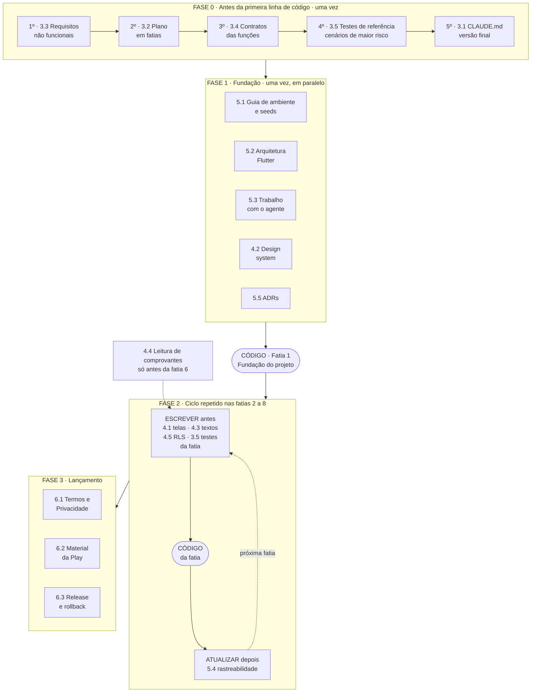

# Documentos Faltantes antes da Implementação
 
> Base: `requisitos.md`, `regras-negocio.md`, `modelo-dados.md` e `stacks.md` (versões de 06/11/2026).
> Objetivo: listar o que ainda precisa existir para que uma IA de desenvolvimento (Claude Code ou similar) consiga construir o VoleiIn com poucas idas e vindas.
>
> **Estado em 09/11/2026:** Fases 0 e 1 concluídas. Já existem os documentos 3.1 a 3.5, 4.2 (`docs/ui/design-system.md`), 5.1 (`docs/setup.md`), 5.2 (`docs/arquitetura-app.md`), 5.3 (`docs/trabalho-com-agente.md`) e 5.5 (`docs/adr/`). Os documentos da fatia 1 (seção 8.3) foram escritos em 09/11/2026: `docs/ui/telas.md` (com o mapa de todas as telas), `docs/copy.md`, `docs/rls-matriz.md` e a seção 9 do `testes-referencia.md`. Neste documento, onde aparece "homologação" como projeto remoto, vale o ADR 0011: a homologação é o Supabase local.
 
## 1. Como ler este documento
 
Os quatro documentos atuais respondem **o quê** (requisitos e regras), **com o quê** (stack) e **onde ficam os dados** (modelo). Para a IA construir o produto, ainda faltam respostas para:
 
- **Em que ordem construir** (plano em fatias).
- **Como cada função se comporta por fora** (contratos).
- **Como saber se está certo** (testes de referência).
- **Como o app deve parecer** (telas, design, textos).
- **Quais são as regras do repositório e do trabalho com o agente** (`CLAUDE.md`, guias).
Cada documento abaixo tem: objetivo, conteúdo mínimo, critério de pronto, ferramentas que ajudam e onde guardar no repositório.
 
**Prioridade:**
 
| Bloco | Quando produzir |
|-------|-----------------|
| **1. Bloqueantes** | Antes da primeira linha de código |
| **2. Por fatia** | Logo antes de implementar cada fatia (sob demanda, para não desatualizar) |
| **3. Ambiente e processo** | Junto com a fundação do projeto |
| **4. Lançamento** | Antes de publicar; não bloqueiam o código |
 
## 2. Resumo
 
| # | Seção | Documento | Bloco | Arquivo sugerido | Ferramentas principais |
|---|-------|-----------|-------|------------------|------------------------|
| 1 | 3.1 | `CLAUDE.md` / `AGENTS.md` | 1 | raiz do repositório | `/init`, Spec Kit (constitution), regras do Flutter |
| 2 | 3.2 | Plano de implementação em fatias | 1 | `docs/plano-implementacao.md` | Spec Kit, Superpowers |
| 3 | 3.3 | Requisitos não funcionais | 1 | `docs/requisitos-nao-funcionais.md` | Distribuição de versões do Android, Claude |
| 4 | 3.4 | Contratos das funções do servidor | 1 | `docs/contratos-api.md` | MCP do Supabase, skills do Supabase |
| 5 | 3.5 | Casos de teste de referência | 1 | `docs/testes-referencia.md` + `supabase/tests/` | pgTAP, Superpowers (TDD), skills do Dart |
| 6 | 4.1 | Telas e navegação | 2 | `docs/ui/telas.md` | Figma, Claude (Design), Mermaid |
| 7 | 4.2 | Design system mínimo | 2 | `docs/ui/design-system.md` | Material Theme Builder, Figma |
| 8 | 4.3 | Catálogo de textos e notificações | 2 | `docs/copy.md` | Claude, revisão humana |
| 9 | 4.4 | Especificação da leitura de comprovantes | 2 | `docs/comprovantes-ia.md` | Console da Anthropic, promptfoo, Deno test |
| 10 | 4.5 | Matriz de RLS | 2 | `docs/rls-matriz.md` | skills do Supabase, `get_advisors`, pgTAP |
| 11 | 5.1 | Guia de ambiente e seeds | 3 | `docs/setup.md` + `supabase/seed.sql` | Supabase CLI, Firebase CLI |
| 12 | 5.2 | Guia de arquitetura do app Flutter | 3 | `docs/arquitetura-app.md` | skills do Flutter e do Dart, `skill-creator` |
| 13 | 5.3 | Regras de trabalho com o agente | 3 | `docs/trabalho-com-agente.md` | Superpowers, Spec Kit, hooks do Claude Code |
| 14 | 5.4 | Matriz de rastreabilidade | 3 | `docs/rastreabilidade.md` | Script próprio, Claude |
| 15 | 5.5 | Registro de decisões (ADRs) | 3 | `docs/adr/` | Claude, modelo MADR |
| 16 | 6.1 | Termos de Uso e Política de Privacidade | 4 | `docs/legal/` | Assessoria jurídica |
| 17 | 6.2 | Material da Google Play | 4 | `docs/play-store.md` | Play Console |
| 18 | 6.3 | Plano de release e rollback | 4 | `docs/release.md` | GitHub Actions, Supabase CLI |
 
**Organização do repositório sugerida:** mover os quatro documentos atuais para `docs/` (`docs/requisitos.md`, `docs/regras-negocio.md`, `docs/modelo-dados.md`, `docs/stacks.md`). O agente lê o que está no repositório, então o repositório deve ser a fonte oficial, e o Project do claude.ai fica como espaço de discussão.
 
---
 
## 3. Bloco 1: bloqueantes
 
### 3.1 `CLAUDE.md` (ou `AGENTS.md`)
 
**Objetivo:** ser o arquivo que o agente lê em toda sessão. Dá o contexto mínimo e aponta para o resto.
 
**Conteúdo mínimo:**
- Resumo do produto em até 5 linhas (grupo de vôlei de Parnaíba, rateio e Pix, Android).
- Stack e comandos: rodar o app, `dart analyze`, `flutter test`, `supabase start`, `supabase db reset`, `supabase test db`, aplicar migração, rodar Edge Function localmente.
- Mapa dos documentos em `docs/`, com a regra "consulte antes de implementar".
- Convenções: nomes em inglês no código e em pt-BR na interface, estrutura *feature-first*, dinheiro em centavos, tempo em UTC.
- **Glossário pt-BR ↔ código**, por exemplo: recebedor = `receiver`, valor a pagar = `charge`, multa = `penalty`, lista de presença = `game_participants`, lista de espera = `game_waitlist`, vaga = `slot`, comprovante = `receipt`, rateio = `split`/`share`.
- Regras do tipo "nunca faça", com o motivo:
  - nunca escrever direto nas tabelas de regra (usar as funções do servidor);
  - nunca usar ponto flutuante para dinheiro (RN04);
  - nunca colocar segredo no app;
  - nunca alterar o banco de produção;
  - nunca confiar no relógio do aparelho (RN02).
- Definição de pronto (resumo; o detalhe fica na seção 5.3).
**Critério de pronto:** um agente novo, sem contexto, consegue subir o ambiente e entender onde mexer lendo só este arquivo.
 
**Ferramentas que ajudam:**
- **`/init` do Claude Code:** gera um rascunho a partir do repositório; você revisa e acrescenta as regras de "nunca faça".
- **Spec Kit:** o comando `/speckit-constitution` cria os princípios do projeto, que cumprem papel parecido.
- **Regras do Flutter:** a documentação do Flutter descreve arquivos de regras para IA (https://docs.flutter.dev/ai/ai-rules), úteis como ponto de partida para a parte de Dart.
- **Escrita:** mantenha curto. Poucas regras bem justificadas funcionam melhor que uma lista longa que o agente não segue por inteiro.
### 3.2 Plano de implementação em fatias verticais
 
**Objetivo:** transformar 108 RFs em uma sequência de entregas pequenas, verificáveis e com dependências claras. A IA rende mais com tarefas delimitadas.
 
**Conteúdo mínimo, para cada fatia:**
- Nome e objetivo em uma frase.
- RFs e RNs cobertos.
- Tabelas, funções do servidor e Edge Functions envolvidas.
- Telas envolvidas.
- Dependências (quais fatias vêm antes).
- Critério de pronto (testes que devem passar, fluxo que deve funcionar de ponta a ponta).
- Fora de escopo (o que fica para a próxima fatia).
**Fatias definidas** (detalhe e motivos em `docs/plano-implementacao.md`, que prevalece sobre este resumo):
1. **Fundação:** repositório, CI, Supabase local e produção, banco completo com RLS, tema do app, login técnico.
2. **Conta e perfil:** RF01 a RF12, RF105 a RF108.
3. **Grupos:** RF14 a RF21, RF23 a RF25, RF103.
4. **Jogo e lista de presença:** RF22, RF26 a RF32, RF34 a RF39, RF44 a RF47, RF49 a RF55, RF101, RF102, com a concorrência de vagas.
5. **Conclusão, multas e rateio:** RF33, RF40 a RF42, RF56 a RF76 (a parte de maior risco; inclui RN62).
6. **Pagamentos, comprovantes e exclusão de conta:** RF13, RF77 a RF87.
7. **Notificações e tarefas agendadas:** RF88 a RF100, RF104.
8. **Convites por link:** RF43, RF48 e a página no Cloudflare Pages.
**Critério de pronto:** cada RF aparece em exatamente uma fatia, e cada fatia cabe em poucas sessões de trabalho.
 
**Ferramentas que ajudam:**
- **GitHub Spec Kit (escolhido em 06/11/2026):** `/speckit-constitution` uma vez por projeto e, em cada fatia, `/speckit-specify`, `/speckit-plan`, `/speckit-tasks`, `/speckit-implement` e `/speckit-converge`. Requer Python 3.11+ e `uv`. Instalação: `uv tool install specify-cli`. Em repositório já existente, depois de um commit de base: `specify init --here --force --integration <chave>`. Confirmar a chave do Claude Code na documentação de integrações.
- **Regra de uso do Spec Kit:** `docs/` é a fonte da verdade. O `spec.md` de cada fatia cita os RFs e RNs em vez de copiar o texto, e o `plano-implementacao.md` continua definindo a ordem e o escopo das fatias.
- **Superpowers:** a skill `writing-plans` produz planos em tarefas pequenas e grava em `docs/superpowers/plans/`.
- **Decisão:** usar só o Spec Kit como framework de especificação, sem combinar com o OpenSpec ou o BMAD.
### 3.3 Requisitos não funcionais
 
**Objetivo:** fechar a primeira pendência do `stacks.md` (seção 14), para que a IA não assuma valores padrão.
 
**Conteúdo mínimo:**
- **Android:** versão mínima suportada (`minSdk`) e versão alvo.
- **Desempenho:** tempo máximo de abertura do app, de carregamento da lista de presença e de leitura de um comprovante.
- **Escala esperada:** número de usuários, grupos e jogos simultâneos nos primeiros 12 meses (dimensiona RLS, índices e custo da Claude API).
- **Acessibilidade:** tamanhos de fonte, contraste, leitores de tela.
- **Idioma e formatos:** pt-BR, moeda em reais, datas em `America/Fortaleza`.
- **Uso sem internet:** o que funciona offline (por exemplo, ver jogos já carregados) e o que exige conexão.
- **Disponibilidade e custo:** metas e teto de gasto mensal (Supabase, Claude API, Cloudflare, Firebase).
- **Privacidade:** referência ao `stacks.md` seção 13.
**Critério de pronto:** cada item tem um valor numérico ou uma decisão explícita, e nenhum fica "a definir".
 
**Ferramentas que ajudam:**
- **Painel de distribuição de versões do Android** (Android Studio / developer.android.com), para escolher o `minSdk` pelo público alcançado.
- **Claude:** para conduzir um questionário de decisão item a item e registrar as respostas.
---
 
### 3.4 Contratos das funções do servidor
 
**Objetivo:** formalizar a fronteira entre app e backend. O `modelo-dados.md` seção 6 descreve as funções em prosa; para implementar falta a assinatura.
 
**Documento pronto em `docs/contratos-api.md`, com a lista completa de funções.** Conteúdo mínimo, para cada função e Edge Function:
- Nome, parâmetros e tipos.
- Retorno (formato do sucesso).
- **Erros possíveis**, com código estável.
- Quem pode chamar (papel exigido).
- Pré-condições e efeitos colaterais (tabelas alteradas, notificações geradas, eventos de auditoria).
- RFs e RNs relacionados.
**Catálogo de códigos de erro** (tabela única), por exemplo `GAME_FULL`, `GAME_STARTED`, `GAME_NOT_OPEN`, `NOT_A_MEMBER`, `RECEIVER_LOCKED` (RN29), `RECEIVER_NEEDS_PIX_KEY` (RN22), `CHARGE_NOT_PENDING` (RN86), `DUPLICATE_TRANSACTION` (RN89), `ACCOUNT_DELETE_BLOCKED` (RN103). Cada código com a mensagem em pt-BR (ligação com a seção 4.3).
 
**Critério de pronto:** o app e o backend podem ser implementados por pessoas ou sessões diferentes, só com este documento.
 
**Ferramentas que ajudam:**
- **MCP do Supabase** (`list_tables`, `generate_typescript_types`): confere nomes de tabelas e colunas e gera tipos para as Edge Functions.
- **Skills do Supabase** (`npx skills add supabase/agent-skills`): orientam funções `security definer`, bloqueio de linha e RLS.
- **Superpowers (`brainstorming`):** para discutir casos de borda de cada função antes de fixar o contrato.
### 3.5 Casos de teste de referência (golden tests)
 
**Objetivo:** dar à IA um critério objetivo de "certo". As partes de maior risco precisam de cenários com entrada e saída esperada, escritos **antes** do código.
 
**Conteúdo mínimo, em tabelas "dado, quando, então":**
- **Rateio (RN71 a RN75):** arredondamento para cima, sobra do recebedor, limite 1, valor total pequeno, total que divide exatamente.
- **Isenção automática (RN62):** limite aumentado entre o prazo e o início (usa `game_limit_history`), limite reduzido, cancelamentos no limite, ordem dos que cancelaram, pessoa que cancelou e voltou (RN56).
- **Faltas e multas:** saída após o início, marcação na conclusão manual, conclusão automática (RN49), recebedor nunca multado.
- **Troca de recebedor após a conclusão (RN31):** bloqueio com valor Em análise, valores Pagos preservados, isenção do novo recebedor, criação do valor do antigo.
- **Concorrência de vagas (RN53):** dois usuários disputando a mesma vaga, aumento de limite com vários interessados.
- **Máquina de estados do jogo (RN40 a RN45) e do valor a pagar (RN80 a RN94).**
- **Limites de tempo (RN03):** instante igual ao prazo e igual ao início.
- **Conta (RN103, RN105):** exclusão bloqueada e remoção de chave Pix bloqueada.
**Critério de pronto:** cada cenário é executável, virando teste pgTAP (banco) ou Deno test (Edge Functions), e todos falham antes da implementação.
 
**Ferramentas que ajudam:**
- **pgTAP via `supabase test db`:** já previsto no `stacks.md` seção 11.
- **Superpowers (`test-driven-development`):** obriga escrever o teste que falha antes da implementação.
- **Skills do Dart** (`dart-lang/skills`): testes unitários e correção de análise estática no app.
- **Claude:** para gerar a primeira versão da tabela de cenários a partir das RNs, com revisão sua, já que o resultado esperado precisa vir da regra, não do código.
---
 
## 4. Bloco 2: por fatia (sob demanda)
 
### 4.1 Especificação de telas e navegação
 
**Objetivo:** dizer ao agente quais telas existem, como se ligam e como se comportam. Sem isso as telas saem genéricas e inconsistentes.
 
**Conteúdo mínimo:**
- **Mapa de telas e rotas** do `go_router`, incluindo as rotas dos deep links (`/g/<codigo>`, `/j/<codigo>`) e o fluxo de convite quando o usuário não está logado.
- **Fluxos principais** em diagrama: cadastro, criar jogo, entrar na lista, cancelar, concluir e ratear, pagar com comprovante, análise manual do recebedor.
- **Para cada tela:** objetivo, dados exibidos, ações, RFs atendidos, papéis que a veem, e os estados **carregando, vazio, erro e sem permissão**.
- Tela de aceite dos Termos (RF105) e de reaceite quando a versão mudar.
- Comportamento em tempo real (Realtime): o que atualiza sozinho.
**Critério de pronto:** todo RF de interface aparece em ao menos uma tela, e todo fluxo tem caminho de erro.
 
**Ferramentas que ajudam:**
- **Figma** ou rascunhos em papel: wireframes simples bastam.
- **Claude (artefatos de Design):** para propor e iterar telas e variações antes de ir ao código.
- **Mermaid:** diagramas de fluxo no próprio Markdown (o `modelo-dados.md` já usa).
- **Skills oficiais do Flutter** (`flutter/agent-plugins`): incluem orientação para configurar rotas declarativas, que é o caso do `go_router`.
### 4.2 Design system mínimo
 
**Objetivo:** dar consistência visual a todas as telas, mesmo geradas em sessões diferentes.
 
**Conteúdo mínimo:**
- **Tokens:** cores (primária, secundária, estados de sucesso, aviso e erro), tipografia, espaçamentos, raios, sombras, modo claro e escuro (se for decidido).
- **Cores de status** já definidas pelo domínio: Aberto, Confirmado, Cancelado, Concluído; Pendente, Em análise, Pago, Isento; Em análise, Aprovado e Recusado (comprovantes).
- **Componentes base:** botão, campo de texto, card de jogo, item da lista de presença, selo de status, cabeçalho de grupo, seletor de data e hora, estado vazio, diálogo de confirmação.
- **Ícones** e padrões de imagem (foto de perfil e de grupo, tamanho máximo, RN106).
- Um `theme.dart` de referência com os tokens.
**Critério de pronto:** o agente monta uma tela nova usando apenas componentes e tokens do documento.
 
**Ferramentas que ajudam:**
- **Material Theme Builder:** gera o esquema de cores do Material 3 a partir de uma cor-base.
- **Figma:** biblioteca de componentes.
- **Skill de design de interface** do Claude (ex.: `frontend-design`): ajuda a evitar o visual genérico, mas foi pensada sobretudo para web, então use como apoio, não como regra.
### 4.3 Catálogo de textos (copy pt-BR)
 
**Objetivo:** padronizar todas as mensagens do app e do push, em vez de cada sessão inventar a sua.
 
**Conteúdo mínimo:**
- **Templates de notificação**, um por `notification_type` (são mais de 20): título, corpo com variáveis (`{apelido}`, `{local}`, `{valor}`), rota de abertura e se vale push.
- **Mensagens de erro** ligadas ao catálogo de códigos da seção 3.4.
- **Rótulos de status e enums** (já definidos na seção 3 do `modelo-dados.md`).
- Textos de estados vazios, confirmações destrutivas (sair do grupo, cancelar jogo, excluir conta), e-mails de confirmação e recuperação de senha.
- Tom de voz: informal, curto, em pt-BR, tratando por "você".
- Formatação de valores (`R$ 20,84`), datas e horas.
**Critério de pronto:** nenhuma string de interface fica solta no código; todas vêm de um arquivo de textos (por exemplo ARB, com `flutter gen-l10n`).
 
**Ferramentas que ajudam:**
- **Claude:** para redigir a primeira versão dos textos; você revisa o tom.
- **`flutter gen-l10n` / arquivos ARB:** mantêm os textos centralizados.
- **Templates de e-mail do Supabase Auth:** para os e-mails de confirmação e recuperação.
### 4.4 Especificação da leitura de comprovantes
 
**Objetivo:** tratar o prompt e o conjunto de testes como código versionado, já que a leitura automática define quem é cobrado e quem é aprovado.
 
**Conteúdo mínimo:**
- **Prompt do sistema** e instruções para extrair valor, data e hora, destinatário (nome e chave) e ID da transação.
- **JSON schema de saída** e o que fazer com campo ilegível (nulo, nunca "chute").
- **Normalização:** nome sem acento e em maiúsculas, ID em maiúsculas, chave por tipo, fuso `America/Sao_Paulo` (RN88).
- **Regras determinísticas** em código, separadas do modelo: valor exato, destinatário (chave atual ou nome), data no minuto, ID não usado (RN88, RN89).
- Tratamento de PDF e de imagem, tamanho e tipo (RN87), HEIC.
- Política de erro e tentativas: 3 leituras (RN86), tempo limite, falha da API.
- **Conjunto fixo de exemplos:** imagens e PDFs de vários bancos (Nubank, Banco do Brasil, Caixa, Itaú, Bradesco, Inter, PicPay, Mercado Pago etc.), incluindo comprovantes ilegíveis, de valor errado, de outro destinatário, anteriores ao jogo e com ID repetido; cada um com a resposta esperada.
- **Cuidado com dados pessoais:** os exemplos devem ser anonimizados ou sintéticos.
- Modelo e versão configuráveis por variável de ambiente (`stacks.md` seção 6.2).
**Critério de pronto:** o conjunto de exemplos roda contra a função e cada resultado confere com o esperado; o teste com a API real roda à parte e não bloqueia o PR.
 
**Ferramentas que ajudam:**
- **Console da Anthropic (workbench de prompts):** para iterar o prompt e o schema.
- **promptfoo** (ou avaliação própria): compara o resultado esperado em lote, para medir mudanças de prompt ou de modelo.
- **Deno test:** testes das regras determinísticas, com a Claude API simulada.
- **Documentação da Claude API** (docs.claude.com): saída estruturada e envio de PDF e imagem.
### 4.5 Matriz de RLS
 
**Objetivo:** transformar o resumo da seção 8 do `modelo-dados.md` em uma especificação testável, incluindo os casos negativos ("quem **não** pode ver o quê").
 
**Conteúdo mínimo:**
- Matriz **papel × tabela × operação** (select, insert, update, delete) para: anônimo, usuário autenticado, membro do grupo, admin do grupo, participante do jogo, admin do jogo, recebedor, pagador e quem já saiu do grupo.
- Definição SQL das funções auxiliares (`is_group_member`, `is_group_admin`, `is_game_admin`, `can_view_game`, `shares_context`).
- Regras do Storage (`avatars`, `receipts`).
- **Casos negativos:** um usuário sem relação não vê perfil, telefone oculto, chave Pix, comprovante nem rateio de outro; membro removido perde acesso ao grupo mas mantém o histórico (RN14, RN17).
- Cuidados de desempenho das políticas (funções com `select` envolvido, índices de apoio).
**Critério de pronto:** cada linha da matriz tem um teste pgTAP, e `get_advisors` não aponta tabela sem RLS.
 
**Ferramentas que ajudam:**
- **Skill `supabase` e `supabase-postgres-best-practices`:** padrões de RLS e de desempenho.
- **MCP do Supabase (`get_advisors`):** acusa tabelas sem RLS e problemas de índice.
- **pgTAP:** testes de política.
---
 
## 5. Bloco 3: ambiente e processo
 
### 5.1 Guia de ambiente e dados de exemplo
 
**Objetivo:** qualquer pessoa (ou agente) sobe o projeto do zero e testa sem montar cenários à mão.
 
**Conteúdo mínimo:**
- Pré-requisitos (Flutter, Dart, Node, Docker, Supabase CLI, Firebase CLI, Deno).
- Passo a passo: clonar, `supabase start`, aplicar migrações, rodar o app em emulador Android.
- **Variáveis e segredos por ambiente** (local e produção): quais existem, onde ficam (nunca no código) e como passá-los com `--dart-define-from-file` (sem *flavors*, ADR 0012).
- Configuração do Firebase (FCM) e do login com Google por ambiente.
- Configuração do domínio de convite e do `assetlinks.json` em cada ambiente.
- **Seeds de desenvolvimento** (`supabase/seed.sql`): usuários de teste, grupos, jogos em todos os estados (Aberto, Confirmado, em andamento, Concluído, Cancelado), valores em todos os status e comprovantes de exemplo.
- Problemas comuns e como resolver.
**Critério de pronto:** uma máquina limpa chega ao app rodando em menos de 30 minutos, seguindo só o guia.
 
**Ferramentas que ajudam:**
- **Supabase CLI:** `supabase start`, `db reset`, `functions serve`.
- **Firebase CLI e FlutterFire CLI:** configuração do FCM.
- **Claude:** para escrever os seeds a partir dos cenários da seção 3.5.
### 5.2 Guia de arquitetura do app Flutter
 
**Objetivo:** fixar padrões concretos para o agente copiar. Descrições abstratas funcionam pior que um exemplo real.
 
**Conteúdo mínimo:**
- Estrutura *feature-first* (`stacks.md` seção 3.2) com o conteúdo esperado de `data`, `domain` e `presentation`.
- Padrões de Riverpod: tipos de provider, quando usar `AsyncNotifier`, como lidar com Realtime.
- Padrão de repositório sobre o `supabase_flutter` e de tratamento de erros (conversão dos códigos da seção 3.4 em erros de domínio).
- Modelos com `freezed` e `json_serializable`; geração de código (`build_runner`).
- Convenções de nome, de arquivos e de testes (unitário, widget, integração).
- Padrão de navegação e de deep links.
- **Uma feature completa de exemplo**, pequena e correta, para servir de modelo.
- Anti-padrões a evitar, cada um com o motivo.
**Critério de pronto:** a primeira feature implementada pelo agente segue o exemplo sem correção de estrutura.
 
**Ferramentas que ajudam:**
- **Skills oficiais do Flutter** (`flutter/agent-plugins`) e do Dart (`dart-lang/skills`): layouts responsivos, rotas, serialização JSON, testes e análise estática. No Claude Code: `claude plugin marketplace add flutter/agent-plugins` e `claude plugin install dart-flutter@dart-flutter`. Outros agentes: `npx skills add flutter/agent-plugins --skill '*' --agent universal`.
- **Servidor MCP de Dart e Flutter:** dá ao agente acesso a ferramentas do SDK.
- **`skill-creator` (Anthropic):** para transformar os padrões do VoleiIn em uma skill própria, que complementa as genéricas.
### 5.3 Regras de trabalho com o agente
 
**Objetivo:** registrar como a IA deve trabalhar neste projeto, para reduzir retrabalho e risco.
 
**Conteúdo mínimo:**
- **Template de tarefa:** contexto, RFs e RNs, arquivos esperados, critério de pronto, testes esperados, fora de escopo.
- **Definição de pronto:** CI verde (`dart analyze`, `flutter test`, `supabase test db`, testes das Edge Functions), `get_advisors` sem alertas novos, teste novo para todo bug corrigido, documentos afetados atualizados.
- **O que o agente nunca faz sozinho:** aplicar migração em produção, mexer em segredos, alterar RLS sem teste, apagar dados.
- **Guardrails de ambiente:** o MCP do Supabase usado só para leitura, já que o único projeto remoto é a produção. Sem bloqueio técnico no Claude Code, por decisão de 09/11/2026: as regras valem como regras escritas (`trabalho-com-agente.md`, seção 8).
- Fluxo de ramificação e de revisão: uma tarefa por *branch*, PR pequeno, revisão obrigatória antes do *merge*.
- Quando parar e perguntar: ambiguidade de regra, conflito entre documentos, mudança de contrato.
- Como lidar com divergência entre documento e código (o documento prevalece até ser atualizado em PR próprio).
**Critério de pronto:** um revisor consegue dizer, olhando um PR, se a regra de pronto foi cumprida.
 
**Ferramentas que ajudam:**
- **Superpowers:** `brainstorming`, `writing-plans`, `test-driven-development`, `verification-before-completion`, `requesting-code-review` e `using-git-worktrees` já implementam boa parte desse fluxo.
- **Spec Kit** (`/speckit-constitution`, `/speckit-implement`, `/speckit-converge`).
- **Hooks e permissões do Claude Code** (`.claude/settings.json`): bloqueiam comandos perigosos e impõem verificações.
- **GitHub Actions:** o CI como árbitro objetivo do "pronto".
### 5.4 Matriz de rastreabilidade
 
**Objetivo:** permitir conferir cobertura, tanto pela IA ("o que ainda não tem teste?") quanto por você.
 
**Conteúdo mínimo:** uma tabela com RF ↔ RN ↔ tabela(s) ↔ função(ões) ↔ tela(s) ↔ teste(s) ↔ fatia ↔ status. Pode começar só com RF, RN e fatia, e ser preenchida a cada fatia.
 
**Critério de pronto:** nenhum RF sem fatia; nenhum RF "concluído" sem teste.
 
**Ferramentas que ajudam:**
- **Script próprio** (Dart ou Python) que lê os documentos e acusa RFs sem fatia ou sem teste.
- **Claude:** para gerar a versão inicial a partir de `requisitos.md` e `regras-negocio.md`, que você confere.
### 5.5 Registro de decisões de arquitetura (ADRs)
 
**Objetivo:** impedir que o agente reabra decisões já tomadas.
 
**Conteúdo mínimo:** um arquivo curto por decisão, com contexto, decisão, alternativas descartadas e consequências. Decisões a registrar, a maior parte já justificada no `stacks.md`:
- Android primeiro, Flutter para manter o iOS possível.
- Supabase em `sa-east-1`.
- Dinheiro em centavos; arredondamento para cima (RF67).
- Regras no servidor, nunca só no app.
- Leitura de comprovantes por LLM com validação determinística.
- Anonimização em vez de exclusão (RF13) e arquivamento de grupos (RF103).
- Fuso único `America/Fortaleza` (RN01).
- App Links próprios no Cloudflare Pages.
- Observabilidade adiada.
**Critério de pronto:** cada decisão "contestável" tem um ADR de até uma página.
 
**Ferramentas que ajudam:** modelo **MADR** e o próprio Claude para extrair as decisões do `stacks.md`.
 
---
 
## 6. Bloco 4: antes do lançamento
 
### 6.1 Termos de Uso e Política de Privacidade
 
**Objetivo:** textos jurídicos exigidos pelo RF105 e pela LGPD. O código só precisa do identificador de versão e da tela de aceite; o texto exige revisão jurídica.
 
**Conteúdo mínimo:**
- Dados tratados e finalidades (telefone, chave Pix, fotos, comprovantes).
- **Uso de IA nos comprovantes:** informar o envio ao provedor (Claude API) apenas para extrair dados, e que os dados extraídos ficam guardados sem prazo mesmo após a exclusão do arquivo (`stacks.md` seção 13.3).
- Retenção: arquivo de comprovante por 30 dias após a decisão; anonimização na exclusão de conta.
- Direitos do titular (consultar, corrigir, excluir) e canal de contato.
- Regras de uso entre usuários: o app **não processa pagamentos**, apenas registra a cobrança e o comprovante.
- Versionamento dos documentos (`terms_acceptances`).
- **Visibilidade entre usuários:** a chave Pix do recebedor aparece para todos os participantes do jogo, inclusive quem entrou pelo link (RN102), e a prévia do convite mostra apelido e foto da lista a quem tem o código (RN107).
**Critério de pronto:** textos revisados por assessoria jurídica e publicados em endereço estável.
 
**Ferramentas que ajudam:** **assessoria jurídica** (decide); Claude pode produzir um rascunho estruturado para facilitar a revisão, mas não substitui o parecer. Também resolve as pendências do `stacks.md` seção 14: prazos de LGPD, termos de retenção da Claude API e uso comercial no plano gratuito do Cloudflare Pages.
 
### 6.2 Material da Google Play
 
**Conteúdo mínimo:** formulário de **segurança de dados**, classificação etária, textos e imagens da página do app, política de privacidade em URL pública, e fluxo de exclusão de conta acessível (a Play exige para apps com conta).
 
**Ferramentas que ajudam:** **Google Play Console** (formulários e trilha de teste interno) e Claude para os textos da loja.
 
### 6.3 Plano de release e rollback
 
**Conteúdo mínimo:**
- Fluxo: teste interno, fechado, produção; critérios de promoção.
- Ordem de publicação: migrações primeiro, depois Edge Functions, depois o app, com aprovação manual em produção (`stacks.md` seção 10.2).
- **Plano de volta:** como reverter uma migração com erro, como desligar uma função, como reduzir o risco (migrações compatíveis com a versão anterior do app).
- Versionamento do app, *keystore* de assinatura e onde o segredo fica guardado.
- Checklist pré-lançamento (RLS, segredos, Termos, Cloudflare, assetlinks, FCM, domínio).
- Canal para receber e tratar incidentes; gatilho para adotar Sentry (`stacks.md` seção 9).
**Ferramentas que ajudam:** **GitHub Actions**, **Supabase CLI** (migrações) e **Play Console**.
 
---
 
## 7. Ferramentas de referência
 
| Ferramenta | Origem | Para que serve neste projeto | Como obter |
|------------|--------|------------------------------|------------|
| `/init` | Claude Code | Rascunho do `CLAUDE.md` | Já incluído |
| Skills do Supabase | Oficial (`supabase/agent-skills`) | RLS, migrações, desempenho do Postgres | `npx skills add supabase/agent-skills` |
| Skills do Flutter | Oficial (`flutter/agent-plugins`) | Layout, rotas, JSON | `claude plugin marketplace add flutter/agent-plugins` |
| Skills do Dart | Oficial (`dart-lang/skills`) | Testes, dependências, análise | `npx skills add dart-lang/skills --skill '*' --agent universal` |
| MCP do Supabase | Oficial | Tabelas, tipos, advisors, logs | Já conectado nesta conta |
| Servidor MCP de Dart e Flutter | Oficial | Ferramentas do SDK para o agente | Documentação do Flutter |
| GitHub Spec Kit | GitHub (aberto) | Especificação, plano e tarefas (framework escolhido) | `uv tool install specify-cli` |
| Superpowers | Comunidade (`obra/superpowers`) | Brainstorming, planos, TDD, revisão | `/plugin marketplace add obra/superpowers-marketplace` |
| `skill-creator` | Anthropic (`anthropics/skills`) | Criar skills próprias do VoleiIn | `/plugin marketplace add anthropics/skills` |
| pgTAP | Supabase | Testes de banco e de RLS | `supabase test db` |
| Deno test | Deno | Testes das Edge Functions | Incluído no Deno |
| promptfoo | Comunidade | Avaliação em lote do prompt de comprovantes | npm |
| Material Theme Builder / Figma | Google / Figma | Cores, componentes e telas | Sites oficiais |
 
**Avisos:**
- O framework de especificação é o Spec Kit. O Superpowers pode entrar como disciplina de TDD e revisão, mas combinar vários frameworks gera instruções conflitantes.
- Leia o `SKILL.md` e o README antes de instalar qualquer skill ou plugin: skills podem executar código, e os comandos mudam com frequência (por exemplo, `flutter/skills` foi renomeado para `flutter/agent-plugins`).
- As ferramentas acima foram consultadas na documentação e nos repositórios, mas **não foram instaladas nem testadas** neste projeto. Teste cada uma em um repositório descartável antes de adotar.
## 8. Ordem sugerida de produção
 
**Como ler esta seção.** Os *blocos* da seção 1 classificam cada documento. As *fases* abaixo dizem **em que ordem** produzi-los e **quando** o código começa. Os números (3.3, 5.1 etc.) são as seções deste arquivo onde cada documento está descrito.
 
São quatro fases. As fases 0 e 1 acontecem uma única vez. A fase 2 se repete para cada fatia do plano (seção 3.2). A fase 3 antecede o lançamento.
 
### 8.1 Visão geral
 

 
Como ler o desenho: setas cheias são a sequência obrigatória; setas tracejadas indicam algo que se repete (a volta do ciclo) ou que só entra em uma fatia específica (4.4).
 
### 8.2 Fase por fase
 
| Fase | Quando acontece | Documentos, na ordem | Por que nesta ordem | Marco de saída |
|------|-----------------|----------------------|---------------------|----------------|
| **0. Antes de começar** | Uma vez, antes de qualquer código | 1º **3.3** Requisitos não funcionais 2º **3.2** Plano em fatias 3º **3.4** Contratos das funções 4º **3.5** Testes de referência (tabela dos cenários de maior risco: rateio, RN62, RN31, concorrência) 5º **3.1** `CLAUDE.md` (versão final) | Os requisitos não funcionais limitam as escolhas do plano. O plano define a ordem e o escopo de cada fatia. Os contratos e os testes detalham as funções que o plano mencionou. O `CLAUDE.md` vem por último porque aponta para todos os outros. | Um agente novo, lendo só o `CLAUDE.md`, sabe o que construir, em que ordem e como saber se está certo |
| **1. Fundação** | Uma vez, junto com a primeira fatia | **5.1** Guia de ambiente e seeds **5.2** Arquitetura Flutter **5.3** Regras de trabalho com o agente **4.2** Design system **5.5** ADRs | São independentes entre si e podem ser escritos em paralelo. Todos precisam existir antes de a segunda fatia começar, porque definem como o código é escrito. | Projeto roda do zero em uma máquina limpa; a fatia 1 (CI, schema base, autenticação mínima) está pronta |
| **2. Ciclo por fatia** | Para cada fatia de 2 a 8, em sequência | **Antes do código:** 4.1 Telas, 4.3 Textos, 4.5 RLS e 3.5 Testes executáveis (pgTAP e Deno), só os da fatia **Antes da fatia 6:** também 4.4 Leitura de comprovantes **Depois do código:** 5.4 Rastreabilidade | Escrever só o que a fatia usa evita documentos que ficam velhos antes de serem lidos. A rastreabilidade se atualiza ao fim, quando se sabe o que foi entregue. | Todos os testes da fatia passam e os RFs dela estão marcados como concluídos |
| **3. Lançamento** | Depois da última fatia (veja a dica abaixo) | **6.1** Termos e Privacidade **6.2** Material da Google Play **6.3** Plano de release e rollback | Dependem de o produto estar fechado: os termos descrevem os dados realmente tratados, e a Play pede o formulário de segurança de dados. | App publicado na trilha de teste interno e depois em produção |
 
**Dica sobre a fase 3.** A revisão jurídica (6.1) costuma demorar. Entregue o rascunho à assessoria jurídica quando a **fatia 6** (pagamentos e comprovantes) estiver definida, porque é ali que se fecha o que é feito com os dados dos comprovantes. Assim o parecer chega antes do fim das fatias.
 
### 8.3 O que escrever antes de cada fatia
 
| Fatia | Telas (4.1) | Textos (4.3) | RLS (4.5) | Testes de referência (3.5) | Extra |
|-------|-------------|--------------|-----------|-----------------------------|-------|
| **1. Fundação** | Navegação base e login mínimo | Mensagens de autenticação | Políticas base e teste de "tabela sem RLS" | Testes de RLS da base | — |
| **2. Conta e perfil** | Cadastro, login, perfil, aceite dos Termos | E-mails de confirmação e recuperação | `profiles`, `profile_private` (telefone e chave Pix) | RN100, RN105, RN106 | — |
| **3. Grupos** | Lista de grupos, solicitações, integrantes | Erros de grupo, confirmações de saída e exclusão | `groups`, `group_members`, `group_join_requests` | RN10 a RN13, RN17, RN107 | — |
| **4. Jogo e lista de presença** | Criar jogo, detalhe do jogo, lista e espera | Erros de vagas, status do jogo | `games`, `game_participants`, `game_waitlist` | **Concorrência de vagas** (RN53), RN14 a RN16, RN40 a RN43, RN50 a RN54, RN56 a RN59, RN102 | — |
| **5. Conclusão e rateio** | Conclusão do jogo, faltas, rateio, troca de recebedor | Textos de multa, isenção e rateio | `charges`, `charge_events`, `receiver_changes` | **Rateio e RN62** (maior risco), RN31, RN44 a RN49, RN60 a RN67, RN70 a RN76 | — |
| **6. Pagamentos, comprovantes e exclusão de conta** | Pagar, enviar comprovante, análise do recebedor, excluir conta | Mensagens de comprovante recusado e em análise, bloqueios de exclusão | `receipts`, Storage `receipts` | RN80 a RN92, RN103, RN104 | **4.4 Leitura de comprovantes** |
| **7. Notificações e agendamentos** | Sino, preferências | **Templates de todas as notificações** | `notifications`, `device_tokens` | RN110 a RN115, idempotência dos lembretes | — |
| **8. Convites por link** | Entrada por convite, página de fallback | Textos da página de convite | Códigos de convite | RN55 | Cloudflare Pages e `assetlinks.json` |
 
### 8.4 Quando a fatia está pronta para começar
 
Antes de pedir a implementação de uma fatia ao agente, confira:
 
- [ ] As telas da fatia estão descritas em 4.1 (inclusive estados de vazio, erro e sem permissão).
- [ ] Os textos da fatia estão em 4.3.
- [ ] As políticas de RLS das tabelas da fatia estão em 4.5.
- [ ] Os testes de referência da fatia estão escritos e **falham** (ainda não há código).
- [ ] As funções do servidor que a fatia usa têm contrato em 3.4.
- [ ] As fatias de que ela depende já foram concluídas.
Se algum item estiver faltando, escreva-o primeiro. É mais barato que corrigir código gerado sem a especificação.
 
## 9. Pendências já registradas no `stacks.md` (seção 14)
 
| Item | Documento onde se resolve |
|------|---------------------------|
| Requisitos não funcionais | 3.3 |
| Revisão jurídica (termos, privacidade, LGPD, guarda dos dados extraídos) | 6.1 |
| Uso comercial no plano gratuito do Cloudflare Pages | 6.1 e 6.3 |
| Termos de retenção e uso de dados da Claude API | 6.1 |
| Escolha da ferramenta de observabilidade (candidata: Sentry) | 6.3 |
